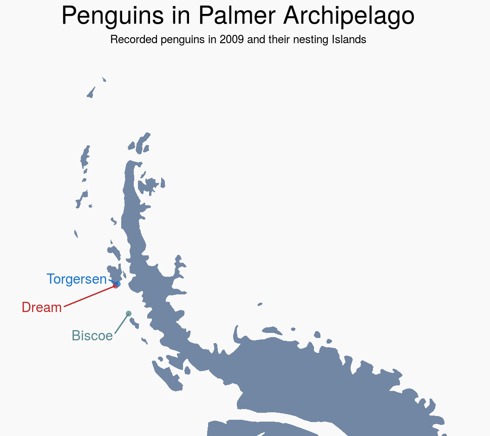

## Outline

- `emmeans` with One-Way ANOVA

- `emmeans` with Two-Way ANOVA

```{r setup}
#| echo: false
#| output: false
library(tidyverse)
library(gt)
```


# One-Way ANOVA `emmeans`


## Estimated Marginal Means

EMMs, also known as "least-squares means"

[EMMs theoretically]


## EMMs With One-Way ANOVA

[EMMs theoretically in conctext of one-way ANOVA]


## One-Way ANOVA

Recall from last time...

:::: {.columns}
::: {.column width="50%"}
```{r}
library(palmerpenguins)
penguins_cleaned <- penguins |>
  filter_out(when_any(is.na(flipper_length_mm), is.na(species)))

flipper_model <- aov(flipper_length_mm ~ species, data = penguins_cleaned)
summary(flipper_model)
```
:::

::: {.column width="50%"}
Let's get the estimated marginal means of penguin flipper length by species!
:::
::::


## Estimated Marginal Means in R

To obtain the EMMs for some linear model:

`emmeans::emmeans(model, specs)`

::: subpoint
○ `model` = linear model object (e.g., from `lm()`, `aov()`, or `stan_glm()`)
:::

::: subpoint
○ `specs` = predictors for which you want estimated marginal means
:::

::: {.callout-note style="font-size: 80%"}
### `emmeans` and pipes `|>`

While we often want to use pipes in our `R` code, and e.g., might want to plot the EMMs from `emmeans`, the developers explicity recommend to always manually check the output of the `emmeans` function! They provide annotations and context that we will lose if we immediately pipe it into something else (e.g., `emmeans(model, specs) |> as_tibble()`)
:::


## One-Way ANOVA `emmeans`

```{r}
# install.packages("emmeans")
library(emmeans)

emms_flipper <- emmeans(flipper_model, specs = "species")
emms_flipper
```


## Plotting One-Way ANOVA `emmeans`

:::: {.columns}
::: {.column width="50%"}
Super quick plotting method with `plot()`
:::

::: {.column width="50%"}
::: {.panel-tabset}
### Plot
```{r}
#| echo: false
#| fig-width: 5
#| fig-height: 4
#| fig-align: center
plot(emms_flipper)
```

### Code
```{r}
#| eval: false
plot(emms_flipper)
```
:::
:::
::::


## Plotting One-Way ANOVA `emmeans`

:::: {.columns}
::: {.column width="50%"}
Returns a `ggplot`, so you can work with it from there.

But don't have much control over the geometries (`geom`s) or mapping (`mapping = aes()`).
:::

::: {.column width="50%"}
::: {.panel-tabset}
### Plot
```{r}
#| echo: false
#| fig-width: 5
#| fig-height: 4
#| fig-align: center
plot(emms_flipper) +
  scale_x_continuous("Estimated Marginal Mean", limits = c(180, 230)) +
  guides(x = guide_axis(cap = T),
         y = guide_axis(NULL, cap = T)) +
  theme_classic(base_size = 14)
```

### Code
```{r}
#| eval: false
plot(emms_flipper) +
  scale_x_continuous("Estimated Marginal Mean", limits = c(180, 230)) +
  guides(x = guide_axis(cap = T),
         y = guide_axis(NULL, cap = T)) +
  theme_classic(base_size = 14)
```
:::
:::
::::


## Plotting One-Way ANOVA `emmeans`

:::: {.columns}
::: {.column width="50%"}
Returns a `ggplot`, so you can work with it from there.

But don't have much control over the geometries (`geom`s) or mapping (`mapping = aes()`).
:::

::: {.column width="50%"}
::: {.panel-tabset}
### Plot
```{r}
#| echo: false
#| fig-width: 5
#| fig-height: 4
#| fig-align: center
plot(emms_flipper) +
  scale_x_continuous("Estimated Marginal Mean of Flipper Length", limits = c(180, 230)) +
  guides(x = guide_axis(cap = T),
         y = guide_axis(NULL, cap = T)) +
  theme_classic(base_size = 14)
```

### Code
```{r}
#| eval: false
plot(emms_flipper) +
  scale_x_continuous("Estimated Marginal Mean of Flipper Length", limits = c(180, 230)) +
  guides(x = guide_axis(cap = T),
         y = guide_axis(NULL, cap = T)) +
  theme_classic(base_size = 14)
```
:::
:::
::::


## Plotting One-Way ANOVA `emmeans`

:::: {.columns}
::: {.column width="50%"}
Can also easily make ourselves by converting the `emmeans` object into a `tibble` (again, after we've looked at it ourselves!)

```{r}
emms_flipper_df <- as_tibble(emms_flipper)
emms_flipper_df |>
  glimpse()
```

::: {.fragment fragment-index=2}
If plotting points, we always want to include our uncertainty.
:::
:::

::: {.column .fragment fragment-index=1 width="50%"}
::: {.panel-tabset}
### Plot
```{r}
#| echo: false
#| fig-width: 5
#| fig-height: 4
#| fig-align: center
emms_flipper_df |>
  ggplot(aes(x = species, y = emmean)) +
  geom_point()
```

### Code
```{r}
#| eval: false
emms_flipper_df |>
  ggplot(aes(x = species, y = emmean)) +
  geom_point()
```
:::
:::
::::


## Plotting One-Way ANOVA `emmeans`

:::: {.columns}
::: {.column width="50%"}
`geom_errorbar(mapping = aes(x, ymin, ymax), width = 0.9)`

::: subpoint-narrow
○ Alternatively, can specify `aes(y, xmin, xmin)` to flip the other way
:::

::: subpoint-narrow
○ `width` = width of error bar, may want to shrink `width` below its default
:::
:::

::: {.column width="50%"}
::: {.panel-tabset}
### Plot
```{r}
#| echo: false
#| fig-width: 5
#| fig-height: 4
#| fig-align: center
emms_flipper_df |>
  ggplot(aes(x = species, y = emmean, ymin = lower.CL, ymax = upper.CL)) +
  geom_errorbar()
```

### Code
```{r}
#| eval: false
emms_flipper_df |>
  ggplot(aes(x = species, y = emmean, ymin = lower.CL, ymax = upper.CL)) +
  geom_errorbar()
```
:::

:::
::::


## Plotting One-Way ANOVA `emmeans`

:::: {.columns}
::: {.column width="50%"}
Can layer `geom_point` on top, tidy up

::: subpoint-narrow
○ `geom_point` will need a `y` `aes` (or `x` if it's flipped)
:::
:::

::: {.column width="50%"}
::: {.panel-tabset}
### Plot
```{r}
#| echo: false
#| fig-width: 4
#| fig-height: 3
#| fig-align: center
emms_flipper_df |>
  ggplot(aes(x = species, y = emmean, ymin = lower.CL, ymax = upper.CL,
             color = species)) +
  geom_errorbar(width = 0.1) +
  geom_point() +
  scale_y_continuous("EMM of Flipper Length", limits = c(180, 230)) +
  guides(x = guide_axis(NULL, cap = T),
         y = guide_axis(cap = T)) +
  theme_classic() +
  theme(legend.position = "none")
```

### Code
```{r}
#| eval: false
emms_flipper_df |>
  ggplot(aes(x = species, y = emmean, ymin = lower.CL, ymax = upper.CL,
             color = species)) +
  geom_errorbar(width = 0.1) +
  geom_point() +
  scale_y_continuous("EMM of Flipper Length", limits = c(180, 230)) +
  guides(x = guide_axis(NULL, cap = T),
         y = guide_axis(cap = T)) +
  theme_classic() +
  theme(legend.position = "none")
```
:::

:::
::::


## Plotting One-Way ANOVA `emmeans`

:::: {.columns}
::: {.column width="50%"}
Or add in the original data too...
:::

::: {.column width="50%"}
::: {.panel-tabset}
### Plot
```{r}
#| echo: false
#| fig-width: 4
#| fig-height: 3
#| fig-align: center
emms_flipper_df |>
  ggplot(aes(x = species, y = emmean, ymin = lower.CL, ymax = upper.CL,
             color = species)) +
  geom_violin(data = penguins_cleaned, 
              aes(x = species, y = flipper_length_mm, fill = species),
              alpha = 0.2, color = NA,
              inherit.aes = F) +
  geom_jitter(data = penguins_cleaned, 
              aes(x = species, y = flipper_length_mm, color = species),
              alpha = 0.15, shape = 21, size = 1.5,
              inherit.aes = F) +
  geom_errorbar(width = 0.1) +
  geom_point() +
  scale_y_continuous("EMM of Flipper Length", limits = c(180, 230)) +
  guides(x = guide_axis(NULL, cap = T),
         y = guide_axis(cap = T)) +
  theme_classic() +
  theme(legend.position = "none")
```

### Code
```{r}
#| eval: false
emms_flipper_df |>
  ggplot(aes(x = species, y = emmean, ymin = lower.CL, ymax = upper.CL,
             color = species)) +
  geom_violin(data = penguins_cleaned, 
              aes(x = species, y = flipper_length_mm, fill = species),
              alpha = 0.2, color = NA,
              inherit.aes = F) +
  geom_jitter(data = penguins_cleaned, 
              aes(x = species, y = flipper_length_mm, color = species),
              alpha = 0.15, shape = 21, size = 1.5,
              inherit.aes = F) +
  geom_errorbar(width = 0.1) +
  geom_point() +
  scale_y_continuous("EMM of Flipper Length", limits = c(180, 230)) +
  guides(x = guide_axis(NULL, cap = T),
         y = guide_axis(cap = T)) +
  theme_classic() +
  theme(legend.position = "none")
```
:::

:::
::::


## Plotting One-Way ANOVA `emmeans`

:::: {.columns}
::: {.column width="50%"}
Or add in the original data too...
:::

::: {.column width="50%"}
::: {.panel-tabset}
### Plot
```{r}
#| echo: false
#| fig-width: 4
#| fig-height: 3
#| fig-align: center
emms_flipper_df |>
  ggplot(aes(x = species, y = emmean, ymin = lower.CL, ymax = upper.CL,
             color = species)) +
  geom_violin(data = penguins_cleaned, 
              aes(x = species, y = flipper_length_mm, fill = species),
              alpha = 0.2, color = NA,
              inherit.aes = F) +
  geom_jitter(data = penguins_cleaned, 
              aes(x = species, y = flipper_length_mm, color = species),
              alpha = 0.15, shape = 21, size = 1.5,
              inherit.aes = F) +
  geom_errorbar(width = 0.1) +
  geom_point() +
  scale_y_continuous("EMM of Flipper Length", limits = c(180, 230)) +
  guides(x = guide_axis(NULL, cap = T),
         y = guide_axis(cap = T)) +
  theme_classic() +
  theme(legend.position = "none")
```

### Code
```{r}
#| eval: false
emms_flipper_df |>
  ggplot(aes(x = species, y = emmean, ymin = lower.CL, ymax = upper.CL,
             color = species)) +
  geom_violin(data = penguins_cleaned, 
              aes(x = species, y = flipper_length_mm, fill = species),
              alpha = 0.2, color = NA,
              inherit.aes = F) +
  geom_jitter(data = penguins_cleaned, 
              aes(x = species, y = flipper_length_mm, color = species),
              alpha = 0.15, shape = 21, size = 1.5,
              inherit.aes = F) +
  geom_errorbar(width = 0.1) +
  geom_point() +
  scale_y_continuous("EMM of Flipper Length", limits = c(180, 230)) +
  guides(x = guide_axis(NULL, cap = T),
         y = guide_axis(cap = T)) +
  theme_classic() +
  theme(legend.position = "none")
```
:::

:::
::::


## Pairwise Comparisons With `emmeans`

`pairs(emmeans_object, adjust = "tukey")`

::: subpoint-narrow
○ Equivalent to `emmeans::contrast(emmeans_object, method = "pairwise)`
:::

::: subpoint-narrow
○ `adjust` = can supply name of adjustment
:::

```{r}
pairs(emms_flipper) 
```

:::: {.columns}
::: {.column width="50%"}
```{r}
pairs(emms_flipper, adjust = "bonf")
```
:::

::: {.column width="50%"}
```{r}
pairs(emms_flipper, adjust = "holm") 
```
:::
::::


# Two-Way ANOVA `emmeans`


## Two-Way ANOVA `emmeans`

[EMMs theoretically in context of two-way ANOVA]


## Two-Way ANOVA

:::: {.columns}
::: {.column width="60%"}
So far we've looked at penguin species, but these penguin measurements were taken over multiple years.

What if the year a penguin's measurement was taken is in some way linked to the penguin's flipper length?
:::

::: {.column width="40%"}
<!-- Penguins in Palmer Archipelago -->

<!-- Nesting islands from 2009 Palmer penguins research -->


:::
::::

::: footer
Photo accessed at [rpubs.com/mgsaavedraro/669873](https://rpubs.com/mgsaavedraro/669873) on 2026-10-15.
:::


## Two-Way ANOVA

Let's examine the effect of both penguin species and measurement year on penguin flipper length.

Design: Two-Way 3x3 ANOVA


## Two-Way ANOVA

:::: {.columns}
::: {.column width="50%"}
```{r}
library(palmerpenguins)
penguins_cleaned <- penguins |>
  filter_out(when_any(is.na(year), is.na(flipper_length_mm), is.na(species))) |>
  mutate(year = factor(year))

flipper_model_twoway <- aov(flipper_length_mm ~ species * year, data = penguins_cleaned)
summary(flipper_model_twoway)
```
:::

::: {.column width="50%"}
Let's get the estimated marginal means of penguin flipper length by species and year!
:::
::::


## One-Way ANOVA `emmeans`

```{r}
emms_flipper_twoway <- emmeans(flipper_model_twoway, specs = c("species", "year"))
emms_flipper_twoway
```


## Plotting One-Way ANOVA `emmeans`

:::: {.columns}
::: {.column width="50%"}
Super quick plotting method with `plot()`

Not so great with more than one factor...
:::

::: {.column width="50%"}
::: {.panel-tabset}
### Plot
```{r}
#| echo: false
#| fig-width: 5
#| fig-height: 4
#| fig-align: center
plot(emms_flipper_twoway)
```

### Code
```{r}
#| eval: false
plot(emms_flipper_twoway)
```
:::
:::
::::


## Plotting One-Way ANOVA `emmeans`

:::: {.columns}
::: {.column width="50%"}
Let's build our own. The color on our last plot was just to make it look nice, but this time, let's use color to represent the year.

```{r}
emms_flipper_twoway_df <- as_tibble(emms_flipper_twoway)
emms_flipper_twoway_df |>
  glimpse()
```

::: {.fragment fragment-index=2}
Like last time, we always want to include our uncertainty.
:::
:::

::: {.column .fragment fragment-index=1 width="50%"}
::: {.panel-tabset}
### Plot
```{r}
#| echo: false
#| fig-width: 5
#| fig-height: 4
#| fig-align: center
emms_flipper_twoway_df |>
  ggplot(aes(x = species, y = emmean, color = year)) +
  geom_point()
```

### Code
```{r}
#| eval: false
emms_flipper_twoway_df |>
  ggplot(aes(x = species, y = emmean, color = year)) +
  geom_point()
```
:::
:::
::::


## Plotting One-Way ANOVA `emmeans`

:::: {.columns}
::: {.column width="50%"}
Let's build our own.
:::

::: {.column .fragment fragment-index=1 width="50%"}
::: {.panel-tabset}
### Plot
```{r}
#| echo: false
#| fig-width: 5
#| fig-height: 4
#| fig-align: center
emms_flipper_twoway_df |>
  ggplot(aes(x = species, y = emmean, color = year,
             ymin = lower.CL, ymax = upper.CL)) +
  geom_point() +
  geom_errorbar()
```

### Code
```{r}
#| eval: false
emms_flipper_twoway_df |>
  ggplot(aes(x = species, y = emmean, color = year,
             ymin = lower.CL, ymax = upper.CL)) +
  geom_point() +
  geom_errorbar()
```
:::
:::
::::


## Plotting One-Way ANOVA `emmeans`

:::: {.columns}
::: {.column width="50%"}
Let's build our own.

And tidy it up.
:::

::: {.column .fragment fragment-index=1 width="50%"}
::: {.panel-tabset}
### Plot
```{r}
#| echo: false
#| fig-width: 5
#| fig-height: 4
#| fig-align: center
emms_flipper_twoway_df |>
  ggplot(aes(x = species, y = emmean, color = year,
             ymin = lower.CL, ymax = upper.CL)) +
  geom_point(position = position_dodge(0.3)) +
  geom_errorbar(width = 0.1, position = position_dodge(0.3)) +
  scale_y_continuous("EMM of Flipper Length", limits = c(180, 230)) +
  guides(x = guide_axis(NULL, cap = T),
         y = guide_axis(cap = T)) +
  theme_classic() +
  theme(legend.position = "none")
```

### Code
```{r}
#| eval: false
emms_flipper_twoway_df |>
  ggplot(aes(x = species, y = emmean, color = year,
             ymin = lower.CL, ymax = upper.CL)) +
  geom_point(position = position_dodge(0.3)) +
  geom_errorbar(width = 0.1, position = position_dodge(0.3)) +
  scale_y_continuous("EMM of Flipper Length", limits = c(180, 230)) +
  guides(x = guide_axis(NULL, cap = T),
         y = guide_axis(cap = T)) +
  theme_classic() +
  theme(legend.position = "none")
```
:::
:::
::::


## Plotting One-Way ANOVA `emmeans`

:::: {.columns}
::: {.column width="50%"}
Can add lines between points to look for interactions.
:::

::: {.column .fragment fragment-index=1 width="50%"}
::: {.panel-tabset}
### Plot
```{r}
#| echo: false
#| fig-width: 5
#| fig-height: 4
#| fig-align: center
emms_flipper_twoway_df |>
  ggplot(aes(x = species, y = emmean, color = year,
             group = year,
             ymin = lower.CL, ymax = upper.CL)) +
  geom_point(position = position_dodge(0.3)) +
  geom_line(position = position_dodge(0.3)) +
  geom_errorbar(width = 0.1, position = position_dodge(0.3)) +
  scale_y_continuous("EMM of Flipper Length", limits = c(180, 230)) +
  guides(x = guide_axis(NULL, cap = T),
         y = guide_axis(cap = T)) +
  theme_classic() +
  theme(legend.position = "none")
```

### Code
```{r}
#| eval: false
emms_flipper_twoway_df |>
  ggplot(aes(x = species, y = emmean, color = year,
             group = year,
             ymin = lower.CL, ymax = upper.CL)) +
  geom_point(position = position_dodge(0.3)) +
  geom_line(position = position_dodge(0.3)) +
  geom_errorbar(width = 0.1, position = position_dodge(0.3)) +
  scale_y_continuous("EMM of Flipper Length", limits = c(180, 230)) +
  guides(x = guide_axis(NULL, cap = T),
         y = guide_axis(cap = T)) +
  theme_classic() +
  theme(legend.position = "none")
```
:::
:::
::::


## Pairwise Comparisons With `emmeans`


```{r}
pairs(emms_flipper_twoway) 
```


