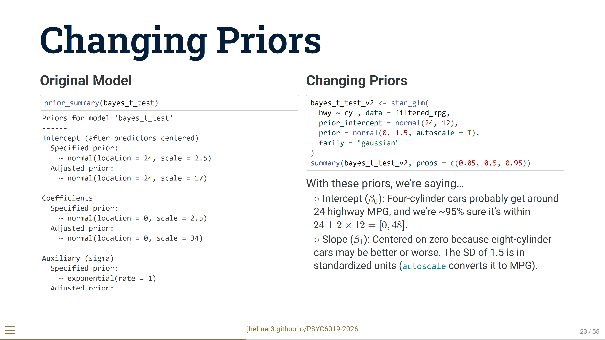
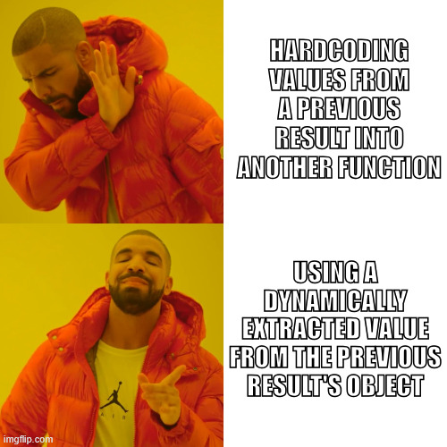
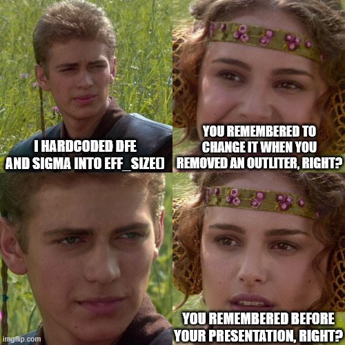
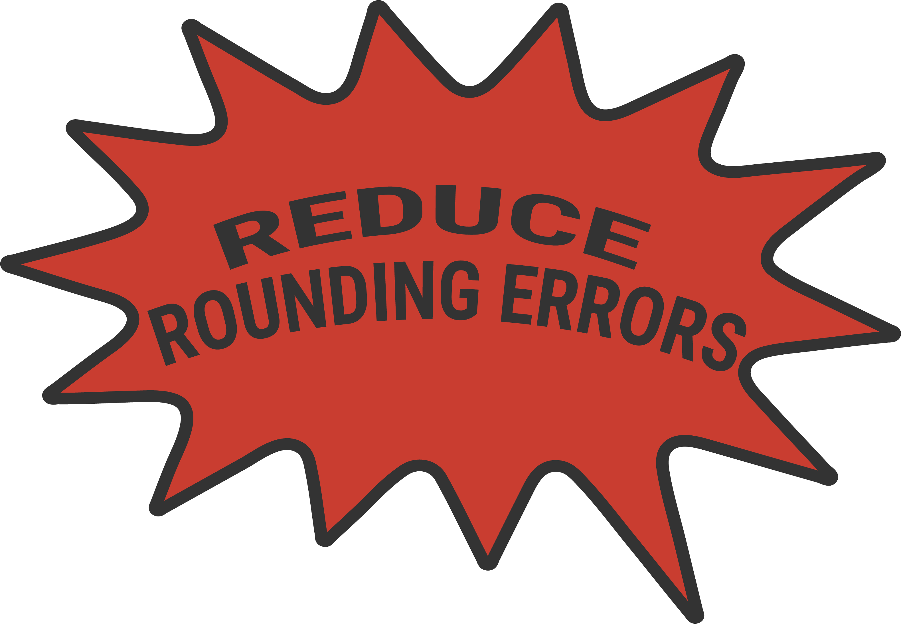

## Outline

- `emmeans` with One-Way ANOVA

- Pairwise comparisons

- Contrasts

```{r setup}
#| echo: false
#| output: false
library(tidyverse)
library(gt)
```


## Lab 07 Follow-Up!

{fig-align="center"}

I could have clarified this better: here, $95\%$ refers to a shorthand of $\pm 2 \ \text{SD}$ of the *prior distribution* for the intercept. I added a note for this on the slides as of 2026-10-23!


# One-Way ANOVA Estimated Marginal Means


## Estimated Marginal Means

EMMs, also known as "least-squares means"

For a One-Way ANOVA, this is the same as just looking at the means of our groups.

::: subpoint
○ Will get a bit more complicated with more than just one factor...
:::

Useful to report with your ANOVA results to actually see the differences between means.


## Why Estimated Marginal Means

These plots all have the same $F$ statistic from a One-Way ANOVA, but their implications are very different!

```{r}
#| echo: false
set.seed(2026)
n   <- 40
z0  <- as.numeric(scale(rnorm(n)))
zA  <- as.numeric(scale(rnorm(n)))
zB  <- as.numeric(scale(rnorm(n)))

b0       <- 5
target_F <- 20
k        <- 3

make_F_plot <- function(pattern, title, target_F = 40) {
  
  # Rescale the pattern of (control, A, B) offsets so that F == target_F.
  # With within-group SD = 1 (MSE = 1): F = n * SS_means / (k - 1)
  ss_pat <- sum((pattern - mean(pattern))^2)
  delta  <- sqrt(target_F * (k - 1) / n / ss_pat)
  bA <- delta * (pattern[2] - pattern[1])
  bB <- delta * (pattern[3] - pattern[1])
  
  grp <- c("control", "trtA", "trtB")
  df <- tibble(
    group = factor(rep(grp, each = n), levels = grp),
    y     = c(b0 + z0, b0 + bA + zA, b0 + bB + zB)
  )
  
  # Check F and get pairwise comparisons
  fit  <- aov(y ~ group, data = df)
  Fval <- summary(fit)[[1]][["F value"]][1]
  tk   <- TukeyHSD(fit)$group[, "p adj"]
  fmt  <- function(p) ifelse(p < 0.001, "p < .001", sprintf("p = %.3f", p))
  sub  <- sprintf("A vs C: %s   |   B vs C: %s   |   B vs A: %s",
                  fmt(tk["trtA-control"]), fmt(tk["trtB-control"]), fmt(tk["trtB-trtA"]))
  
  mA   <- b0 + bA
  mB   <- b0 + bB
  grey <- "grey25"
  arr  <- arrow(length = unit(0.09, "inches"), type = "closed")
  
  bracket <- tibble(
    x    = c(2.45, 3.45),
    ymin = c(min(b0, mA), min(b0, mB)),
    ymax = c(max(b0, mA), max(b0, mB))
  )
  
  ggplot(df, aes(x = group, y = y, fill = group, color = group)) +
    geom_violin(alpha = 0.3, color = NA, width = 0.7) +
    geom_jitter(alpha = 0.6, shape = 16, size = 1.8, width = 0.1, height = 0) +
    annotate("segment", x = 1, xend = 3.45, y = b0, yend = b0,
             linetype = "dashed", color = grey, linewidth = 0.4) +
    stat_summary(fun = mean, geom = "point", color = "black", size = 3) +
    annotate("curve", x = 0.62, xend = 0.93, y = b0 + 1.8, yend = b0 + 0.2,
             curvature = 0.35, arrow = arr, color = grey, linewidth = 0.5) +
    annotate("text", x = 0.58, y = b0 + 2.2, label = "beta[0]",
             parse = TRUE, color = grey, size = 4.5) +
    geom_errorbar(data = bracket, aes(x = x, ymin = ymin, ymax = ymax),
                  width = 0.08, color = grey, linewidth = 0.6,
                  inherit.aes = FALSE) +
    annotate("text", x = 2.52, y = (b0 + mA) / 2 + 0.35, label = "beta[A]",
             parse = TRUE, hjust = 0, color = grey, size = 4.5) +
    annotate("text", x = 3.52, y = (b0 + mB) / 2 + 0.35, label = "beta[B]",
             parse = TRUE, hjust = 0, color = grey, size = 4.5) +
    scale_x_discrete(NULL, labels = expression(
      atop("Control", beta[0]),
      atop("Treatment A", beta[0] + beta[A]),
      atop("Treatment B", beta[0] + beta[B])
    )) +
    scale_y_continuous("Outcome", breaks = seq(2, 10, 2)) +
    scale_fill_manual(values = c(control = "#7FA6C9", trtA = "#E8A07A", trtB = "#8FB8A8")) +
    scale_color_manual(values = c(control = "#3F6E94", trtA = "#C2623A", trtB = "#5E8F7D")) +
    coord_cartesian(xlim = c(0.45, 3.85), ylim = c(0.5, 10.5)) +
    guides(x = guide_axis(cap = TRUE), y = guide_axis(cap = TRUE),
           fill = "none", color = "none") +
    labs(title = sprintf("%s\nF = %.0f", title, Fval)) +
    theme_classic() +
    theme(axis.line.x  = element_blank(),
          axis.ticks.x = element_blank(),
          axis.text.x  = element_text(size = 10, color = "black"),
          plot.title    = element_text(hjust = 0.5, size = 11),
          plot.subtitle = element_text(hjust = 0.5, size = 8.5, color = "grey30"))
}
```

```{r}
#| layout-ncol: 3
#| fig-width: 6.5
#| fig-height: 4
#| echo: false
#| fig-align: center
p1 <- make_F_plot(c(0,  1,  1), "Both treatments high")
p2 <- make_F_plot(c(0,  0,  1), "Only treatment B high")
p3 <- make_F_plot(c(0,  1, -1), "Treatment A high, treatment B low")

p1; p2; p3
```


## Estimated Marginal Means

Remember those interpretations of slope parameters?

:::: {.columns style="font-size:59%"}
::: {.column width="66%"}
Dummy coding compares $g-1$ groups to $\beta_0 =$ **reference group mean**:

| Predictor | $g_1$ | $g_2$ | $\cdots$ | $g_{G-1}$ | $g_G$ |
| :---: | :---: | :---: | :---: | :---: | :---: |
| $x_1$ | 1 | 0 | $\cdots$ | 0 | 0 |
| $x_2$ | 0 | 1 | $\cdots$ | 0 | 0 |
| $\vdots$ | $\vdots$ | $\vdots$ | $\ddots$ | $\vdots$ | $\vdots$ |
| $x_{G-1}$ | 0 | 0 | $\cdots$ | 1 | 0 |
:::

::: {.column width="33%"}
**Dummy coding:**

- $\beta_0: = \mu_3$
- $\beta_1: = \mu_{1} - \mu_3$
- $\beta_2: = \mu_{2} - \mu_3$
:::
::::

:::: {.columns style="font-size:59%"}
::: {.column width="66%"}
Effects or contrast coding compares $g-1$ groups to $\beta_0 =$ **grand mean**:

| Predictor | $g_1$ | $g_2$ | $\cdots$ | $g_{G-1}$ | $g_G$ |
| :---: | :---: | :---: | :---: | :---: | :---: |
| $x_1$ | 1 | 0 | $\cdots$ | 0 | -1 |
| $x_2$ | 0 | 1 | $\cdots$ | 0 | -1 |
| $\vdots$ | $\vdots$ | $\vdots$ | $\ddots$ | $\vdots$ | $\vdots$ |
| $x_{G-1}$ | 0 | 0 | $\cdots$ | 1 | -1 |
:::

::: {.column width="33%"}
**Contrast/Effects coding:**

- $\beta_0: = \mu$
- $\beta_1: = \mu_{1} - \mu$
- $\beta_2: = \mu_{2} - \mu$

Compares groups to **grand mean**
:::
::::

The means calculated from the slope parameters are the Estimated Marginal Means (EMMs) as predicted by our model.

::: footer
[Stolen from Mark's slides](https://jhelmer3.github.io/PSYC6019-2026/lecture/slides/16%20One%20Way%20ANOVA/Lecture%2016%20One%20Way%20ANOVA_v0.html#/coding-options)
:::


## One-Way ANOVA

Recall from last time...

```{r}
#| layout-ncol: 2
library(palmerpenguins)
penguins_cleaned <- penguins |>
  filter_out(when_any(is.na(flipper_length_mm), is.na(species)))

flipper_model <- aov(flipper_length_mm ~ species, data = penguins_cleaned)
flipper_model_lm <- lm(flipper_length_mm ~ species, data = penguins_cleaned)
summary(flipper_model); summary(flipper_model_lm)
```

Let's get the estimated marginal means of penguin flipper length by species!


## EMMs in R

To obtain the EMMs for some linear model:

`emmeans::emmeans(model, specs)`

::: subpoint
○ `model` = linear model object (e.g., from `lm()`, `aov()`, or `stan_glm()`)
:::

::: subpoint
○ `specs` = predictors for which you want estimated marginal means
:::

<br>

::: {.callout-note style="font-size:85%"}
### `emmeans` and pipes `|>`

While we often want to use pipes in our `R` code, and e.g., might want to plot the EMMs from `emmeans`, the developers explicitly recommend to always **manually check** the output of the `emmeans` function! They provide annotations and context that we will lose if we immediately pipe it into something else (e.g., `emmeans(model, specs) |> as_tibble()`)
:::


## One-Way ANOVA `emmeans`

::: fragment
```{r}
# install.packages("emmeans")
library(emmeans)

emms_flipper <- emmeans(flipper_model, specs = "species")
emms_flipper
```
:::


## Plotting One-Way `emmeans`

:::: {.columns}
::: {.column width="50%"}
Super quick plotting method with `plot()`.

Points are Estimated Marginal Means, and bars are confidence intervals for those EMMs.
:::

::: {.column width="50%"}
::: {.panel-tabset}
### Plot
```{r}
#| echo: false
#| fig-width: 5
#| fig-height: 4
#| fig-align: center
plot(emms_flipper)
```

### Code
```{r}
#| eval: false
plot(emms_flipper)
```
:::
:::
::::


## Plotting One-Way `emmeans`

:::: {.columns}
::: {.column width="50%"}
Returns a `ggplot`, so you can work with it from there.

But don't have muchhh control over the geometries (`geom`s) or mapping (`mapping = aes()`).

Feel free to check out the documentation at [rvlenth.github.io/emmeans/reference/plot.html](https://rvlenth.github.io/emmeans/reference/plot.html)
:::

::: {.column width="50%"}
::: {.panel-tabset}
### Plot
```{r}
#| echo: false
#| fig-width: 5
#| fig-height: 4
#| fig-align: center
plot(emms_flipper) +
  scale_x_continuous("Estimated Marginal Mean", limits = c(180, 230)) +
  guides(x = guide_axis(cap = T),
         y = guide_axis(NULL, cap = T)) +
  theme_classic(base_size = 14)
```

### Code
```{r}
#| eval: false
plot(emms_flipper) +
  scale_x_continuous("Estimated Marginal Mean", limits = c(180, 230)) +
  guides(x = guide_axis(cap = T),
         y = guide_axis(NULL, cap = T)) +
  theme_classic(base_size = 14)
```
:::
:::
::::


## Plotting One-Way `emmeans`

:::: {.columns}
::: {.column width="50%"}
Can also easily make ourselves by converting the `emmeans` object into a `tibble` (again, after we've looked at it ourselves!)

```{r}
emms_flipper_df <- as_tibble(emms_flipper)
emms_flipper_df |>
  glimpse()
```

::: {.fragment fragment-index=2}
If plotting point estimates, we always want to include our uncertainty.
:::
:::

::: {.column .fragment fragment-index=1 width="50%"}
::: {.panel-tabset}
### Plot
```{r}
#| echo: false
#| fig-width: 5
#| fig-height: 4
#| fig-align: center
emms_flipper_df |>
  ggplot(aes(x = species, y = emmean)) +
  geom_point()
```

### Code
```{r}
#| eval: false
emms_flipper_df |>
  ggplot(aes(x = species, y = emmean)) +
  geom_point()
```
:::
:::
::::


## Plotting One-Way `emmeans`

:::: {.columns}
::: {.column width="50%"}
`geom_errorbar(mapping = aes(x, ymin, ymax), width = 0.9)`

::: subpoint-narrow
○ Alternatively, can specify `aes(y, xmin, xmin)` to flip the other way
:::

::: subpoint-narrow
○ `width` = width of error bar, may want to shrink `width` below its default
:::

The correct interpretation of error bars can be ambiguous (one SE? Confidence interval?): add a note clarifying what they represent.
:::

::: {.column width="50%"}
::: {.panel-tabset}
### Plot
```{r}
#| echo: false
#| fig-width: 5
#| fig-height: 4
#| fig-align: center
emms_flipper_df |>
  ggplot(aes(x = species, y = emmean, ymin = lower.CL, ymax = upper.CL)) +
  geom_errorbar() +
  labs(caption = "Error bars represent 95% confidence intervals.")
```

### Code
```{r}
#| eval: false
emms_flipper_df |>
  ggplot(aes(x = species, y = emmean, ymin = lower.CL, ymax = upper.CL)) +
  geom_errorbar() +
  labs(caption = "Error bars represent 95% confidence intervals.")
```
:::

:::
::::


## Plotting One-Way `emmeans`

:::: {.columns}
::: {.column width="50%"}
Can layer `geom_point` on top, tidy up

::: subpoint-narrow
○ `geom_point` will need a `y` `aes` (or `x` if it's flipped)
:::

::: fragment
Plotting EMMs is one of those places where you'll see some crunched-up scales that visually exaggerate the size of the effect. This is a good time to consider how you'll set your axis limits!
:::
:::

::: {.column width="50%"}
::: {.panel-tabset}
### Plot
```{r}
#| echo: false
#| fig-width: 4
#| fig-height: 3
#| fig-align: center
emms_flipper_df |>
  ggplot(aes(x = species, y = emmean, ymin = lower.CL, ymax = upper.CL,
             color = species)) +
  geom_errorbar(width = 0.1) +
  geom_point() +
  scale_y_continuous("EMM of Flipper Length", limits = c(180, 230)) +
  guides(x = guide_axis(NULL, cap = T),
         y = guide_axis(cap = T))  +
  labs(caption = "Error bars represent 95% confidence intervals.") +
  theme_classic() +
  theme(legend.position = "none")
```

### Code
```{r}
#| eval: false
emms_flipper_df |>
  ggplot(aes(x = species, y = emmean, ymin = lower.CL, ymax = upper.CL,
             color = species)) +
  geom_errorbar(width = 0.1) +
  geom_point() +
  scale_y_continuous("EMM of Flipper Length", limits = c(180, 230)) +
  labs(caption = "Error bars represent 95% confidence intervals.") +
  guides(x = guide_axis(NULL, cap = T),
         y = guide_axis(cap = T)) +
  theme_classic() +
  theme(legend.position = "none")
```
:::

:::
::::


## Plotting One-Way `emmeans`

:::: {.columns}
::: {.column width="50%"}
Or add in the original data too...

*Note*: setting `limits` in `scale_x_continuous()` (or `y`) will **remove data** that falls outside its bounds.

Pay attention to the `warning` messages, and expand if needed. Setting bounds with `coord_cartesian(xlim, ylim)` will *not* remove data, but you could still zoom in too tight and lose it.
:::

::: {.column width="50%"}
::: {.panel-tabset}
### Plot
```{r}
#| echo: false
#| fig-width: 4
#| fig-height: 3
#| fig-align: center
emms_flipper_df |>
  ggplot(aes(x = species, y = emmean, ymin = lower.CL, ymax = upper.CL,
             color = species)) +
  geom_violin(data = penguins_cleaned, 
              aes(x = species, y = flipper_length_mm, fill = species),
              alpha = 0.2, color = NA,
              inherit.aes = F) +
  geom_jitter(data = penguins_cleaned, 
              aes(x = species, y = flipper_length_mm, color = species),
              alpha = 0.15, shape = 21, size = 1.5,
              inherit.aes = F) +
  geom_errorbar(width = 0.1) +
  geom_point() +
  scale_y_continuous("EMM of Flipper Length", limits = c(160, 240)) +
  labs(caption = "Error bars represent 95% confidence intervals.") +
  guides(x = guide_axis(NULL, cap = T),
         y = guide_axis(cap = T)) +
  theme_classic() +
  theme(legend.position = "none")
```

### Code
```{r}
#| eval: false
emms_flipper_df |>
  ggplot(aes(x = species, y = emmean, ymin = lower.CL, ymax = upper.CL,
             color = species)) +
  geom_violin(data = penguins_cleaned, 
              aes(x = species, y = flipper_length_mm, fill = species),
              alpha = 0.2, color = NA,
              inherit.aes = F) +
  geom_jitter(data = penguins_cleaned, 
              aes(x = species, y = flipper_length_mm, color = species),
              alpha = 0.15, shape = 21, size = 1.5,
              inherit.aes = F) +
  geom_errorbar(width = 0.1) +
  geom_point() +
  scale_y_continuous("EMM of Flipper Length", limits = c(160, 240)) +
  labs(caption = "Error bars represent 95% confidence intervals.") +
  guides(x = guide_axis(NULL, cap = T),
         y = guide_axis(cap = T)) +
  theme_classic() +
  theme(legend.position = "none")
```
:::

:::
::::


## Axis Limits Comparison

::::: {.columns style="font-size:80%"}
:::: {.column width="33%"}

`scale_y_continuous(limits = c(180, 220))`

::: {.panel-tabset}
### Plot
```{r}
#| echo: false
#| fig-width: 5
#| fig-height: 4
#| fig-align: center
emms_flipper_df |>
  ggplot(aes(x = species, y = emmean, ymin = lower.CL, ymax = upper.CL,
             color = species)) +
  geom_violin(data = penguins_cleaned, 
              aes(x = species, y = flipper_length_mm, fill = species),
              alpha = 0.2, color = NA,
              inherit.aes = F) +
  geom_jitter(data = penguins_cleaned, 
              aes(x = species, y = flipper_length_mm, color = species),
              alpha = 0.15, shape = 21, size = 1.5,
              inherit.aes = F) +
  geom_errorbar(width = 0.1) +
  geom_point() +
  scale_y_continuous("EMM of Flipper Length", limits = c(180, 220)) +
  labs(caption = "Error bars represent 95% confidence intervals.") +
  guides(x = guide_axis(NULL, cap = T),
         y = guide_axis(cap = T)) +
  theme_classic() +
  theme(legend.position = "none")
```

### Code
```{r}
#| eval: false
emms_flipper_df |>
  ggplot(aes(x = species, y = emmean, ymin = lower.CL, ymax = upper.CL,
             color = species)) +
  geom_violin(data = penguins_cleaned, 
              aes(x = species, y = flipper_length_mm, fill = species),
              alpha = 0.2, color = NA,
              inherit.aes = F) +
  geom_jitter(data = penguins_cleaned, 
              aes(x = species, y = flipper_length_mm, color = species),
              alpha = 0.15, shape = 21, size = 1.5,
              inherit.aes = F) +
  geom_errorbar(width = 0.1) +
  geom_point() +
  scale_y_continuous("EMM of Flipper Length", limits = c(180, 220)) +
  labs(caption = "Error bars represent 95% confidence intervals.") +
  guides(x = guide_axis(NULL, cap = T),
         y = guide_axis(cap = T)) +
  theme_classic() +
  theme(legend.position = "none")
```
:::
::::

:::: {.column width="33%"}

`coord_cartesian(ylim = c(180, 220))`

::: {.panel-tabset}
### Plot
```{r}
#| echo: false
#| fig-width: 5
#| fig-height: 4
#| fig-align: center
emms_flipper_df |>
  ggplot(aes(x = species, y = emmean, ymin = lower.CL, ymax = upper.CL,
             color = species)) +
  geom_violin(data = penguins_cleaned, 
              aes(x = species, y = flipper_length_mm, fill = species),
              alpha = 0.2, color = NA,
              inherit.aes = F) +
  geom_jitter(data = penguins_cleaned, 
              aes(x = species, y = flipper_length_mm, color = species),
              alpha = 0.15, shape = 21, size = 1.5,
              inherit.aes = F) +
  geom_errorbar(width = 0.1) +
  geom_point() +
  scale_y_continuous("EMM of Flipper Length") +
  coord_cartesian(ylim = c(180, 220)) +
  labs(caption = "Error bars represent 95% confidence intervals.") +
  guides(x = guide_axis(NULL, cap = T),
         y = guide_axis(cap = T)) +
  theme_classic() +
  theme(legend.position = "none")
```

### Code
```{r}
#| eval: false
emms_flipper_df |>
  ggplot(aes(x = species, y = emmean, ymin = lower.CL, ymax = upper.CL,
             color = species)) +
  geom_violin(data = penguins_cleaned, 
              aes(x = species, y = flipper_length_mm, fill = species),
              alpha = 0.2, color = NA,
              inherit.aes = F) +
  geom_jitter(data = penguins_cleaned, 
              aes(x = species, y = flipper_length_mm, color = species),
              alpha = 0.15, shape = 21, size = 1.5,
              inherit.aes = F) +
  geom_errorbar(width = 0.1) +
  geom_point() +
  scale_y_continuous("EMM of Flipper Length") +
  coord_cartesian(ylim = c(180, 220)) +
  labs(caption = "Error bars represent 95% confidence intervals.") +
  guides(x = guide_axis(NULL, cap = T),
         y = guide_axis(cap = T)) +
  theme_classic() +
  theme(legend.position = "none")
```
:::
::::

:::: {.column width="33%"}

`coord_cartesian(ylim = c(180, 220), clip = "off)`

::: {.panel-tabset}
### Plot
```{r}
#| echo: false
#| fig-width: 5
#| fig-height: 4
#| fig-align: center
emms_flipper_df |>
  ggplot(aes(x = species, y = emmean, ymin = lower.CL, ymax = upper.CL,
             color = species)) +
  geom_violin(data = penguins_cleaned, 
              aes(x = species, y = flipper_length_mm, fill = species),
              alpha = 0.2, color = NA,
              inherit.aes = F) +
  geom_jitter(data = penguins_cleaned, 
              aes(x = species, y = flipper_length_mm, color = species),
              alpha = 0.15, shape = 21, size = 1.5,
              inherit.aes = F) +
  geom_errorbar(width = 0.1) +
  geom_point() +
  scale_y_continuous("EMM of Flipper Length") +
  coord_cartesian(ylim = c(180, 220), clip = "off") +
  labs(caption = "Error bars represent 95% confidence intervals.") +
  guides(x = guide_axis(NULL, cap = T),
         y = guide_axis(cap = T)) +
  theme_classic() +
  theme(legend.position = "none")
```

### Code
```{r}
#| eval: false
emms_flipper_df |>
  ggplot(aes(x = species, y = emmean, ymin = lower.CL, ymax = upper.CL,
             color = species)) +
  geom_violin(data = penguins_cleaned, 
              aes(x = species, y = flipper_length_mm, fill = species),
              alpha = 0.2, color = NA,
              inherit.aes = F) +
  geom_jitter(data = penguins_cleaned, 
              aes(x = species, y = flipper_length_mm, color = species),
              alpha = 0.15, shape = 21, size = 1.5,
              inherit.aes = F) +
  geom_errorbar(width = 0.1) +
  geom_point() +
  scale_y_continuous("EMM of Flipper Length") +
  coord_cartesian(ylim = c(180, 220), clip = "off") +
  labs(caption = "Error bars represent 95% confidence intervals.") +
  guides(x = guide_axis(NULL, cap = T),
         y = guide_axis(cap = T)) +
  theme_classic() +
  theme(legend.position = "none")
```
:::
::::
:::::


## Pairwise Comparisons

`pairs(emmeans_object, adjust = "tukey")`

::: subpoint-narrow
○ Equivalent to `emmeans::contrast(emmeans_object, method = "pairwise")`
:::

::: subpoint-narrow
○ `adjust` = can supply name of adjustment
:::

```{r}
pairs(emms_flipper) 
```

:::: {.columns}
::: {.column width="50%"}
```{r}
pairs(emms_flipper, adjust = "bonf")
```
:::

::: {.column width="50%"}
```{r}
pairs(emms_flipper, adjust = "holm") 
```
:::
::::


## Effect Size

`emmeans::eff_size(emmeans_result, edf, sigma)`

::: subpoint
○ `dfe =` the residual degrees of freedom from the model
:::

::: subpoint
○ `sigma =` $\sqrt{MS_w}$ from the model
:::

::: fragment
```{r}
summary(flipper_model)
eff_size(emms_flipper, method = "pairwise", edf = 339, sigma = sqrt(44))
```
:::

::: fragment
Here, `edf` and `sigma` are *hardcoded*: we manually inputted those numbers, and they won't update if we adjust something upstream.
:::


## Avoid Hardcoding! Boo!

:::: {.columns}
::: {.column width="50%"}

:::

::: {.column width="50%"}

:::
::::


## Effect Size: Dynamically

:::: {.columns}
::: {.column width="15%"}

:::

::: {.column width="70%"}
```{r}
flipper_model_tidy <- broom::tidy(flipper_model)
flipper_model_tidy

ms_w <- flipper_model_tidy |>
  filter(term == "Residuals") |>
  pull(meansq)
df_e <- flipper_model_tidy |>
  filter(term == "Residuals") |>
  pull(df)

eff_size(emms_flipper, method = "pairwise", edf = df_e, sigma = sqrt(ms_w))
```
:::

::: {.column width="15%"}

:::
::::


{.absolute top="15%" right="18%" width="250px" style="transform: rotate(5deg);" .fragment fragment-index=1}

{.absolute bottom="35%" left="0%" width="250px" style="transform: rotate(-14deg);" .fragment fragment-index=1}

{.absolute bottom="18%" right="5%" width="250px" style="transform: rotate(17deg);" .fragment fragment-index=1}


## Nice Tables

The `gt` package can make excellent tables!

::: fragment
```{r}
# install.packages("gt")
library(gt)
emms_flipper_df |>
  gt()
```
:::

::: footer
Check out the [`gt` documentation](https://gt.rstudio.com/index.html) for more information!
:::


## Nice Tables

The `gt` package can make excellent tables!

::: {.panel-tabset}
### Table
```{r}
#| echo: false
#| fig-width: 5
#| fig-height: 4
#| fig-align: center
emms_flipper_df |>
  gt() |>
  tab_header(title = "Estimated Marginal Means of Flipper Length",
             subtitle = "by Penguin Species") |>
  fmt_number() |> # takes everything to two decimal places
  fmt_number(columns = df, decimals = 0) |> # takes df specifically to 0 decimal places
  cols_label_with(columns = species, fn = str_to_title) |> # title case species column
  cols_label(
    emmean ~ "EMM", # relabel other columns
    SE ~ "SE", # specify names with their name from the dataframe columns
    df = "DF",
    lower.CL = "CI 2.5%",
    upper.CL = "CI 97.5%"
  ) |>
  tab_style(style = cell_text(weight = "bold"), # make the column headers bold
            locations = cells_column_labels())
```

### Code
```{r}
#| eval: false
emms_flipper_df |>
  gt() |>
  fmt_number() |> # takes everything to two decimal places
  fmt_number(columns = df, decimals = 0) |> # takes df specifically to 0 decimal places
  cols_label_with(columns = species, fn = str_to_title) |> # title case species column
  cols_label(
    emmean ~ "EMM", # relabel other columns
    SE ~ "SE", # specify names with their name from the dataframe columns
    df = "DF",
    lower.CL = "CI 2.5%",
    upper.CL = "CI 97.5%"
  ) |>
  tab_style(style = cell_text(weight = "bold"), # make the column headers bold
            locations = cells_column_labels())
```
:::

::: fragment
Tell a Quarto document not to do additional styling (e.g., gray stripes) to a `gt` table by adding to your YAML header `html-table-processing: none`.
:::

::: footer
Check out the [`gt` documentation](https://gt.rstudio.com/index.html){target = "blank"} for more information!
:::


## Contrasts

Contrasts are like custom pairwise comparisons. Can examine differences between two groups... or sets of groups. 

Typically specify *a priori* (planned before data collection), and often have some theoretical reason for doing that contrast


## Setting up a Linear Contrast I 

Maybe you as a researcher are very interested in Gentoo penguins. You want to compare Gentoo penguins to all other penguin species. 


## Setting up a Linear Contrast I {.contrast-slide}

::: {.sub}
Species means from the `palmerpenguins` data
:::

::::::::: {.layout}

:::::::: {.diagram}

<!-- Layer 1: all groups (visible from the start) -->

::::::: {.row}
[Gentoo]{.cell .big} [Adelie]{.cell .big} [Chinstrap]{.cell .big}
:::::::

<!-- Layer 2: choose the sides -->

::::::: {.row .fragment .fade-up data-fragment-index="1"}

:::::: {.panel .pos}
[+]{.sign} [Gentoo]{.cell} []{.eq .ghost} []{.total .ghost}
::::::

:::::: {.panel .neg}
[−]{.sign} [Adelie]{.cell} []{.op .ghost} [Chinstrap]{.cell} []{.eq .ghost} []{.total .ghost}
::::::

:::::::

<!-- Layer 3: naive weights of 1 -->

::::::: {.row .fragment .fade-up data-fragment-index="2"}

:::::: {.panel .pos}
[+]{.sign} [$1$]{.cell} [=]{.eq} [$1$]{.total}
::::::

:::::: {.panel .neg}
[−]{.sign} [$1$]{.cell} [+]{.op} [$1$]{.cell} [=]{.eq} [$-2$]{.total}
::::::

:::::::

<!-- Layer 4: divide by the total -->

::::::: {.row .fragment .fade-up data-fragment-index="3"}

:::::: {.panel .pos}
[+]{.sign} [$\tfrac{1}{1}$]{.cell} [=]{.eq} [$1$]{.total}
::::::

:::::: {.panel .neg}
[−]{.sign} [$\tfrac{1}{2}$]{.cell} [+]{.op} [$\tfrac{1}{2}$]{.cell} [=]{.eq} [$-1$]{.total}
::::::

:::::::

<!-- Layer 5: the null hypothesis -->

::::::: {.row .final .fragment .fade-up data-fragment-index="4"}
[$H_0$:]{.h0} [$(1)\,\mu_{\text{Gentoo}}$]{.cell} [+]{.op} [$\left(-\tfrac{1}{2}\right)\mu_{\text{Adelie}}$]{.cell} [+]{.op} [$\left(-\tfrac{1}{2}\right)\mu_{\text{Chinstrap}}$]{.cell} [=]{.eq} [$0$]{.zero}
:::::::

::::::::

:::::::: {.notes-col}

::: {.note .n1 .fragment .fade-out data-fragment-index="1"}
First, here are all of the groups laid out. These represent every we could include in our comparison.
:::

::: {.note .n2 .fragment .fade-in-then-out data-fragment-index="1"}
Next, ask: *which group, or groups, do I want to compare?* If a side contains several groups, they are weighted equally within the comparison. Here, we plan to compare Gentoo penguins with the average of Adelie and Chinstrap penguins. Which side is positive and which is negative is arbitrary; it only affects interpretation.
:::

::: {.note .n3 .fragment .fade-in-then-out data-fragment-index="2"}
Now we need the *weights* on each side to balance, so that everything sums to zero across the selected groups. Right now there is 1 mean on the positive side and 2 on the negative side. If we give every group a weight of 1, the positive side adds up to $1$ and the negative side to $-2$.
:::

::: {.note .n4 .fragment .fade-in-then-out data-fragment-index="3"}
If we divide each side by its total, each side sums to $1$ or $-1$, so the two sides now balance.
:::

::: {.note .n5 .fragment .fade-in-then-out data-fragment-index="4"}
Our null hypothesis is then that there is no difference between the two sides: the difference between them is zero.
:::

::::::::

:::::::::


## Testing a Linear Contrast I

$$ \psi_1 = (1) \ \mu_\text{Gentoo} \ + \ (-\frac{1}{2}) \ \mu_\text{Adelie} \ + \ (-\frac{1}{2}) \ \mu_\text{Chinstrap}$$

**Hypotheses**: 

$H_0: \psi_1 = 0$

$H_A: \psi_1 \neq 0$


## Testing a Linear Contrast I

```{r}
emms_flipper
levels(penguins_cleaned$species) # what order are they in?
contrast(emms_flipper, method = list(gentoo_vs_others = c(-1/2, -1/2, 1))) 
```

::: fragment
There is a significant difference between Gentoo flipper length and the average of Adelie and Chinstrap flipper lengths.
:::


## Setting up a Linear Contrast II

You don't have to include all groups in a contrasts' comparison.

"Zero-out" a group in a contrast equation by setting its weight to zero.

For example, let's just compare Gentoo penguins to Adelie penguins.


## Setting up a Linear Contrast II {.contrast-slide}

::: {.sub}
Just comparing Gentoo and Adelie penguins.
:::

::::::::: {.layout}

:::::::: {.diagram .three}

<!-- Layer 1: all groups (visible from the start) -->

::::::: {.row}
[Gentoo]{.cell .big} [Adelie]{.cell .big} [Chinstrap]{.cell .big}
:::::::

<!-- Layer 2: choose the sides, and set one group aside -->

::::::: {.row .fragment .fade-up data-fragment-index="1"}

:::::: {.panel .pos}
[+]{.sign} [Gentoo]{.cell} []{.eq .ghost} []{.total .ghost}
::::::

:::::: {.panel .neg}
[−]{.sign} [Adelie]{.cell} []{.eq .ghost} []{.total .ghost}
::::::

:::::: {.panel .nul}
[0]{.sign} [Chinstrap]{.cell} []{.eq .ghost} []{.total .ghost}
::::::

:::::::

<!-- Layer 3: weights (the excluded group gets 0) -->

::::::: {.row .fragment .fade-up data-fragment-index="2"}

:::::: {.panel .pos}
[+]{.sign} [$1$]{.cell} [=]{.eq} [$1$]{.total}
::::::

:::::: {.panel .neg}
[−]{.sign} [$1$]{.cell} [=]{.eq} [$-1$]{.total}
::::::

:::::: {.panel .nul}
[0]{.sign} [$0$]{.cell} [=]{.eq} [$0$]{.total}
::::::

:::::::

<!-- Layer 4: the null hypothesis -->

::::::: {.row .final .fragment .fade-up data-fragment-index="3"}
[$H_0$:]{.h0} [$(1)\,\mu_{\text{Gentoo}}$]{.cell} [+]{.op} [$(-1)\,\mu_{\text{Adelie}}$]{.cell} [+]{.op} [$(0)\,\mu_{\text{Chinstrap}}$]{.cell} [=]{.eq} [$0$]{.zero}
:::::::

::::::::

:::::::: {.notes-col}

::: {.note .n1 .fragment .fade-out data-fragment-index="1"}
We still have all the groups available to us, but this time we only want to compare Gentoo and Adelie
:::

::: {.note .n2 .fragment .fade-in-then-out data-fragment-index="1"}
To do this, Chinstrap gets "zero-ed out". We will assign it a weight of zero.
:::

::: {.note .n3 .fragment .fade-in-then-out data-fragment-index="2"}
Since Chinstrap's coefficient is zero, we don't have to consider it in our "sum to zero" constraint.
:::

::: {.note .n4 .fragment .fade-in-then-out data-fragment-index="3"}
We only have one group on each (positive / negative) side, so we don't have to divide here. Implicitly, we are dividing each by one.
:::

::::::::

:::::::::


## Testing a Linear Contrast II

$$
\begin{aligned}
  \psi_2 &= (1) \ \mu_\text{Gentoo} \ + \ (-1) \ \mu_\text{Adelie} \ + \ (0) \ \mu_\text{Chinstrap} \\
         &= (1) \ \mu_\text{Gentoo} \ + \ (-1) \ \mu_\text{Adelie} \\
         &= \mu_\text{Gentoo} - \mu_\text{Adelie}
\end{aligned}
$$

**Hypotheses**:

$H_0: \psi_2 = 0$

$H_A: \psi_2 \neq 0$


## Testing a Linear Contrast II

```{r}
emms_flipper
contrast(emms_flipper, method = list(gentoo_vs_adelie = c(-1, 0, 1)))
```


## Polynomial Contrasts

If your groups have some natural *ordering* and *equal intervals* between levels, you may also be interested in testing a polynomial contrast. 

Polynomial contrasts tests for polynomial relationships in the outcome. If you have $J$ groups, you can test for $J-1$ polynomial contrasts, e.g.,

:::: {.columns}
::: {.column width="33%"}
**Linear** ($J \geq2$)

$y = \beta_0 + \beta_1x$

```{r}
#| fig-width: 2
#| fig-height: 2
#| echo: false
tibble(x = seq(-5, 5, length.out = 1000),
       y = x) |>
  ggplot(aes(x = x, y = y)) +
  geom_line() +
  theme_classic() +
  scale_x_continuous(breaks = c(-5, 5), labels = NULL) +
  guides(x = guide_axis(NULL, cap = T),
         y = guide_none(NULL))
```

:::

::: {.column width="33%"}
**Quadratic** ($J \geq 3$)

$y = \beta_0 + \beta_1x + \beta_2x^2$

```{r}
#| fig-width: 2
#| fig-height: 2
#| echo: false
tibble(x = seq(-5, 5, length.out = 1000),
       y = x^2) |>
  ggplot(aes(x = x, y = y)) +
  geom_line() +
  theme_classic() +
  scale_x_continuous(breaks = c(-5, 5), labels = NULL) +
  guides(x = guide_axis(NULL, cap = T),
         y = guide_none(NULL))
```


:::

::: {.column width="33%"}
**Cubic** ($J \geq 4$)

$y = \beta_0 + \beta_1x + \beta_2x^2 + \beta_3x^3$

```{r}
#| fig-width: 2
#| fig-height: 2
#| echo: false
tibble(x = seq(-5, 5, length.out = 1000),
       y = x^3) |>
  ggplot(aes(x = x, y = y)) +
  geom_line() +
  theme_classic() +
  scale_x_continuous(breaks = c(-5, 5), labels = NULL) +
  guides(x = guide_axis(NULL, cap = T),
         y = guide_none(NULL))
```
:::
::::


## Polynomial Contrasts

Polynomial contrasts use pre-specified weights for each term ($x$, $x^2$, $x^3$, etc.), e.g.,

```{r}
#| echo: false
contrasts <- tribble(
  ~n, ~degree, ~T1, ~T2, ~T3, ~T4, ~T5, ~T6, ~k,
  2, 1,  -1,  1, NA, NA, NA, NA,   2,
  3, 1,  -1,  0,  1, NA, NA, NA,   2,
  3, 2,   1, -2,  1, NA, NA, NA,   6,
  4, 1,  -3, -1,  1,  3, NA, NA,  20,
  4, 2,   1, -1, -1,  1, NA, NA,   4,
  4, 3,  -1,  3, -3,  1, NA, NA,  20,
  5, 1,  -2, -1,  0,  1,  2, NA,  10,
  5, 2,   2, -1, -2, -1,  2, NA,  14,
  5, 3,  -1,  2,  0, -2,  1, NA,  10,
  5, 4,   1, -4,  6, -4,  1, NA,  70
)

contrasts |>
  gt(groupname_col = "n", row_group_as_column = TRUE) |>
  tab_header(
    title = "Polynomial Contrast Weights",
  ) |>
  tab_stubhead(label = "Number of treatments") |>
  tab_spanner(label = "Treatment totals", columns = T1:T6) |>
  cols_label(
    degree = "Degree of polynomial",
    k = html("Divisor<br>\\(k = \\sum \\text{weight}_i^2\\)")
  ) |>
  fmt_number(T1:T6, decimals = 0, force_sign = TRUE) |>
  fmt_integer(k) |>
  sub_missing(T1:T6, missing_text = "") |>
  cols_align(align = "center", columns = c(degree, T1:T6, k)) |>
  tab_style(
    style = cell_text(weight = "bold"),
    locations = cells_column_labels()
  ) |>
  tab_options(
    table.font.size = px(18),
    data_row.padding = px(3),
    row_group.as_column = TRUE
  )
```

::: fragment
(You do not have to know these)
:::

::: footer
Adapted from [rcompanion's Orthogonal Polynomial Contrasts handout](https://rcompanion.org/documents/Polycnst.pdf)
:::


## Polynomial Contrasts

::: {style="font-size:90%"}
For example, we can examine the effect of year of measurement on penguin body mass.

We have three groups (year = 2007, 2008, 2009), with ordered, equal spaced intervals between groups, so we can fit a linear and quadratic contrast.

:::: {.columns}
::: {.column width="50%"}
```{r}
penguins_year_data <- penguins |>
  mutate(year = factor(year, ordered = T))
year_model <- lm(body_mass_g ~ year, 
                 data = penguins_year_data)
summary(year_model)
```
:::

::: {.column width="50%"}
```{r}
emms_year <- emmeans(year_model, specs = "year")
emms_year
contrast(emms_year, method = "poly")
```
:::
::::

:::


## Polynomial Contrasts

We found no significant linear or quadratic effect of year on penguin body mass.

::: {.panel-tabset}
### Plot
```{r}
#| echo: false
#| fig-width: 5
#| fig-height: 4
#| fig-align: center
emms_year_df <- emms_year |>
  as_tibble()

P  <- contr.poly(3)
m  <- emms_year_df$emmean
gm <- mean(m)

fits <- tibble(
  year      = emms_year_df$year,
  Linear    = gm + sum(P[, 1] * m) * P[, 1],
  Quadratic = gm + sum(P[, 2] * m) * P[, 2]
) |>
  pivot_longer(-year, names_to = "poly", values_to = "fit")

emms_year_df |>
  ggplot(aes(x = year, y = emmean, ymin = lower.CL, ymax = upper.CL,
             color = year)) +
  geom_violin(data = penguins_year_data,
              aes(x = year, y = body_mass_g, fill = year),
              alpha = 0.2, color = NA,
              inherit.aes = F) +
  geom_jitter(data = penguins_year_data,
              aes(x = year, y = body_mass_g, color = year),
              alpha = 0.15, shape = 21, size = 1.5,
              inherit.aes = F) +
  
  # Theoretical polynomial fits
  geom_line(data = fits,
            aes(x = year, y = fit, group = poly, linetype = poly),
            color = "grey25", linewidth = 0.8,
            inherit.aes = F) +
  geom_point(data = fits,
             aes(x = year, y = fit, shape = poly),
             color = "grey25", fill = "white", size = 2.5,
             inherit.aes = F) +
  
  # Observed EMMs
  geom_errorbar(width = 0.1) +
  geom_point() +
  
  scale_linetype_manual(NULL, values = c(Linear = "dashed", Quadratic = "dotted")) +
  scale_shape_manual(NULL, values = c(Linear = 22, Quadratic = 24)) +
  scale_x_discrete("Year") +
  scale_y_continuous("EMM of Body Mass (g)") +
  coord_cartesian(ylim = c(2500, 6500)) +
  labs(caption = "Error bars represent 95% confidence intervals.") +
  guides(x = guide_axis(NULL, cap = T),
         y = guide_axis(cap = T),
         color = "none", fill = "none") +
  theme_classic() +
  theme(legend.position = "bottom")
```

### Code
```{r}
#| eval: false
#| fig-width: 5
#| fig-height: 3
#| fig-align: center
# I had Claude Sonnet 5.5 Low make this plot on 2026-10-23.

P  <- contr.poly(3)
m  <- emms_year_df$emmean
gm <- mean(m)

fits <- tibble(
  year      = emms_year_df$year,
  Linear    = gm + sum(P[, 1] * m) * P[, 1],
  Quadratic = gm + sum(P[, 2] * m) * P[, 2]
) |>
  pivot_longer(-year, names_to = "poly", values_to = "fit")

emms_year_df |>
  ggplot(aes(x = year, y = emmean, ymin = lower.CL, ymax = upper.CL,
             color = year)) +
  geom_violin(data = penguins_year_data,
              aes(x = year, y = body_mass_g, fill = year),
              alpha = 0.2, color = NA,
              inherit.aes = F) +
  geom_jitter(data = penguins_year_data,
              aes(x = year, y = body_mass_g, color = year),
              alpha = 0.15, shape = 21, size = 1.5,
              inherit.aes = F) +
  
  # Theoretical polynomial fits
  geom_line(data = fits,
            aes(x = year, y = fit, group = poly, linetype = poly),
            color = "grey25", linewidth = 0.8,
            inherit.aes = F) +
  geom_point(data = fits,
             aes(x = year, y = fit, shape = poly),
             color = "grey25", fill = "white", size = 2.5,
             inherit.aes = F) +
  
  # Observed EMMs
  geom_errorbar(width = 0.1) +
  geom_point() +
  
  scale_linetype_manual(NULL, values = c(Linear = "dashed", Quadratic = "dotted")) +
  scale_shape_manual(NULL, values = c(Linear = 22, Quadratic = 24)) +
  scale_x_discrete("Year") +
  scale_y_continuous("EMM of Body Mass (g)") +
  coord_cartesian(ylim = c(2500, 6500)) +
  labs(caption = "Error bars represent 95% confidence intervals.") +
  guides(x = guide_axis(NULL, cap = T),
         y = guide_axis(cap = T),
         color = "none", fill = "none") +
  theme_classic() +
  theme(legend.position = "bottom")
```
:::


## Polynomial Contrasts

<div>
```{=html}
<iframe class="slide-deck" src="https://jhelmer3.github.io/PSYC6019-2026/lecture/slides/12%20Models/Lecture%2012%20The%20Model%20Based%20Perspective.html#/overfit-visualized"></iframe>
```
</div>

::: footer
From Mark's [Lecture 12: The Model Based Perspective, Slide 44](https://jhelmer3.github.io/PSYC6019-2026/lecture/slides/12%20Models/Lecture%2012%20The%20Model%20Based%20Perspective.html#/overfit-visualized) accessed on 2026-10-17
:::


## Lab 09 Assignment


