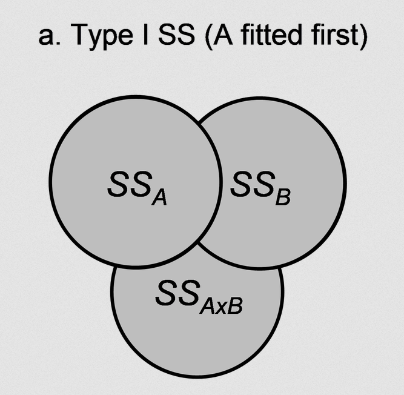
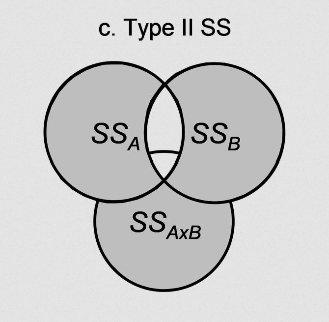
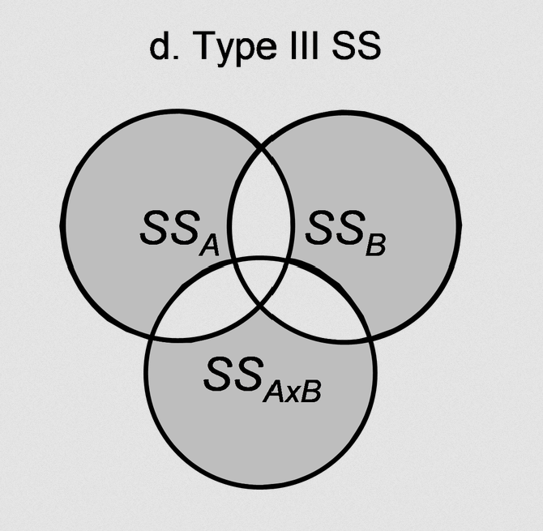

## Outline

- Factorial ANOVA

- Simple main effects

- Interactions

- ANOVA and power

```{r setup}
#| echo: false
#| output: false
library(tidyverse)
library(gt)
```


## Schedule Change

:::: {.columns style = "font-size:50%"}
::: {.column width="50%"}
**Previously**

| Week | Date  | Lab        |
|------|-------|--------------|
| 13   | 11/20 | No lab     |
| 14   | 11/24 | Regression |
:::

::: {.column width="50%"}
**Updated**

| Week | Date  | Lab        |
|------|-------|--------------|
| 13   | 11/20 | Regression |
| 14   | 11/24 | Hosting Quarto on GitHub |
:::
::::

<div>
```{=html}
<iframe class="slide-deck" src="https://jhelmer3.github.io/PSYC6019-2026/syllabus.html#class-schedule"></iframe>
```
</div>

<!-- # One-Way ANOVA `emmeans` -->

<!-- Topics: Simple main effects, perhaps of year by species. Interaction contrasts. Type I, Type II, Type III sums of squares. Risk of getting messed up with unbalanced data. Partial and full effect sizes for factorial ANOVA and their interpretations. Implementation in `lm()`, adding and removing components to test.  -->


# Two-Way ANOVA

## Two-Way ANOVA

Like One-Way ANOVA, but now we have more than one categorical variable of interest.

::: subpoint
○ Year $\times$ Department on student stress
:::

::: subpoint
○ Treatment $\times$ gender on health outcome
:::

Need to be thinking about both *main effects* of each factor and their *interaction effects*.

::: fragment
*Factorial ANOVA*: more than one factor. We are going to focus on Two-Way ANOVA today, but in theory you can run an as-many-Way-as-you-want ANOVA, with the limitation being interpretation difficulty as the number of factors increases. 

::: subpoint
○ Trying to interpret a five-way interaction term? 😱
:::
:::


## Two-Way ANOVA

If you have two factors ($A$ and $B$), where $A$ has levels $j = 1, \ ..., \ J$ and $B$ has levels $k = 1, \ ..., \ K$,

$$y_{ijk} = \mu_\text{grand} + \alpha_j + \beta_k + (\alpha \beta)_{jk} + \epsilon_{ijk}$$

::: subpoint
○ $\mu_\text{grand}$: overall grand mean

○ $\alpha_j$: effect of $A$

○ $\beta_k$: effect of $B$

○ $(\alpha \beta)_{jk}$: effect of unique interaction between $A_j$ and $B_k$, beyond what just $\alpha_j + \beta_k$ would expect
:::

Want to examine variance in $y_{ijk}$ that is accounted for by each of these terms.


## Two-Way ANOVA Example

So far we've looked at penguin **species**, but these penguin measurements were taken over multiple **years**.

:::: {.columns}
::: {.column width="66%"}
What if the year a penguin's measurement was taken is in some way linked to the penguin's flipper length?

::: subpoint-narrow
○ We are assuming these are *different* penguins each year: the researchers took measurements on three independent groups of penguins in each year. If the researchers had instead followed the penguins over time, we would need to consider the **within-penguin** variance as well (more on this next week!).
:::
<!--  -->
:::

::: {.column width="33%"}

:::
::::

::: footer
[Left penguins photo](https://encrypted-tbn0.gstatic.com/images?q=tbn:ANd9GcTzYUfXHwRxnp2TO2aWno8g92wL-smciQRjTJQh3NGAisxvuiy-f9fmewQO&s=10) accessed on 2026-10-30. [Right penguins photo](https://encrypted-tbn0.gstatic.com/images?q=tbn:ANd9GcQ3ay9b-kaFKcfoam63QlCU4YUb137GjbhzlP1jxjG6M12eEvZvLBMl9BWT&s=10) accessed on 2026-10-30.
:::


## Two-Way ANOVA in R

Can use an asterisk `*` between terms to denote interactions in formula syntax.

Swapping to a `+` would just estimate the main effects (no interactions).

::: fragment
```{r}
library(palmerpenguins)
penguins_cleaned <- penguins |>
  filter_out(when_any(is.na(year), is.na(flipper_length_mm), is.na(species))) |>
  mutate(year = factor(year))

flipper_model_twoway <- aov(flipper_length_mm ~ species * year, data = penguins_cleaned)
summary(flipper_model_twoway)
```
:::

:::: {.columns}
::: {.column .fragment style="font-size:90%" width="50%"}
$SS_T = SS_\text{between} + SS_W$

$SS_\text{between} = SS_\text{species} + SS_\text{year} + SS_{\text{species} \times \text{year}}$
:::

::: {.column .fragment width="50%"}

::: {.callout-note style="font-size:80%"}
### Note

The $SS_B = SS_A + SS_B + SS_{AB}$ decomposition applies only in the case of **balanced sample sizes** within groups.
:::

:::
::::


## Balanced Sample Sizes?

:::: {.columns}
::: {.column .fragment width="50%"}
```{r}
penguins_cleaned |>
  count(species, year)
```
:::

::: {.column .fragment width="50%"}
```{r}
penguins_cleaned |>
  count(species, year) |>
  pivot_wider(names_from = species, values_from = n) |>
  gt(rowname_col = "year") |>
  tab_style(style = cell_text(weight = "bold"),
            locations = cells_column_labels())
```
:::
::::


## Types of Sums of Squares

{.absolute width=500 height=500 left=29%}

::: footer
[Sums of Squares diagram](https://learninghub.primer-e.com/uploads/images/gallery/2022-08/fig1-41.png) accessed 2026-10-22.
:::


## Types of Sums of Squares in R

:::: {.columns}
::: {.column .fragment width="33%"}
### Type I

Ordered. Use only if you have a theoretical reason (this is rare!)

::: fragment
`aov()`'s default (uh oh)
:::
:::

::: {.column .fragment width="33%"}
### Type II

Assumes no confounding from interaction. Use only if you believe interaction is negligible.

`ez::ezANOVA()`'s default
:::

::: {.column .fragment width="33%"}
### Type III

Use if you think interaction may be non-negligible.

`afex::aov_ez()`'s default (we will learn this next week!)
:::
::::


## Types of Sums of Squares

The capital 'A' `Anova()` function from the `car` package can help us swap between.

But have to specify orthogonal (e.g., effect-coded) contrasts **before fitting the model**.

```{r}
# install.packages("car")
```


## Types of Sums of Squares

:::::: {.panel-tabset}
### Type I

```{r}
flipper_model_type_i <- summary(flipper_model_twoway)
flipper_model_type_i
```

### Type II

```{r}
flipper_model_type_ii <- car::Anova(flipper_model_twoway, type = 2)
flipper_model_type_ii
```

### Type III

::::: {.columns}
:::: {.column width="45%"}
```{r}
car::Anova(flipper_model_twoway, type = 3)
```

::: {.callout-warning .fragment}
#### Wrong

^ This is wrong! While this looks semi-reasonable, this is **not** the actual Type III Sums of Squares for this model.
:::
::::

:::: {.column .fragment width="55%"}
```{r}
options(
  contrasts = c(unordered = "contr.sum", 
                ordered = "contr.poly")
)
flipper_model_twoway_again <- aov(flipper_length_mm ~ species * year, 
                                  data = penguins_cleaned)
flipper_model_type_iii <- car::Anova(flipper_model_twoway_again, 
                                     type = 3)
flipper_model_type_iii
```
::::
:::::

::::::


## Types of Sums of Squares

:::: {.columns}
::: {.column .fragment width="33%"}
### Type I

::: {style="font-size:70%"}
```{r}
flipper_model_type_i
```
:::


:::

::: {.column .fragment width="33%"}
### Type II

::: {style="font-size:70%"}
```{r}
flipper_model_type_ii
```
:::


:::

::: {.column .fragment width="33%"}
### Type III

::: {style="font-size:70%"}
```{r}
flipper_model_type_iii
```
:::


:::
::::


## Proceeding With Type III

```{r}
flipper_model_twoway <- flipper_model_twoway_again
```

Note that effect coding will be used for the rest of the models we estimate!


## Types of Sums of Squares

The `ezANOVA()` function from the `ez` package has different syntax, but will handle remembering unbalanced sample sizes (and remembering the effect coding) for us.

```{r}
# install.packages("ez")
```

We will need an ID column for the penguins:

```{r}
penguins_cleaned <- penguins |>
  filter_out(when_any(is.na(year), is.na(flipper_length_mm), is.na(species))) |>
  mutate(year = factor(year),
         id = row_number())
```


## Types of Sums of Squares

::: {.panel-tabset}
### Type I

```{r}
ez::ezANOVA(penguins_cleaned,
            dv = flipper_length_mm,
            wid = id,
            between = c(species, year),
            type = 1)$ANOVA
```

### Type II

```{r}
ez::ezANOVA(penguins_cleaned,
            dv = flipper_length_mm,
            wid = id,
            between = c(species, year))$ANOVA
```

### Type III

```{r}
ez::ezANOVA(penguins_cleaned,
            dv = flipper_length_mm,
            wid = id,
            between = c(species, year),
            type = 3)$ANOVA
```
:::


## Assumption Checking

Looking for normally distributed outcome in each group combination and homogeneity of variance across groups.

::: fragment

::: {.panel-tabset}
### Plot
```{r}
#| echo: false
#| fig-width: 7
#| fig-height: 4
#| fig-align: center
penguins_cleaned |>
  ggplot(aes(x = year, fill = species, y = flipper_length_mm, color = species)) +
  geom_violin(alpha = 0.3, color = NA) +
  geom_jitter(position = position_jitterdodge(dodge.width = 0.9), 
              alpha = .6, shape = 16, size = 2) +
  labs(x = "Year", y = "Flipper Length (mm)", color = "Species") +
  guides(fill = guide_none()) +
  theme_minimal(base_size = 14) +
  theme(legend.position = "bottom",
        panel.grid.minor = element_blank(),
        panel.grid.major.x = element_blank())
```

### Code
```{r}
#| eval: false
penguins_cleaned |>
  ggplot(aes(x = year, fill = species, y = flipper_length_mm, color = species)) +
  geom_violin(alpha = 0.3, color = NA) +
  geom_jitter(position = position_jitterdodge(dodge.width = 0.9), 
              alpha = .6, shape = 16, size = 2) +
  labs(x = "Year", y = "Flipper Length (mm)", color = "Species") +
  guides(fill = guide_none()) +
  theme_minimal(base_size = 14) +
  theme(legend.position = "bottom",
        panel.grid.minor = element_blank(),
        panel.grid.major.x = element_blank())
```
:::

:::


## Effect Sizes: Partial $\eta^2$

With two factors, have to consider whether you want to investigate the proportion of variance accounted for by a factor by **ignoring other factors** or as a proportion of the total variance.

:::: {.columns style="font-size:90%"}
::: {.column .fragment width="33%"}
partial $\eta^2$ for species

$\frac{\mathrm{SS}_\text{species}}{\mathrm{SS}_\text{species} + \mathrm{SS}_W}$
:::

::: {.column .fragment width="33%"}
partial $\eta^2$ for year

$\frac{\mathrm{SS}_\text{year}}{\mathrm{SS}_\text{year} + \mathrm{SS}_W}$
:::

::: {.column .fragment width="33%"}
partial $\eta^2$ for species $\times$ year

$\frac{\mathrm{SS}_{\text{year} \times \text{species}}}{\mathrm{SS}_{\text{year} \times \text{species}} + \mathrm{SS}_W}$
:::
::::

::: fragment
```{r}
effectsize::eta_squared(flipper_model_twoway, partial = T) # partial = T is default
```
:::


## Effect Sizes: "Full" $\eta^2$

With two factors, have to consider whether you want to investigate the proportion of variance accounted for by a factor by ignoring other factors or as a **proportion of the total variance**.

:::: {.columns style="font-size:90%"}
::: {.column .fragment width="33%"}
partial $\eta^2$ for species

$\frac{\mathrm{SS}_\text{species}}{\mathrm{SS}_T}$
:::

::: {.column .fragment width="33%"}
partial $\eta^2$ for year

$\frac{\mathrm{SS}_\text{year}}{\mathrm{SS}_T}$
:::

::: {.column .fragment width="33%"}
partial $\eta^2$ for species $\times$ year

$\frac{\mathrm{SS}_{\text{year} \times \text{species}}}{\mathrm{SS}_T}$
:::
::::

::: fragment
```{r}
effectsize::eta_squared(flipper_model_twoway, partial = F) # partial = T is default
```
:::


## Effect Sizes: Partial $\omega^2$

With two factors, have to consider whether you want to investigate the proportion of variance accounted for by a factor by **ignoring other factors** or as a proportion of the total variance.

:::: {.columns style="font-size:90%"}
::: {.column .fragment width="33%"}
partial $\omega^2$ for species

$\frac{\mathrm{df}_\text{species} (\mathrm{MS}_\text{species} - \mathrm{MS}_\text{W}) }{\mathrm{SS}_\text{species} + (N - \mathrm{df}_\text{species})\mathrm{MS}_W}$
:::

::: {.column .fragment width="33%"}
partial $\omega^2$ for year

$\frac{\mathrm{df}_\text{year} (\mathrm{MS}_\text{year} - \mathrm{MS}_\text{W}) }{\mathrm{SS}_\text{year} + (N - \mathrm{df}_\text{year})\mathrm{MS}_W}$
:::

::: {.column .fragment width="33%"}
partial $\omega^2$ for species $\times$ year

$\frac{\mathrm{df}_{\text{year} \times \text{species}} (\mathrm{MS}_{\text{year} \times \text{species}} - \mathrm{MS}_\text{W}) }{\mathrm{SS}_{\text{year} \times \text{species}} + (N - \mathrm{df}_{\text{year} \times \text{species}})\mathrm{MS}_W}$
:::
::::

::: fragment
```{r}
effectsize::omega_squared(flipper_model_twoway, partial = T) # partial = T is default
```
:::


## Effect Sizes: "Full" $\omega^2$

With two factors, have to consider whether you want to investigate the proportion of variance accounted for by a factor by **ignoring other factors** or as a proportion of the total variance.

:::: {.columns style="font-size:90%"}
::: {.column .fragment width="33%"}
$\omega^2$ for species

$\frac{\mathrm{df}_\text{species} (\mathrm{MS}_\text{species} - \mathrm{MS}_\text{W}) }{SS_T + MS_W}$
:::

::: {.column .fragment width="33%"}
$\omega^2$ for year

$\frac{\mathrm{df}_\text{year} (\mathrm{MS}_\text{year} - \mathrm{MS}_\text{W}) }{SS_T + MS_W}$
:::

::: {.column .fragment width="33%"}
$\omega^2$ for species $\times$ year

$\frac{\mathrm{df}_{\text{year} \times \text{species}} (\mathrm{MS}_{\text{year} \times \text{species}} - \mathrm{MS}_\text{W}) }{SS_T + MS_W}$
:::
::::

::: fragment
```{r}
effectsize::omega_squared(flipper_model_twoway, partial = F) # partial = T is default
```
:::


## Comparison

## Comparison

::: {style="display: grid; grid-template-columns: 2em 1fr 1fr; column-gap: 1.5em; row-gap: 0.5em; align-items: start; font-size: 0.8em;"}

<!-- header row -->
::: {}
:::

::: {style="text-align: center; font-size: 1.3em;"}
$\eta^2$
:::

::: {style="text-align: center; font-size: 1.3em;"}
$\omega^2$
:::

<!-- partial row -->
::: {style="writing-mode: vertical-rl; transform: rotate(180deg); text-align: center; align-self: center;"}
partial
:::

```{r}
effectsize::eta_squared(flipper_model_twoway)
```

```{r}
effectsize::omega_squared(flipper_model_twoway)
```

<!-- full row -->
::: {style="writing-mode: vertical-rl; transform: rotate(180deg); text-align: center; align-self: center;"}
full
:::

```{r}
effectsize::eta_squared(flipper_model_twoway, partial = F)
```

```{r}
effectsize::omega_squared(flipper_model_twoway, partial = F)
```

:::

<!-- :::: {.columns} -->
<!-- ::: {.column width="50%"} -->
<!-- partial $\eta^2$ -->

<!-- ```{r} -->
<!-- effectsize::eta_squared(flipper_model_twoway) -->
<!-- ``` -->
<!-- ::: -->

<!-- ::: {.column width="50%"} -->
<!-- partial $\omega^2$ -->

<!-- ```{r} -->
<!-- effectsize::omega_squared(flipper_model_twoway) -->
<!-- ``` -->
<!-- ::: -->
<!-- :::: -->

<!-- :::: {.columns} -->
<!-- ::: {.column width="50%"} -->
<!-- $\eta^2$ -->

<!-- ```{r} -->
<!-- effectsize::eta_squared(flipper_model_twoway, partial = F) -->
<!-- ``` -->
<!-- ::: -->

<!-- ::: {.column width="50%"} -->
<!-- $\omega^2$ -->

<!-- ```{r} -->
<!-- effectsize::omega_squared(flipper_model_twoway, partial = F) -->
<!-- ``` -->
<!-- ::: -->
<!-- :::: -->


## Two-Way ANOVA as a Linear Model

```{r}
flipper_model_twoway_lm <- lm(flipper_length_mm ~ species * year, data = penguins_cleaned)
summary(flipper_model_twoway_lm)
```


## Bayesian Two-Way ANOVA

```{r}
#| eval: false
library(rstanarm)
flipper_model_twoway_bayes <- stan_glm(
  flipper_length_mm ~ species * year, 
  data = penguins_cleaned, 
  family = "gaussian"
) 
summary(flipper_model_twoway_bayes)
```

```{r}
#| echo: false
library(rstanarm)
flipper_model_twoway_bayes <- stan_glm(
  flipper_length_mm ~ species * year, 
  data = penguins_cleaned, 
  family = "gaussian",
  refresh = 0
) 
summary(flipper_model_twoway_bayes)
```


<!-- ## Bayesian Two-Way ANOVA -->

<!-- ```{r} -->
<!-- bayesplot::ppc_violin_grouped( -->
<!--   y = penguins_cleaned$flipper_length_mm, -->
<!--   yrep = posterior_predict(flipper_model_twoway_bayes, draws = 50), -->
<!--   group = penguins_cleaned$species -->
<!-- )  -->

<!-- ``` -->

<!-- ## Testing Effects with Bayes Factors -->

<!-- [add testing by removing effects and comparing bayes factors] -->


# Simple Main Effects

## Simple Main Effects

How do we examine effects within these multiple factors?

We can investigate the differences in outcome between levels of $A$ within a single level of $B$ at a time.

::: subpoint
○ Within the year of 2007, what were the differences between Adelie, Gentoo, and Chinstrap penguins?

○ What about within the year of 2008?
:::

Can also flip (depending on how you'd like to interpret the results)

::: subpoint
○ For Adelie penguins only, what was the effect of year on flipper length?

○ What about for Gentoo penguins?
:::

Can examine this by running a separate One-Way ANOVA within each level.


## Simple Main Effects `emmeans`

::::: fragment
```{r}
library(emmeans)
emms_flipper_twoway <- emmeans(flipper_model_twoway, specs = c("species", "year"))
emms_flipper_twoway
```

:::: {.columns}
::: {.column width="50%"}
```{r}
smes_by_species <- joint_tests(emms_flipper_twoway, 
                               by = "species")
smes_by_species
```
:::

::: {.column width="50%"}
```{r}
smes_by_year <- joint_tests(emms_flipper_twoway, 
                            by = "year")
smes_by_year
```
:::
::::

:::::

## Simple Main Effects `emmeans`

Can then look at pairwise comparisons within each of those One-Way ANOVAs.

```{r}
pairs_within_species <- pairs(emms_flipper_twoway, by = "species") # default: adjust = "tukey"
pairs_within_species
```


## Effect Sizes


::: panel-tabset
### Gathering Ingredients

```{r}
flipper_twoway_tidy <- broom::tidy(flipper_model_twoway)
flipper_twoway_tidy

df_residual <- flipper_twoway_tidy |>
  filter(term == "Residuals") |>
  pull(df)
ms_w <- flipper_twoway_tidy |>
  filter(term == "Residuals") |>
  pull(meansq)

df_residual; ms_w
```


### Effect Sizes

```{r}
eff_size(emms_flipper_twoway, edf = df_residual, sigma = sqrt(ms_w))
```
:::


## Main Effects

Given that our interaction wasn't significant, we can also look at main effects.

```{r}
emms_species <- emmeans(flipper_model_twoway, specs = "species")
emms_year <- emmeans(flipper_model_twoway, specs = "year")

emms_species; emms_year
```


## Plotting Two-Way `emmeans`

:::: {.columns}
::: {.column width="50%"}
Super quick plotting method with `plot()`

Not so great with more than one factor...
:::

::: {.column width="50%"}
::: {.panel-tabset}
### Plot
```{r}
#| echo: false
#| fig-width: 5
#| fig-height: 4
#| fig-align: center
plot(emms_flipper_twoway)
```

### Code
```{r}
#| eval: false
plot(emms_flipper_twoway)
```
:::
:::
::::


## Plotting Two-Way `emmeans`

:::: {.columns}
::: {.column width="50%"}
Let's build our own. The color on our last plot was just to make it look nice, but this time, let's use color to represent the year.

```{r}
emms_flipper_twoway_df <- as_tibble(emms_flipper_twoway)
emms_flipper_twoway_df |>
  glimpse(width = 60)
```

::: {.fragment fragment-index=2}
Like last time, we always want to include our uncertainty.
:::
:::

::: {.column .fragment fragment-index=1 width="50%"}
::: {.panel-tabset}
### Plot
```{r}
#| echo: false
#| fig-width: 5
#| fig-height: 4
#| fig-align: center
emms_flipper_twoway_df |>
  ggplot(aes(x = year, y = emmean, color = species)) +
  geom_point()
```

### Code
```{r}
#| eval: false
emms_flipper_twoway_df |>
  ggplot(aes(x = year, y = emmean, color = species)) +
  geom_point()
```
:::
:::
::::


## Plotting Two-Way `emmeans`

:::: {.columns}
::: {.column width="50%"}
Adding on error bars (this time, with `geom_pointrange()`.
:::

::: {.column width="50%"}
::: {.panel-tabset}
### Plot
```{r}
#| echo: false
#| fig-width: 5
#| fig-height: 4
#| fig-align: center
emms_flipper_twoway_df |>
  ggplot(aes(x = year, y = emmean, color = species,
             ymin = lower.CL, ymax = upper.CL)) +
  geom_point() +
  geom_pointrange()
```

### Code
```{r}
#| eval: false
emms_flipper_twoway_df |>
  ggplot(aes(x = year, y = emmean, color = species,
             ymin = lower.CL, ymax = upper.CL)) +
  geom_point() +
  geom_pointrange()
```
:::
:::
::::


## Plotting Two-Way `emmeans`

:::: {.columns}
::: {.column width="50%"}
Let's build our own.

And tidy it up.
:::

::: {.column width="50%"}
::: {.panel-tabset}
### Plot
```{r}
#| echo: false
#| fig-width: 5
#| fig-height: 4
#| fig-align: center
emms_flipper_twoway_df |>
  ggplot(aes(x = year, y = emmean, color = species,
             ymin = lower.CL, ymax = upper.CL)) +
  geom_point(position = position_dodge(0.3)) +
  geom_pointrange(position = position_dodge(0.3)) +
  scale_y_continuous("EMM of Flipper Length", limits = c(180, 230)) +
  scale_color_discrete(palette = "Set2") +
  labs(caption = "Line ranges represent 95% confidence intervals of the mean" |>
         str_wrap(50)) +
  guides(x = guide_axis(NULL, cap = T),
         y = guide_axis(cap = T)) +
  theme_classic() +
  theme(legend.position = "none")
```

### Code
```{r}
#| eval: false
emms_flipper_twoway_df |>
  ggplot(aes(x = year, y = emmean, color = species,
             ymin = lower.CL, ymax = upper.CL)) +
  geom_point(position = position_dodge(0.3)) +
  geom_pointrange(position = position_dodge(0.3)) +
  scale_y_continuous("EMM of Flipper Length", limits = c(180, 230)) +
  scale_color_discrete(palette = "Set2") +
  labs(caption = "Line ranges represent 95% confidence intervals of the mean" |>
         str_wrap(50)) +
  guides(x = guide_axis(NULL, cap = T),
         y = guide_axis(cap = T)) +
  theme_classic() +
  theme(legend.position = "none")
```
:::
:::
::::

::: footer
See options of color scales in the [`{ggplot2}` book](https://ggplot2-book.org/scales-colour.html#sec-colour-discrete){target = "blank"}.
:::


## Plotting Two-Way `emmeans`

:::: {.columns}
::: {.column width="50%"}
Adding a `geom_line()` makes sense because the axis has (1) natural ordering and (2) equal-spaced intervals (2007, 2008, 2009).
:::

::: {.column width="50%"}
::: {.panel-tabset}
### Plot
```{r}
#| echo: false
#| fig-width: 5
#| fig-height: 4
#| fig-align: center
emms_flipper_twoway_df |>
  ggplot(aes(x = year, y = emmean, 
             color = species, group = species,
             ymin = lower.CL, ymax = upper.CL)) +
  geom_line(position = position_dodge(0.3)) +
  geom_point(position = position_dodge(0.3)) +
  geom_pointrange(position = position_dodge(0.3)) +
  scale_y_continuous("EMM of Flipper Length", limits = c(180, 230)) +
  scale_color_discrete(palette = "Set2") +
  labs(caption = "Line ranges represent 95% confidence intervals of the mean" |>
         str_wrap(50)) +
  guides(x = guide_axis(NULL, cap = T),
         y = guide_axis(cap = T)) +
  theme_classic() +
  theme(legend.position = "none")
```

### Code
```{r}
#| eval: false
emms_flipper_twoway_df |>
  ggplot(aes(x = year, y = emmean, 
             color = species, group = species,
             ymin = lower.CL, ymax = upper.CL)) +
  geom_line(position = position_dodge(0.3)) +
  geom_point(position = position_dodge(0.3)) +
  geom_pointrange(position = position_dodge(0.3)) +
  scale_y_continuous("EMM of Flipper Length", limits = c(180, 230)) +
  scale_color_discrete(palette = "Set2") +
  labs(caption = "Line ranges represent 95% confidence intervals of the mean" |>
         str_wrap(50)) +
  guides(x = guide_axis(NULL, cap = T),
         y = guide_axis(cap = T)) +
  theme_classic() +
  theme(legend.position = "none")
```
:::
:::
::::


## Simple Main Effects & Bayes

Can get the `emmeans` and `pairs` the same way.

:::: {.columns}
::: {.column width="50%"}
```{r}
emms_flipper_twoway_bayes <- emmeans(
  flipper_model_twoway_bayes, 
  specs = c("species", "year")
)
emms_flipper_twoway_bayes
```
:::

::: {.column width="50%"}
```{r}
pairs_by_species_bayes <- pairs(
  emms_flipper_twoway_bayes, 
  by = "species"
)
pairs_by_species_bayes
```
:::
::::


## Effect Size and Bayes

Little trickier to get effect sizes for each of these comparisons. For an effect size, we want to divide the mean differences by the residual standard deviation.

$$d = \frac{\text{contrast estimate}}{\sigma}$$

With Bayes, we typically want to incorporate the full posterior uncertainty in our effect size, both the uncertainty in the contrast estimate **and** the uncertainty in the residual standard deviation. 


## Effect Size and Bayes

:::: {.columns}
::: {.column width="50%"}
```{r}
# install.packages("posterior")
flipper_model_twoway_bayes |>
  posterior::summarise_draws(
    mean, sd, function(param) quantile(
      param, probs = c(0.05, 0.5, 0.95)
    )
  ) 
```
:::

::: {.column width="50%"}
::: {.panel-tabset}
### Plot
```{r}
#| echo: false
#| fig-width: 4
#| fig-height: 6
#| fig-align: center
bayesplot::mcmc_areas(
 flipper_model_twoway_bayes,
 pars = c(
   "species1",
   "year1",
   "species1:year1",
   "sigma"
 ),
 prob = 0.90,  
 prob_outer = 0.99
) +
 guides(x = guide_axis(cap = T),
        y = guide_axis(cap = T)) +
 theme_classic()
```

### Code
```{r}
#| eval: false
bayesplot::mcmc_areas(
 flipper_model_twoway_bayes,
 pars = c(
   "species1",
   "year1",
   "species1:year1",
   "sigma"
 ),
 prob = 0.90,  
 prob_outer = 0.99
) +
 guides(x = guide_axis(cap = T),
        y = guide_axis(cap = T)) +
 theme_classic()
```
:::
:::
::::


## Effect Size and Bayes

If you want to include the full uncertainty of $\sigma$ in your effect size:

::: panel-tabset

### Get Ingredients

```{r}
emms_contrast_draws <- as.mcmc.emmGrid(pairs_by_species_bayes, sep.chains = F) |>
  as_tibble()
sigma_draws <- flipper_model_twoway_bayes |> 
  as.data.frame(pars = "sigma") |>
  pull(sigma)

head(emms_contrast_draws)
```


### Effect Size

:::: {.columns}
::: {.column width="50%"}
```{r}
d_draws <- emms_contrast_draws |>
  mutate(
    across(
      everything(), 
      function(contrast_draws_column) 
        contrast_draws_column / sigma_draws
    )
  )
```
:::

::: {.column width="50%"}
```{r}
d_draws |> 
  pivot_longer(everything(), 
               names_to = "contrast_name",
               values_to = "d_draw") |> 
  summarize(
    .by = contrast_name,
    mean = mean(d_draw),
    lower_025 = quantile(d_draw, 0.025),
    upper_975 = quantile(d_draw, 0.975),
  )
```
:::
::::


:::


# ANOVA and Power

## One-Way ANOVA and Power

Just like with *t*-tests, you may want to examine power for an ANOVA.

`pwr.anova.test(k, n, f, sig.level = 0.05, power)`

::: subpoint
○ `k =` number of groups

○ `n =` number of observations **per group**

○ `f =` effect size as in $f = \sqrt{f^2}$

○ `sig.level =` significance level, typically `0.05`

○ `power =` power of test
:::

Like before, specify all but one, and the function will calculate the last

Remember $f^2$ is the ratio of between-group variability to within-group variability


## Getting $f$

The `prw::pwr.anova.test` function wants $f = \sqrt{f^2}$.

If you're thinking about an effect size in $\eta^2$ or $\omega^2$ you can convert it. 

:::: {.columns}
::: {.column width="50%"}
$$f = \sqrt{\frac{\eta_2}{1 - \eta^2}}$$
:::

::: {.column width="50%"}
$$f = \sqrt{\frac{\omega^2}{1 - \omega^2}}$$
:::
::::

The `effectsize::eta2_to_f(effect_size)` can convert "any measure of variance explained such as Eta-, Epsilon-, Omega-, or R-Squared, partial or otherwise"

:::: {.columns}
::: {.column width="33%"}
```{r}
effectsize::eta2_to_f(.7)
```
:::

::: {.column width="33%"}
```{r}
effectsize::eta2_to_f(.2)
```
:::

::: {.column width="33%"}
```{r}
effectsize::eta2_to_f(.1)
```
:::
::::

::: footer
See `?effectsize::eta2_to_f` to confirm.
:::

## One-Way ANOVA and Power

:::: {.columns}
::: {.column width="33%"}
```{r}
pwr::pwr.anova.test(k = 4, 
                    n = 20, 
                    f = .25)
```
:::

::: {.column width="33%"}
```{r}
pwr::pwr.anova.test(k = 4, 
                    f = .25,
                    power = 0.8)
```
:::

::: {.column width="33%"}
```{r}
pwr::pwr.anova.test(n = 20, 
                    f = 0.3,
                    power = 0.7)
```
:::
::::


## One-Way ANOVA and Power

Let's examine how many participants we would need for a small, medium, or large effect (we can do $f =$ $0.1$, $0.25$, and $0.6$).

:::: {.columns}
::: {.column width="50%"}

Starting with small...

::: panel-tabset

### Code
```{r}
power_values_df <- tibble(
  sample_sizes = seq(10, 250, by = 20)
) |>
  mutate(
    power = map_dbl(
      sample_sizes, 
      function(sample_size) 
        pwr::pwr.anova.test(
          n = sample_size, 
          k = 3,
          f = 0.1, 
          sig.level = 0.05)$power
    )
  )
```

### Output

```{r}
power_values_df |> head(10)
```

:::
:::

::: {.column width="50%"}
::: {.panel-tabset}
### Plot
```{r}
#| echo: false
#| fig-width: 5
#| fig-height: 4
#| fig-align: center
power_values_df |>
  ggplot(aes(x = sample_sizes, y = power)) +
  geom_line() +
  geom_hline(aes(yintercept = 0.8), 
             linetype = "dashed", color = "gray75") +
  geom_line() +
  coord_cartesian(ylim = c(0, 1)) +
  theme_classic(base_size = 14)
```

### Code
```{r}
#| eval: false
power_values_df |>
  ggplot(aes(x = sample_sizes, y = power)) +
  geom_line() +
  geom_hline(aes(yintercept = 0.8), 
             linetype = "dashed", color = "gray75") +
  geom_line() +
  coord_cartesian(ylim = c(0, 1)) +
  theme_classic(base_size = 14)
```
:::

:::
::::


## One-Way ANOVA and Power

Let's examine how many participants we would need for a small, medium, or large effect (we can do $f =$ $0.1$, $0.25$, and $0.6$).

:::: {.columns}
::: {.column width="50%"}

Adding effect size condition...

::: panel-tabset

### Code

```{r}
power_values_df <- tibble(
  sample_sizes = seq(10, 250, by = 20)
) |>
  expand_grid(f = c(0.1, 0.25, 0.6)) |>
  mutate(
    power = map2_dbl(
      sample_sizes, f,
      function(sample_size, f) 
        pwr::pwr.anova.test(
          n = sample_size, 
          k = 3,
          f = f, 
          sig.level = 0.05)$power
    )
  )
```

### Output

```{r}
power_values_df |> head(10)
```

:::

:::

::: {.column width="50%"}
::: {.panel-tabset}
### Plot
```{r}
#| echo: false
#| fig-width: 5
#| fig-height: 4
#| fig-align: center
power_values_df |>
  ggplot(aes(x = sample_sizes, y = power, color = factor(f))) +
  geom_line() +
  geom_hline(aes(yintercept = 0.8), 
             linetype = "dashed", color = "gray75") +
  geom_line() +
  coord_cartesian(ylim = c(0, 1)) +
  theme_classic(base_size = 14)
```

### Code
```{r}
#| eval: false
power_values_df |>
  ggplot(aes(x = sample_sizes, y = power, color = factor(f))) +
  geom_line() +
  geom_hline(aes(yintercept = 0.8), 
             linetype = "dashed", color = "gray75") +
  geom_line() +
  coord_cartesian(ylim = c(0, 1)) +
  theme_classic(base_size = 14)
```
:::

:::
::::


## One-Way ANOVA and Power

Let's examine how many participants we would need for a small, medium, or large effect (we can do $f =$ $0.1$, $0.25$, and $0.6$).

:::: {.columns}
::: {.column width="50%"}

Increasing sample size and precision

::: panel-tabset

### Code

```{r}
power_values_df <- tibble(
  sample_sizes = seq(10, 500, by = 10)
) |>
  expand_grid(f = c(0.1, 0.25, 0.6)) |>
  mutate(
    power = map2_dbl(
      sample_sizes, f,
      function(sample_size, f) 
        pwr::pwr.anova.test(
          n = sample_size, 
          k = 3,
          f = f, 
          sig.level = 0.05)$power
    )
  )
```

### Output

```{r}
power_values_df |> head(10)
```
:::
:::

::: {.column width="50%"}
::: {.panel-tabset}
### Plot
```{r}
#| echo: false
#| fig-width: 5
#| fig-height: 4
#| fig-align: center
power_values_df |>
  ggplot(aes(x = sample_sizes, y = power, color = factor(f))) +
  geom_line() +
  geom_hline(aes(yintercept = 0.8), 
             linetype = "dashed", color = "gray75") +
  geom_line() +
  coord_cartesian(ylim = c(0, 1)) +
  theme_classic(base_size = 14)
```

### Code
```{r}
#| eval: false
power_values_df |>
  ggplot(aes(x = sample_sizes, y = power, color = factor(f))) +
  geom_line() +
  geom_hline(aes(yintercept = 0.8), 
             linetype = "dashed", color = "gray75") +
  geom_line() +
  coord_cartesian(ylim = c(0, 1)) +
  theme_classic(base_size = 14)
```
:::

:::
::::


## One-Way ANOVA and Power

Let's examine how many participants we would need for a small, medium, or large effect (we can do $f =$ $0.1$, $0.25$, and $0.6$).

:::: {.columns}
::: {.column width="50%"}

Remember total sample size is `k * n`!

::: panel-tabset

### Code

```{r}
power_values_df <- tibble(
  sample_sizes = seq(10, 500, by = 10)
) |>
  expand_grid(f = c(0.1, 0.25, 0.6)) |>
  mutate(
    power = map2_dbl(
      sample_sizes, f,
      function(sample_size, f) 
        pwr::pwr.anova.test(
          n = sample_size, 
          k = 3,
          f = f, 
          sig.level = 0.05)$power
    ),
    total_sample_size = sample_sizes * 3
  )
```

### Output

```{r}
power_values_df |> head(10)
```

:::

:::

::: {.column width="50%"}
::: {.panel-tabset}
### Plot
```{r}
#| echo: false
#| fig-width: 5
#| fig-height: 4
#| fig-align: center
power_values_df |>
  ggplot(aes(x = total_sample_size, y = power, color = factor(f))) +
  geom_line() +
  geom_hline(aes(yintercept = 0.8), 
             linetype = "dashed", color = "gray75") +
  geom_line() +
  coord_cartesian(ylim = c(0, 1)) +
  theme_classic(base_size = 14)
```

### Code
```{r}
#| eval: false
power_values_df |>
  ggplot(aes(x = total_sample_size, y = power, color = factor(f))) +
  geom_line() +
  geom_hline(aes(yintercept = 0.8), 
             linetype = "dashed", color = "gray75") +
  geom_line() +
  coord_cartesian(ylim = c(0, 1)) +
  theme_classic(base_size = 14)
```
:::

:::
::::


## Two-Way ANOVA and Power

There is no specific `pwr` function for a two-way ANOVA, but it has a broader function for the **general linear model**. It more flexible because it is based on **degrees of freedom**.

`pwr::pwr.f2.test(u, v, f2, sig.level = 0.05, power)`

::: subpoint
○ `u =` numerator degrees of freedom

○ `v =` denominator degrees of freedom

○ `f2 =` effect size (note $f^2$ here, not $f$)

○ `sig.level =` significance level, typically `.05`

○ `power =` power of test
:::

Need to consider degrees of freedom for your intended test. 


## Two-Way ANOVA and Power

Maybe you want to conduct a 3x3 ANOVA, and you'd like to know how many people to recruit. With this function, we can examine the power for each effect at a time. For example, let's do the interaction effect. 

**Numerator**: $\mathrm{df}_\mathrm{interaction} = (J - 1)(K - 1)$

**Denominator**: $\mathrm{df}_\mathrm{total} = N - 1 \quad \mathrm{df}_\mathrm{between} = J \times K - 1 \quad \mathrm{df}_\mathrm{within} = \mathrm{df}_\mathrm{total} - \mathrm{df}_\mathrm{between}$


```{r}
J <- 3
K <- 3

df_interaction <- (J - 1) * (K - 1)
df_between <- (J * K - 1)

df_interaction; df_between
```


<!-- ## Two-Way ANOVA and Power -->

<!-- ::: {.panel-tabset} -->
<!-- ### Plot -->
<!-- ```{r} -->
<!-- #| echo: false -->
<!-- #| fig-width: 5 -->
<!-- #| fig-height: 4 -->
<!-- #| fig-align: center -->
<!-- power_values_df |> -->
<!--   ggplot(aes(x = sample_size, y = power, color = factor(sqrt(f2)))) + -->
<!--   geom_line() + -->
<!--   geom_hline(aes(yintercept = 0.8),  -->
<!--              linetype = "dashed", color = "gray75") + -->
<!--   geom_line() + -->
<!--   coord_cartesian(ylim = c(0, 1)) + -->
<!--   labs(color = "f") + -->
<!--   theme_classic(base_size = 14) -->
<!-- ``` -->

<!-- ### Code -->
<!-- ```{r} -->
<!-- #| eval: false -->
<!-- power_values_df |> -->
<!--   ggplot(aes(x = sample_size, y = power, color = factor(sqrt(f2)))) + -->
<!--   geom_line() + -->
<!--   geom_hline(aes(yintercept = 0.8),  -->
<!--              linetype = "dashed", color = "gray75") + -->
<!--   geom_line() + -->
<!--   coord_cartesian(ylim = c(0, 1)) + -->
<!--   labs(color = "f") + -->
<!--   theme_classic(base_size = 14) -->
<!-- ``` -->
<!-- ::: -->


## Two-Way ANOVA and Power

Maybe you want to conduct a 3x3 ANOVA, and you'd like to know how many people to recruit. With this function, we can examine the power for each effect at a time. For example, let's do the interaction effect. 

:::: {.columns}
::: {.column width="50%"}

::: panel-tabset

### Code

```{r}
power_values_df <- tibble(
  sample_size = seq(10, 500, by = 10),
  df_total = sample_size - 1, # total sample size
  df_numerator = df_interaction,
  df_denominator = df_total - df_between
) |>
  expand_grid(f2 = c(0.1, 0.25, 0.6)^2) |>
  mutate(
    power = pmap_dbl(
      list(df_numerator, df_denominator, f2),
      function(df_numerator, df_denominator, f2) 
        pwr::pwr.f2.test(
          u = df_numerator, 
          v = df_denominator,
          f2 = f2, 
          sig.level = 0.05)$power
    )
  )
```

### Output

```{r}
power_values_df |> head(10)
```

:::

:::

::: {.column width="50%"}
::: {.panel-tabset}
### Plot
```{r}
#| echo: false
#| fig-width: 5
#| fig-height: 4
#| fig-align: center
power_values_df |>
  ggplot(aes(x = sample_size, y = power, color = factor(sqrt(f2)))) +
  geom_line() +
  geom_hline(aes(yintercept = 0.8), 
             linetype = "dashed", color = "gray75") +
  geom_line() +
  coord_cartesian(ylim = c(0, 1)) +
  labs(color = "f") +
  theme_classic(base_size = 14)
```

### Code
```{r}
#| eval: false
power_values_df |>
  ggplot(aes(x = sample_size, y = power, color = factor(sqrt(f2)))) +
  geom_line() +
  geom_hline(aes(yintercept = 0.8), 
             linetype = "dashed", color = "gray75") +
  geom_line() +
  coord_cartesian(ylim = c(0, 1)) +
  labs(color = "f") +
  theme_classic(base_size = 14)
```
:::

:::
::::


<!-- ## Plotting Two-Way ANOVA `emmeans` -->

<!-- :::: {.columns} -->
<!-- ::: {.column width="50%"} -->
<!-- Can add lines between points to look for interactions. -->
<!-- ::: -->

<!-- ::: {.column .fragment fragment-index=1 width="50%"} -->
<!-- ::: {.panel-tabset} -->
<!-- ### Plot -->
<!-- ```{r} -->
<!-- #| echo: false -->
<!-- #| fig-width: 5 -->
<!-- #| fig-height: 4 -->
<!-- #| fig-align: center -->
<!-- emms_flipper_twoway_df |> -->
<!--   ggplot(aes(x = species, y = emmean, color = year, -->
<!--              group = year, -->
<!--              ymin = lower.CL, ymax = upper.CL)) + -->
<!--   geom_point(position = position_dodge(0.3)) + -->
<!--   geom_line(position = position_dodge(0.3)) + -->
<!--   geom_errorbar(width = 0.1, position = position_dodge(0.3)) + -->
<!--   scale_y_continuous("EMM of Flipper Length", limits = c(180, 230)) + -->
<!--   guides(x = guide_axis(NULL, cap = T), -->
<!--          y = guide_axis(cap = T)) + -->
<!--   theme_classic() + -->
<!--   theme(legend.position = "none") -->
<!-- ``` -->

<!-- ### Code -->
<!-- ```{r} -->
<!-- #| eval: false -->
<!-- emms_flipper_twoway_df |> -->
<!--   ggplot(aes(x = species, y = emmean, color = year, -->
<!--              group = year, -->
<!--              ymin = lower.CL, ymax = upper.CL)) + -->
<!--   geom_point(position = position_dodge(0.3)) + -->
<!--   geom_line(position = position_dodge(0.3)) + -->
<!--   geom_errorbar(width = 0.1, position = position_dodge(0.3)) + -->
<!--   scale_y_continuous("EMM of Flipper Length", limits = c(180, 230)) + -->
<!--   guides(x = guide_axis(NULL, cap = T), -->
<!--          y = guide_axis(cap = T)) + -->
<!--   theme_classic() + -->
<!--   theme(legend.position = "none") -->
<!-- ``` -->
<!-- ::: -->
<!-- ::: -->
<!-- :::: -->


## Lab 10 Assignment {.nostretch background-image="https://img1.picmix.com/output/stamp/normal/2/7/1/5/2365172_f0bd0.gif" background-size="contain"} 

### [**Happy Halloween!**]{style="color:#051E39"}

{.absolute bottom=0 right=0 width="200px"}

{.absolute bottom=0 left=500 width="215px"}

{.absolute bottom=0 left=0 width="200px"}


