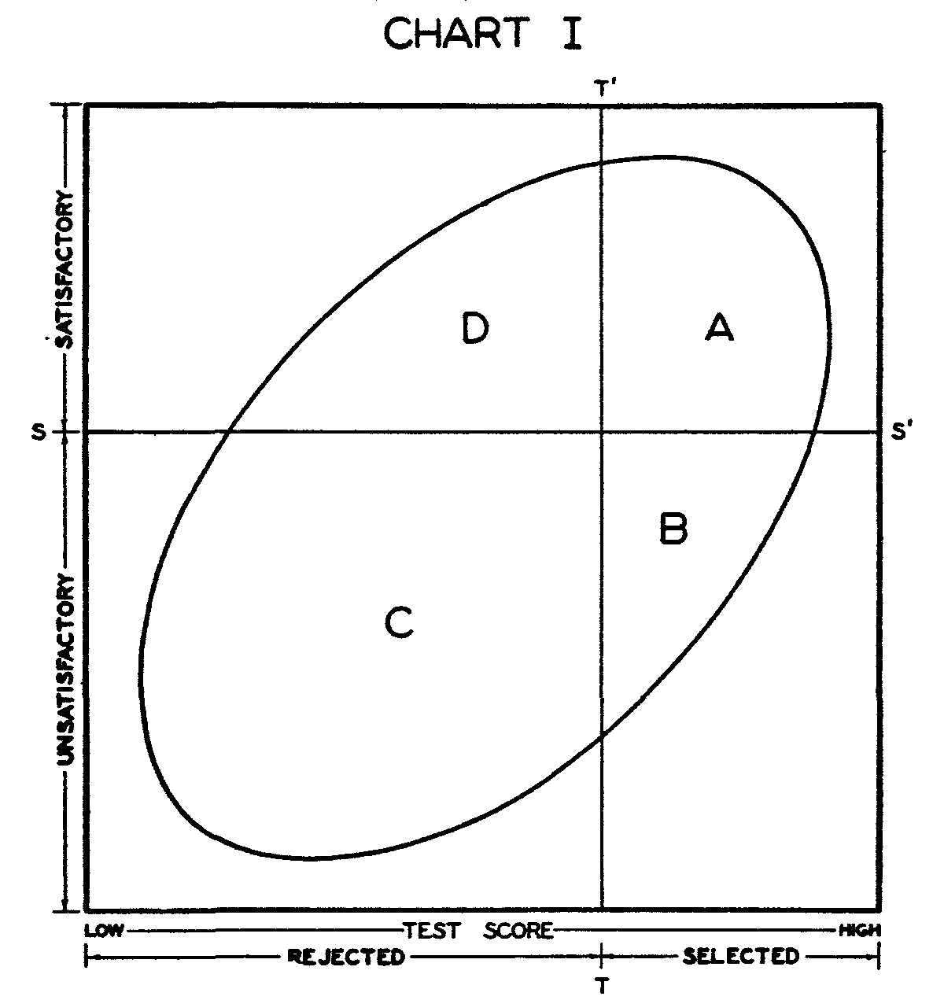

```{r}
#| echo: false


library(knitr)
library(formatR)
library(tidyverse)
library(gganimate)
library(gifski)
opts_chunk$set(out.width = '100%', options(width=60))

opts_knit$set(global.par = TRUE)
opts_chunk$set(echo=FALSE, warning = FALSE, message = FALSE, comment = '', class.output='sh',
               fig.width=8, fig.height=5, fig.align = "center")

my_red <- "#E41A1C"
my_blue <- "#377EB8"
my_green <- "#4DAF4A"
my_purple <- "#984EA3"
my_orange <- "#FF7F00"
my_yellow <- "#FFFF33"
my_red2 <- "#FBB4AE" 
my_blue2 <- "#B3CDE3" 
my_green2 <- "#CCEBC5" 
my_purple2 <- "#DECBE4"
my_orange2 <- "#FED9A6"
my_yellow2 <- "#FFFFCC"


```


## Correlation

Pearson Product Moment (PPM) correlation is a standardized covariance:

$$r_{xy} = \frac{s_{xy}}{s_x s_y} = \frac{\sum_{i=1}^N(x_i - \bar{x})(y_i - \bar{y})}{\sqrt{\sum_{i=1}^N(x_i - \bar{x})^2}\sqrt{\sum_{i=1}^N(y_i - \bar{y})^2}}$$


- $s_{xy}$ is the sample covariance
- $s_x s_y$ is the product of the sample variances

## PPM Correlation

- The PPM is the most common type of correlation
- If not specified, safe to assume that a correlation is a PPM
- Equals the degree to which to variables co-vary in terms of their $SD$s
- Scale-free
- Correlations range from -1 to 1
- Correlations of 0 indicate no linear relationship
- The sign of a correlation is the same as the sign of the covariance


## Hypothesis Testing

In hypothesis testing, we use sample statistics to estimate population parameters

- $\bar{x}$ is an estimate of $\mu$
- $s_{x}$ is an estimate of $\sigma_x$
- $r_{xy}$ is an estimate of $\rho_{xy}$
- $\hat{b}_0$ and $\hat{b}_1$ are estimates of $b_0$ and $b_1$

Null hypotheses we can test include:

- $H_0$: $\rho_{xy} = 0$
- $H_0$: $\rho_{xy} = \#$ (specific number other than zero)
- $H_0$: population $R^2 = 0$
- $H_0$: $b_1 = 0$
- $H_0$: $b_0 = 0$ (usually not substantively interesting)


## Hypothesis Test for $r_{xy}$

- $H_0: \rho_{xy} = 0$
- $H_1: \rho_{xy} \neq 0$ (directional tests may also be appropriate)

When $H_0$ is true, the test statistic follows a $t$ distribution with $N-2$ $df$

$$t_{\text{obs}}(df) = \frac{r_{xy}\sqrt{N-2}}{\sqrt{1 - r_{xy}^2}}$$

## Non-nil $r_{xy}$

What if we want to test against a different null hypothesis?

- Sampling distribution is not symmetric if $\rho_{xy} \neq 0$

Fisher's $r$-to-$z$ transformation:

(equal to hyperbolic arctan function)

$$z_{\text{obs}} = \frac{1}{2}\ln\left(\frac{1+r_{xy}}{1-r_{xy}}\right)$$

- $z_{\text{obs}}$ follows a normal distribution
    - Mean = $\frac{1}{2}\ln\left(\frac{1 + \rho_{xy}}{1-\rho_{xy}}\right)$
    - Standard error = $\frac{1}{\sqrt{N-3}}$
- $\ln()$: natural logarithm function
- $N$: sample size

Assumes that $x$ and $y$ have a **bivariate normal** distribution


## Bivariate Normal $r_{xy} = 0$

```{r}
#| fig.align: "center"
#| out.width: "85%"
#| fig.width: 8
#| fig.height: 7

x <- y <- seq(-2, 2, length = 30)
z <- matrix(NA, 30, 30)
for(i in 1:30){
  for(j in 1:30){
    z[i, j] <- mvtnorm::dmvnorm(c(x[i], y[j]),
                                mean = c(0, 0),
                                sigma = matrix(c(1, 0, 0, 1), 2))
  }
}

col.pal <- colorRampPalette(c(my_blue, my_green))
colors <- col.pal(100)
z.facet.center <- (z[-1, -1] + z[-1, -ncol(z)] + z[-nrow(z), -1] + z[-nrow(z), -ncol(z)])/4
z.facet.range <- cut(z.facet.center, 100)

# Strip default base-graphics margins to maximize plot area and clear top/bottom gap
par(mar = c(0, 0, 0, 0))

# 1. Capture the perspective transformation matrix
pmat <- persp(x = x, y = y, z = z, box = FALSE, theta = 30, phi = 40,
              zlim = c(0, .4), col = colors[z.facet.range])

# 2. Project 3D coordinate locations into 2D plot space
pt_x <- trans3d(x = 0, y = -2.5, z = 0, pmat = pmat)
pt_y <- trans3d(x = 2.5, y = 0, z = 0, pmat = pmat)

# 3. Add rotated bold-italic math labels
text(pt_x$x, pt_x$y, labels = expression(bolditalic(x)), srt = -30, cex = 2.2, xpd = TRUE)
text(pt_y$x, pt_y$y, labels = expression(bolditalic(y)), srt = 70,  cex = 2.2, xpd = TRUE)
```

## Bivariate Normal $r_{xy} = .5$

```{r}
#| fig.align: "center"
#| out.width: "85%"
#| fig.width: 8
#| fig.height: 7

x <- y <- seq(-2, 2, length = 30)
z <- matrix(NA, 30, 30)
for(i in 1:30){
  for(j in 1:30){
    z[i, j] <- mvtnorm::dmvnorm(c(x[i], y[j]),
                                mean = c(0, 0),
                                sigma = matrix(c(1, .5, .5, 1), 2))
  }
}

col.pal <- colorRampPalette(c(my_blue, my_green))
colors <- col.pal(100)
z.facet.center <- (z[-1, -1] + z[-1, -ncol(z)] + z[-nrow(z), -1] + z[-nrow(z), -ncol(z)])/4
z.facet.range <- cut(z.facet.center, 100)

# Strip base plot margins to remove whitespace and fill the slide area
par(mar = c(0, 0, 0, 0))

# 1. Capture the perspective transformation matrix
pmat <- persp(x = x, y = y, z = z, box = FALSE, theta = 30, phi = 40,
              zlim = c(0, .4), col = colors[z.facet.range])

# 2. Project 3D axis coordinate points into 2D canvas space
pt_x <- trans3d(x = 0, y = -2.5, z = 0, pmat = pmat)
pt_y <- trans3d(x = 2.5, y = 0, z = 0, pmat = pmat)

# 3. Add rotated bold-italic math axis labels
text(pt_x$x, pt_x$y, labels = expression(bolditalic(x)), srt = -30, cex = 2.2, xpd = TRUE)
text(pt_y$x, pt_y$y, labels = expression(bolditalic(y)), srt = 70,  cex = 2.2, xpd = TRUE)
```


## Confidence Interval $\rho$

**Step 1**: calculate the lower and upper limits of $\frac{1}{2}\ln\left(\frac{1 + \rho_{xy}}{1-\rho_{xy}}\right)$:

- Limits: $\frac{1}{2}\ln\left(\frac{1+r_{xy}}{1-r_{xy}}\right) \pm z_{\alpha/2}\frac{1}{\sqrt{N-3}}$
- $z_{\alpha/2}$: $\alpha/2$ quantile of the $z$ distribution (critical value)

**Step 2**: calculate the lower and upper limits of $\rho_{xy}$:

- Limits = $\frac{\exp(2\times \text{ limit }) - 1}{\exp(2\times \text{ limit }) + 1}$
- $\exp()$: exponential function (inverse of $\ln()$)

## $Z$-Transformation

- Fisher's $Z$-transformation of the correlation is useful any time you want to represent a **distribution** of correlations
    - For hypothesis tests: better represents **sampling distribution**
    - Not necessary if $H_0: \rho = 0$ because that implies symmetric distribution 
      - 0 is the midpoint of the range of possible $\rho$ values


## Other Uses 

- Also useful if you have a sample of correlations
    - Maybe you have a sample of participants who did 50 trials on an experiment, and you want to see the distribution of **within-person** correlations between response time and score on trial
    - Transform observed $r$'s to $Z$'s
    - Calculate mean and SD
    - Back-transform descriptive stats from $Z$ to $r$


## Example

::: {style="font-size: 0.6em;"}

**Original Study**:

Pleskac, T. J. (2008). Decision making and learning while taking sequential risks. *Journal of Experimental Psychology: Learning, Memory, and Cognition*, *34*, 167-185.

**Replication study link**: [https://osf.io/3amj4](https://osf.io/3amj4)

:::

::: {style="font-size: 0.8em;"}


To what extent is the learning aspect of risk-taking behavior related to risky drug use?

ART = Angling Risk Tasks, computer game to study risk-taking behavior

Game play:

- Subjects decide whether to cast a rod to catch fish in a pond
- If red fish is caught, earn 5 cents and a chance to cast again
- If blue fish is caught, end the round & lose money
- Play 30 rounds per study condition
- Subjects were compensated based on their winnings

:::

## Details

::: {style="font-size: 0.8em;"}

**Conditions**:

- Weather:
    - Sunny day (S): subjects can see # of red & blue fish in the pond
    - Cloudy day (C): subjects cannot see # each type of fish
    - In cloudy day condition, subjects can learn about probabilities
- Type of fishing:
    - Catch n' release (R): probabilities of red and blue fish are constant
    - Catch n' keep (K): probabilities change with successive casts

Each subject was exposed to 30 reps of all 4 combinations of conditions:

- KS, KC, RS, RC

**Variables**:

- Polydrug: count of the number of risky/illegal drugs ever tried (11 categories), weighted by frequency of use
- ART scores (for each KS, KC, RS, RC): average number of casts taken on trials for which subjects chose to stop fishing (no blue fish)

:::

## More Details


Original comparisons of interest:

- Are the correlations between ART scores and polydrug in the sunny conditions greater than the correlations for the cloudy conditions?

Let's test a simpler hypothesis:

- Are KC scores related to real-life risk-taking behavior (polydrug)?
    - Catch n' keep on a cloudy day
    
    
    

## Scatterplot

```{r}
library(haven)

dat <- read_dta("../../Data/Pleskac data.dta")

dat <- dat %>% filter(!is.na(polydrug) & !is.na(testeddrugs))

ggplot(dat, aes(KC, polydrug)) + geom_point() + theme_light()

```


## Correlation Test (By hand)

```{r}
#| echo: true
cor(dat$KC, dat$polydrug)
nrow(dat)
```

$$t_{\text{obs}}(df) = \frac{r_{xy}\sqrt{N-2}}{\sqrt{1 - r_{xy}^2}}=$$

$$t_{\text{obs}}(153 - 2) = \frac{-0.046\sqrt{153 - 2}}{\sqrt{1 - -0.046^2}} = -0.564$$

```{r}
pt(-0.564, df = 153 - 2) * 2
```


## Correlation Test (by `R`)

```{r}
cor.test(dat$KC, dat$polydrug)
```

## For Non-nil

How might we use the info we have here to at least think about a non-nil hypothesis?

- [Can we use the confidence interval somehow?]{.answer .fragment .content-visible unless-meta="params.v0"}
- [Cannot reject any value inside confidence interval]{.answer .fragment .content-visible unless-meta="params.v0"}
- [Can reject any value outside confidence interval]{.answer .fragment .content-visible unless-meta="params.v0"}

## Scatterplot Lines

When plotting data, it can be useful to add a line of "best fit". Two common options

- Simple regression line (more on regression next time!)
  - Best fitting "straight" line
- LOESS line
  - Non-parameteric method line that can help identify non-linearity
  - Stands for LOcally Estimated Scatterplot Smoothing


## Regression Line

```{r}
#| echo: true
ggplot(dat, aes(KC, polydrug)) + geom_point() + stat_smooth(method = "lm") +
  theme_light()
```

## LOESS Line

```{r}
#| echo: true
ggplot(dat, aes(KC, polydrug)) + geom_point() + stat_smooth(method = "loess") +
  theme_light()
```

## Scatterplot Matrices

- Scatterplots visually represent correlations between **two** variables
- **Scatterplot matrices** (SPLOMs) visually represent multiple variables
    - Think: visual versions of correlation matrices
    - **Diagonals:** univariate distributions
      - Kernel density plots
      - Histograms
    - **Off Diagnonals:** Correlations
      - Scatterplots
      - Numeric correlations


## `GGally`

There are different tools for generating scatterplot matrices. I use `GGally::ggpairs()`. Let's create a scatterplot matrix for 

- `polydrug`
- `KS`
- `KC`
- `RS`
- `RC`

## SPLOM

```{r}
#| echo: true
library(GGally)
ggpairs(dat, columns = c("polydrug", "KS", "KC", "RS","RC"))
```


## Tweaking SPLOMs

You can modify the elements of the SPLOM. Here I 

- Add Loess line to the scatterplots (below diagnonal)
- Change the diagonal to histograms instead of kernel density plots

```{r}
#| echo: true
#| eval: false
ggpairs(dat, columns = c("polydrug", "KS", "KC", "RS","RC"),
lower = list(continuous = "smooth_loess"),
  diag = list(continuous = "barDiag"))
```

## Tweaked SPLOM


```{r}
ggpairs(dat, columns = c("polydrug", "KS", "KC", "RS","RC"),
lower = list(continuous = "smooth_loess"),
  diag = list(continuous = "barDiag"))
```


## Correlation and Causation


## Extrapolation

A regression equation only applies to data like those used to create it

```{r}
#| fig.height: 4.5
#| message: false


library(mosaicData)
data(KidsFeet)

kids <- KidsFeet %>% mutate(age = 12 * (97 + 10 / 12 - birthyear - birthmonth / 12))
ggplot(kids, aes(age, length)) + geom_point() + theme_minimal() +
labs(x = "age (months)", y = "foot length (cm)") +
geom_smooth(method = lm, se = FALSE, col = my_blue)
```

Should predictions from this regression be applied to adults? babies?


## Simpson's Paradox

**Simpson's Paradox**: A statistical phenomenon in which the relationship between two variables disappears, or changes direction, after taking a third variable into account.

```{r}
#| out.width: "2.5in"

x1 <- c(2.203238, 3.993760, 3.724024, 2.043236, 2.467711, 
      3.583935, 2.144721, 2.226255, 2.652197, 3.428988, 
      3.770715, 2.216773, 3.410745, 2.209811, 2.809236, 
      2.300356, 3.100263, 3.845462, 2.501281, 2.378523)
x2 <- c(3.243598, 3.254951, 4.748524, 4.717160, 3.505060, 
      4.282852, 4.699896, 4.122449, 4.037477, 4.394976, 
      3.735109, 3.070310, 3.558367, 3.050568, 4.277358, 
      3.745601, 3.959244, 4.035739, 3.732211, 3.082316)
y1 <- c(9.625757, 9.295677, 9.227256, 9.631647, 9.374482, 
      9.278029, 9.484488, 9.602746, 9.589197, 9.326182, 
      9.190381, 9.730368, 9.239969, 9.564581, 9.379645, 
      9.599260, 9.431853, 9.331000, 9.420500, 9.433152)
y2 <- c(10.311066, 10.479211, 10.201392, 10.145051, 10.052641,
      9.992423, 10.056571, 10.209829, 10.295861, 10.174168,
      10.222788, 10.334728, 10.252141, 10.333328, 10.214233, 
      10.112690, 10.185801, 10.097405, 10.177012, 10.556885)

par(pty = "s")
plot(c(x1, x2), c(y1, y2), xlab = "x", ylab = "y",
   col = my_red,
   pch = 16, cex = 1.3, bty = "l")
mtext(expression(paste(italic(r), " = .40")),
    side = 3, col = my_red, cex = 2)
abline(lm(c(y1, y2) ~ c(x1, x2)), col = my_red, lty = 3, lwd = 2)
```


## Paradox Revealed

**Simpson's Paradox**: A statistical phenomenon in which the relationship between two variables disappears, or changes direction, after taking a third variable into account.

```{r}
#| out.width: "2.5in"

plot(c(x1, x2), c(y1, y2), xlab = "x", ylab = "y",
   col = c(rep(my_blue, 20), rep(my_purple, 20)),
   pch = c(rep(4, 20), rep(3, 20)), cex = 1.3, bty = "l")
mtext(expression(paste(italic(r), " = -.85")),
    side = 3, col = my_blue, adj = 0, cex = 1.5)
mtext(expression(paste(italic(r), " = -.64")),
    side = 3, col = my_purple, adj = 1, cex = 1.5)

abline(lm(y1 ~ x1), col = my_blue, lwd = 2, lty = 3)
abline(lm(y2 ~ x2), col = my_purple, lwd = 2, lty = 3)

par(pty = "m")
```


## Range Restriction

Correlations can change if selecting on one variable (Taylor & Russell, 1936)

```{r}


```


## And Others!

Other factors that can affect correlations:

- Confounding third variables: can make a correlation larger, smaller than it should be, can even change signs!
- Unreliable variables: generally attenuate (reduce in magnitude) correlations
- Nonlinearity: PPMs assume a linear relationship
- Dichotomization or discretization: changing continuous variables to categorical removes information, can change correlations
- The crud factor: "soft" psychology variables tend to correlate $\approx .3$ (Meehl, 1990)

## Some References

MacCallum, R. C., Zhang, S., Preacher, K. J., & Rucker, D. D. (2002). On the practice of dichotomization of quantitative variables. *Psychological Methods*, *7*, 19-40.

Meehl, P. E. (1990). Why summaries of research on psychological theories are often uninterpretable. *Psychological Reports*, *66*, 195-244.

Taylor, H. C., & Russell, J. T. (1936). The relationship between validity coefficients to the practical effectiveness of tests in selection: Discussion and tables.

Many of these ideas will come up again in later lectures :)


