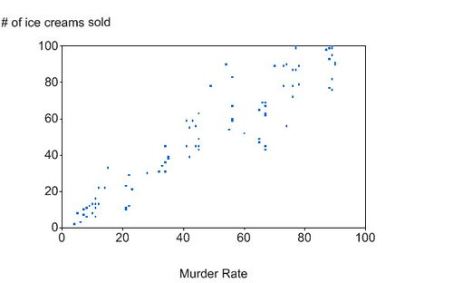

```{r}
#| echo: false


library(knitr)
library(formatR)
library(readxl)
library(tidyverse)
opts_chunk$set(out.width = '100%', options(width=60))

opts_knit$set(global.par = TRUE)
opts_chunk$set(echo=FALSE, warning = FALSE, message = FALSE, comment = '', class.output='sh',
               fig.width=8, fig.height=5, fig.align = "center")

my_red <- "#E41A1C"
my_blue <- "#377EB8"
my_green <- "#4DAF4A"
my_purple <- "#984EA3"
my_orange <- "#FF7F00"
my_yellow <- "#FFFF33"
my_red2 <- "#FBB4AE" 
my_blue2 <- "#B3CDE3" 
my_green2 <- "#CCEBC5" 
my_purple2 <- "#DECBE4"
my_orange2 <- "#FED9A6"
my_yellow2 <- "#FFFFCC"

```


## Jargon Refresher

**Linear Model:**

$${\color{blue}y_i} = \beta_0 + \sum_{p=1}^P \beta_p {\color{red}x_{ip}} + \epsilon_i$$

::::: {.columns .v-center-container}
::: {.column width="50%"}

[**Left side variable terms**]{style="color: blue;"}


- $y$
- Dependent variable (DV)
- Outcome variable
- Response variable

:::

::: {.column width="50%"}
[**Right side variable terms**]{style="color: red;"}

- $x$
- Independent variable(s) (IVs)
- Predictor variable(s)

:::
:::::

## Tests We Will Cover {.scrollable}


::: {style="font-size: 0.8em;"}

| IV(s) | DV | IV Status | Model Structure |
| :--- | :--- | :--- | :--- |
| — | One categorical | — | $\chi^2$ Goodness of Fit |
| One Categorical | One categorical | — | $\chi^2$ Test of Independence |
| — | One Continuous | — | One Sample $t$-Test |
| One Binary | One Continuous | Dependent Groups | Paired Sample $t$-Test |
| One Binary | One Continuous | Independent Groups | Independent Sample $t$-Test |
| One Categorical | One Continuous | Independent Groups | One-Way ANOVA |
| More than One Categorical | One Continuous | Independent Groups | Factorial ANOVA |
| One Categorical | One Continuous | Dependent Groups | One-Way Repeated Measures ANOVA |
| More than One Categorical | One Continuous | Dependent Groups | Factorial Repeated Measures ANOVA |
| More than One Categorical | One Continuous | Mixed Groups | Mixed ANOVA |
| One Continuous | One Continuous | — | Correlation or Simple Regression |
| **More than One Continuous** | **One Continuous** | — | **Multiple Regression** |

::: 


## More than two variables

Many research studies aim to establish a relationship between **multiple** continuous variables. 

Often, there is one criterion (response) variable, and several predictor variables.

One common conceptual example is that we may want to understand the effect of a particular predictor of interest, but also "control" or "account" for the effects of third variables 

We can do this using **multiple linear regression**

BUT...

- What does it mean to "take into account" a third variable?
  
- How does this affect our interpretations? 

- What are the limitations of this approach?

## Multiple Regression

::: {style="font-size: 0.85em;"}

**Multiple linear regression** is a popular method that allows us to estimate the relationship between a **single** response variable and **multiple** predictors

Multiple linear regression equations:

\vspace{-10pt}

$$\hat{y} = \beta_0 + \beta_1x_1 +\cdots + \beta_px_p \ \ \text{(population prediction)}\\
  y  = b_0 + \beta_1x_1 + \cdots + \beta_px_p + \epsilon \ \ \text{(population points)}\\
  \hat{y} = b_0 + b_1x_1 + \cdots + b_px_p \ \  \text{(sample prediction)} \\
  y  = b_0 + b_1x_1 + \cdots + b_px_p + e \ \  \text{(sample points)}$$

::: columns

:::: column

- $p$ is the number of **predictors** (continuous IVs)

- $x_1, \ldots, x_p$ are predictor variables

- $\beta_0, \ldots, \beta_p$ are population regression coefficients


::::

:::: column
  
- $y$: observed criterion value (continuous)

- $\hat{y}$: predicted criterion value

- $\epsilon = y - \hat{y}$: model residuals


- $b_0, \ldots b_p$ are estimated regression coefficients

::::

:::
:::


## Example

Psychiatric patients hospitalized for depression were measured on the following variables:

- **simplicity (s)**: higher scores = higher need to see the world in black-and-white

- **fatalism (f)**: higher scores = greater belief that events are inevitable and we are powerless to change the future
  
- **depression (d)**: Beck's self-report scale, higher scores = greater depression

All variables scaled to have mean 1 and standard deviation .5

Do **simplicity** and **fatalism** scores predict depression? What do you think? 


## Using What We Know


We learned that the normal equations in single variable regression were

$$\hat{b}_1 = \frac{s_{xy}}{s^2_{x}}$$

$$\hat{b}_0 = \bar{y} - \hat{b}_1 \bar{x}$$

In these data 

::: columns

:::: column

- $s_{s, d} = 0.161$ 

- $s_{f, d} = 0.164$ 

- $s^2_s = 0.250$

::::

:::: column
  
- $s^2_f = 0.250$

- $\bar{d} = \bar{s} = \bar{f} = 1.00$

::::

:::


## Plugging In


::: {style="font-size: 0.825em;"}

So we could try something like


::: columns

:::: column

$$\hat{b}_1 = \frac{s_{s, d}}{s^2_{d}} = \frac{0.161}{0.250}= 0.644$$

::::

:::: column
  
$$\hat{b}_2 = \frac{s_{f, d}}{s^2_{d}} = \frac{0.164}{0.250}= 0.656$$
::::

:::


$$\hat{b}_0 = \bar{y} - \hat{b}_1 \bar{s} - \hat{b}_2 \bar{f} = 1 - (0.644)(1) - (0.656)(1) = -0.3$$

Giving us


$$d = -0.3 + 0.644s + 0.656f + e$$

Why might we **NOT** like this approach?

- [What piece of information do we know from these data that we are not making use of here?]{.answer .fragment .content-visible unless-meta="params.v0"}

- [Do you think there is no correlation between **simplicity** and **fatalism**?]{.answer .fragment .content-visible unless-meta="params.v0"}


::: 


## More than two variables

Whenever we deal with more than two variables, we need to consider **all** possible inter-relationships. 

We can look at the **bivariate** associations between all variables by looking at the covariance or correlation **matrix**. We can also visualize **bivariate** relationships with a pairs plot, aka a **scatterplot matrix**

- **bivariate** - as pertaining to a given pair of variables (ignoring the others)
- **matrix** - an array of rows and columns (sort of a fancy word for a table, but with some special implications)

## Scatterplot Matrix

```{r}
data(Ginzberg, package = "carData") # load data

dat <- Ginzberg %>% dplyr::select(1:3)
```


```{r}
#| warning: false
#| message: false

library(GGally)
ggpairs(dat)
```


## Correlation Matrix


```{r}
#| echo: true

round(cor(dat), 3) # rounding to 3 digits

```


What do you notice?


- [There are strong relationships between both predictors and the response, $r_{s,d} = .643$ and $r_{f, d} =  .667$]{.answer .fragment .content-visible unless-meta="params.v0"}
- [However, there is **also** a strong correlation between both predictors, $r_{s, f} = 0.631$]{.answer .fragment .content-visible unless-meta="params.v0"}
- [The strong relationship between $s$ and $f$ means some of what we see in $r_{s,d}$ might also be shared by what we're seeing in $r_{f, d}$, and vice versa.]{.answer .fragment .content-visible unless-meta="params.v0"}

## Multiple Correlations

```{r}
#| echo: false
#| message: false
#| warning: false
#| fig-align: center


library(ggtext)

# Helper function to generate circle polygon coordinates
get_circle <- function(x0, y0, r, group_name, npoints = 200) {
  tt <- seq(0, 2 * pi, length.out = npoints)
  data.frame(
    x = x0 + r * cos(tt),
    y = y0 + r * sin(tt),
    group = group_name
  )
}

df_circles <- rbind(
  get_circle(0, 0, 1.5, "y"),
  get_circle(-1, -1.5, 1.5, "x1"),
  get_circle(1, -1.5, 1.5, "x2")
)

# Regular grid for fast native rasterization of all distinct intersecting regions
gx <- seq(-2.7, 2.7, length.out = 120)
gy <- seq(-3.2, 1.7, length.out = 120)
grid_df <- expand.grid(x = gx, y = gy)

in_y  <- (grid_df$x - 0)^2    + (grid_df$y - 0)^2    <= 1.5^2
in_x1 <- (grid_df$x - (-1))^2 + (grid_df$y - (-1.5))^2 <= 1.5^2
in_x2 <- (grid_df$x - 1)^2    + (grid_df$y - (-1.5))^2 <= 1.5^2
in_any <- in_y | in_x1 | in_x2

# Full matching color palette
grid_df$color <- ifelse(!in_any, NA,
                 ifelse(in_y & in_x1 & in_x2, "#777777", # all 3 overlap
                 ifelse(in_y & in_x1,        "#984EA3", # y & x1 (purple)
                 ifelse(in_y & in_x2,        "#4DAF4A", # y & x2 (green)
                 ifelse(in_x1 & in_x2,       "#FF7F00", # x1 & x2 (orange)
                 ifelse(in_y,                "#377EB8", # y only (blue)
                 ifelse(in_x1,               "#E41A1C", "#E6AB02"))))))) # x1 (red), x2 (yellow)

labels <- data.frame(
  x = c(0, -1.6, 1.6),
  y = c(0.4, -1.8, -1.8),
  label = c("y", "x<sub>1</sub>", "x<sub>2</sub>")
)

annotations <- data.frame(
  x = c(0, -2.8, 2.8, 0),
  y = c(2.2, 0.4, 0.4, -3.2),
  xend = c(0, -0.7, 0.7, 0),
  yend = c(0.8, -0.4, -0.4, -1.0),
  label = c(
    "Variance of y not<br>predicted by x<sub>1</sub> or x<sub>2</sub>",
    "Variance of y uniquely<br>predicted by x<sub>1</sub>",
    "Variance of y uniquely<br>predicted by x<sub>2</sub>",
    "Variance of y predicted<br>by both x<sub>1</sub> and x<sub>2</sub>"
  )
)

ggplot() +
  # 1. Shaded Venn sections matching full lecture color palette
  geom_raster(data = grid_df, aes(x = x, y = y, fill = color), alpha = 0.85) +
  scale_fill_identity(na.value = "transparent") +
  
  # 2. Circle outlines
  geom_polygon(data = df_circles, aes(x = x, y = y, group = group), 
               fill = NA, color = "black", linewidth = 0.8) +
               
  # 3. Inside circle labels
  geom_richtext(data = labels, aes(x = x, y = y, label = label), 
                size = 6, fontface = "bold", fill = NA, label.color = NA) +
                
  # 4. Arrows & Callout text boxes
  geom_segment(data = annotations, aes(x = x, y = y, xend = xend, yend = yend),
               arrow = arrow(length = unit(0.25, "cm")), linewidth = 0.7, color = "grey20") +
  geom_richtext(data = annotations, aes(x = x, y = y, label = label), 
                size = 3.5, fill = "white", label.color = "grey60", label.size = 0.3) +
                
  coord_fixed(xlim = c(-4.8, 4.8), ylim = c(-3.7, 2.7), clip = "off") +
  theme_void() +
  theme(legend.position = "none",
        plot.margin = margin(10, 10, 10, 10))
```

## Correlations in Regression

Summary of the Venn diagram:

- Each predictor may add some unique ability to predict the outcome
- Predictors often share some ability to predict the outcome

Implications:

- $R$-square ($R^2$) is the proportion of variance of the outcome accounted for by the predictors
- In the Venn diagram, $R^2$ is the proportion of the $y$ circle that overlaps with any other circle

- In multiple regression, $R^2$ usually doesn't equal the sum of the proportion of variance accounted for by each predictor, because they also overlap with each other


## $R^2$

- In the Venn diagram, $R^2$ is the proportion of the $y$ circle that overlaps with any other circle

```{r}
#| echo: false
#| message: false
#| warning: false
#| fig-align: center
# Helper function to generate circle polygon points
get_circle <- function(x0, y0, r, group_name, npoints = 200) {
  tt <- seq(0, 2 * pi, length.out = npoints)
  data.frame(
    x = x0 + r * cos(tt),
    y = y0 + r * sin(tt),
    group = group_name
  )
}

df_circles <- rbind(
  get_circle(0, 0, 1.5, "y"),
  get_circle(-1, -1.5, 1.5, "x1"),
  get_circle(1, -1.5, 1.5, "x2")
)

# Dense grid over y circle to isolate and fill only the R^2 overlap regions
grid_pts <- expand.grid(
  x = seq(-1.5, 1.5, length.out = 300),
  y = seq(-1.5, 1.5, length.out = 300)
)

in_y  <- (grid_pts$x - 0)^2 + (grid_pts$y - 0)^2 <= 1.5^2
in_x1 <- (grid_pts$x - (-1))^2 + (grid_pts$y - (-1.5))^2 <= 1.5^2
in_x2 <- (grid_pts$x - 1)^2 + (grid_pts$y - (-1.5))^2 <= 1.5^2

# Assign regions to grid_pts first, then filter down
grid_pts$region <- ifelse(in_x1 & in_x2, "all3",
                   ifelse(in_x1, "y_x1", "y_x2"))

r2_grid <- grid_pts[in_y & (in_x1 | in_x2), ]

labels <- data.frame(
  x = c(0, -1.6, 1.6),
  y = c(0.4, -1.8, -1.8),
  label = c("y", "x<sub>1</sub>", "x<sub>2</sub>")
)

ggplot() +
  # Faint background context for outer circles
  geom_polygon(data = df_circles, aes(x = x, y = y, group = group), 
               fill = "grey95", alpha = 0.5, color = NA) +
  # Highlighted R^2 overlap region
  geom_raster(data = r2_grid, aes(x = x, y = y, fill = region), alpha = 0.85) +
  # Black circle outlines
  geom_polygon(data = df_circles, aes(x = x, y = y, group = group), 
               fill = NA, color = "black", linewidth = 0.8) +
  # Labels
  geom_richtext(data = labels, aes(x = x, y = y, label = label), 
                size = 5.5, fontface = "bold", fill = NA, label.color = NA) +
  scale_fill_manual(values = c("y_x1" = "#984EA3", "y_x2" = "#4DAF4A", "all3" = "grey50")) +
  coord_fixed() +
  theme_void() +
  theme(legend.position = "none")
```

## Bivariate Pearson Correlation

The ordinary Pearson correlation, $r_{y, x_1}$, ignores the existence of $x_2$:

::: columns
:::: column

$r_{y, x_1} = \frac{s_{y, x_1}}{\sqrt{s_{y}^2} \sqrt{s_{x_1}^2}}$

::::
:::: column
- $s_{y, x_1}$: sample covariance of $y$ and $x_1$
- $s_{y}^2$: sample variance of $y$
- $s_{x_1}^2$: sample variance of $x_1$
::::
:::


## Bivariate Visual


```{r}
#| echo: false
#| message: false
#| warning: false
#| fig-align: center
#| fig-width: 10
#| fig-height: 5.5


# Helper function generating uniform local grids for fast native rasterization
create_venn_data <- function(x0, y0, r = 0.8, type = "full", n_grid = 60, n_circle = 120) {
  cy  <- c(x0, y0)
  cx1 <- c(x0 - (2/3) * r, y0 - r)
  cx2 <- c(x0 + (2/3) * r, y0 - r)
  
  tt <- seq(0, 2 * pi, length.out = n_circle)
  circles <- rbind(
    data.frame(x = cy[1] + r * cos(tt),  y = cy[2] + r * sin(tt),  group = "y",  venn = type),
    data.frame(x = cx1[1] + r * cos(tt), y = cx1[2] + r * sin(tt), group = "x1", venn = type),
    data.frame(x = cx2[1] + r * cos(tt), y = cx2[2] + r * sin(tt), group = "x2", venn = type)
  )
  
  gx <- seq(x0 - 1.8 * r, x0 + 1.8 * r, length.out = n_grid)
  gy <- seq(y0 - 2.2 * r, y0 + 1.2 * r, length.out = n_grid)
  grid_df <- expand.grid(x = gx, y = gy)
  
  in_y  <- (grid_df$x - cy[1])^2  + (grid_df$y - cy[2])^2  <= r^2
  in_x1 <- (grid_df$x - cx1[1])^2 + (grid_df$y - cx1[2])^2 <= r^2
  in_x2 <- (grid_df$x - cx2[1])^2 + (grid_df$y - cx2[2])^2 <= r^2
  in_any <- in_y | in_x1 | in_x2
  
  if (type == "full") {
    grid_df$color <- ifelse(!in_any, NA,
                     ifelse(in_y & in_x1 & in_x2, "#777777",
                     ifelse(in_y & in_x1,        "#984EA3",
                     ifelse(in_y & in_x2,        "#4DAF4A",
                     ifelse(in_x1 & in_x2,       "#FF7F00",
                     ifelse(in_y,                "#377EB8",
                     ifelse(in_x1,               "#E41A1C", "#E6AB02")))))))
  } else if (type == "numerator") {
    grid_df$color <- ifelse(!in_any, NA,
                     ifelse(in_y & in_x1 & in_x2, "#777777",
                     ifelse(in_y & in_x1,        "#984EA3", "#EAEAEA")))
  } else if (type == "denom_y") {
    grid_df$color <- ifelse(!in_any, NA,
                     ifelse(in_y & in_x1 & in_x2, "#777777",
                     ifelse(in_y & in_x1,        "#984EA3",
                     ifelse(in_y & in_x2,        "#4DAF4A",
                     ifelse(in_y,                "#377EB8", "#EAEAEA")))))
  } else if (type == "denom_x1") {
    grid_df$color <- ifelse(!in_any, NA,
                     ifelse(in_y & in_x1 & in_x2, "#777777",
                     ifelse(in_y & in_x1,        "#984EA3",
                     ifelse(in_x1 & in_x2,       "#FF7F00",
                     ifelse(in_x1,               "#E41A1C", "#EAEAEA")))))
  }
  
  labels_df <- data.frame(
    x = c(cy[1], cx1[1] - 0.25 * r, cx2[1] + 0.25 * r),
    y = c(cy[2] + 0.2 * r, cx1[2] - 0.15 * r, cx2[2] - 0.15 * r),
    label = c("y", "x<sub>1</sub>", "x<sub>2</sub>"),
    venn = type
  )
  
  list(circles = circles, grid = grid_df, labels = labels_df)
}

# Generate datasets for all 4 diagrams
v_full  <- create_venn_data(2.0, 1.0, r = 1.1, type = "full")
v_num   <- create_venn_data(9.5, 3.2, r = 0.85, type = "numerator")
v_den_y <- create_venn_data(8.0, -1.2, r = 0.8, type = "denom_y")
v_den_x <- create_venn_data(13.0, -1.2, r = 0.8, type = "denom_x1")

all_circles <- rbind(v_full$circles, v_num$circles, v_den_y$circles, v_den_x$circles)
all_labels  <- rbind(v_full$labels, v_num$labels, v_den_y$labels, v_den_x$labels)

# Square root radical paths
sqrt1 <- data.frame(x = c(6.5, 6.7, 7.0, 9.4), y = c(-1.8, -2.1, -0.1, -0.1))
sqrt2 <- data.frame(x = c(11.5, 11.7, 12.0, 14.4), y = c(-1.8, -2.1, -0.1, -0.1))

ggplot() +
  # 1. Individual geom_raster calls trigger fast native rendering
  geom_raster(data = v_full$grid,  aes(x = x, y = y, fill = color), alpha = 0.9) +
  geom_raster(data = v_num$grid,   aes(x = x, y = y, fill = color), alpha = 0.9) +
  geom_raster(data = v_den_y$grid, aes(x = x, y = y, fill = color), alpha = 0.9) +
  geom_raster(data = v_den_x$grid, aes(x = x, y = y, fill = color), alpha = 0.9) +
  scale_fill_identity(na.value = "transparent") +
  
  # 2. Circle outlines
  geom_polygon(data = all_circles, aes(x = x, y = y, group = interaction(group, venn)), 
               fill = NA, color = "black", linewidth = 0.6) +
  
  # 3. Text labels inside circles
  geom_richtext(data = all_labels, aes(x = x, y = y, label = label), 
                size = 4.2, fontface = "bold", fill = NA, label.color = NA) +
  
  # 4. Math symbols
  annotate("richtext", x = 4.6, y = 1.0, label = "<span style='font-size:22pt;'><i>r</i><sub><i>y, x</i><sub>1</sub></sub> = </span>", 
           fill = NA, label.color = NA) +
  annotate("segment", x = 5.8, xend = 15.2, y = 1.0, yend = 1.0, linewidth = 1.2, color = "black") +
  geom_path(data = sqrt1, aes(x = x, y = y), linewidth = 1.0, color = "black") +
  geom_path(data = sqrt2, aes(x = x, y = y), linewidth = 1.0, color = "black") +
  
  # Canvas settings
  coord_fixed(xlim = c(0, 15.8), ylim = c(-2.8, 5.2), clip = "off") +
  theme_void() +
  theme(plot.margin = margin(10, 10, 10, 10))
```


## Partial Correlation

The **partial correlation** gives the extent to which the part of $x_1$ that is independent of $x_2$ correlates with the part of $y$ that is independent of $x_2$:


Squared partial correlation:

- extent to which $x_1$ predicts the proportion of variance in $y$ that is not predicted by $x_2$

## Partial Correlation

::: {style="font-size: 0.825em;"}

"Partialing out": another way to say "controlling for" or "adjusting for"

For the partial correlation of $y$ with $x_1$, controlling for $x_2$, fit two models:

$$\text{Model 1: }  y = b_0 + b_1x_2 \\
  \text{Model 2: }  x_1 = b_0 + b_1x_2$$

Partial correlation: 

$$r_{y, x_1 . x_2} = \text{cor}(\hat{e}_{y \cdot x_2}, \hat{e}_{x_1 \cdot x_2}) = \text{cor}(\overbrace{y - \hat{y}}^{\text{Model 1 residuals}}, \overbrace{x_1 - \hat{x}_1}^{\text{Model 2 residuals}})$$

- Equals the correlation between two sets of residuals:
  - **Residuals of Model 1**: the portion of $y$ independent of $x_2$
  - **Residuals of Model 2**: the portion of $x_1$ independent of $x_2$

::: 


## Partial Correlation

Other formulations of the partial correlation:

$$r_{y, x_1 . x_2} = \frac{r_{y, x_1} - r_{y, x_2}r_{x_1, x_2}}{\sqrt{1 - r^2_{y, x_2}}\sqrt{1 - r^2_{x_1, x_ 2}}}$$

$$r^2_{y, x_1 . x_2} = \frac{(R^2 \text{ of } y \text{ predicted by both } x_1 \text{ and } x_2) - (R^2 \text{ of } y \text{ predicted by } x_2)}{1 - R^2 \text{ of } y \text{ predicted by } x_2}$$

## Partial Visual


```{r}
#| echo: false
#| message: false
#| warning: false
#| fig-align: center


# Helper function generating uniform local grids for fast native rasterization
create_venn_data <- function(x0, y0, r = 0.8, type = "full", n_grid = 60, n_circle = 120) {
  cy  <- c(x0, y0)
  cx1 <- c(x0 - (2/3) * r, y0 - r)
  cx2 <- c(x0 + (2/3) * r, y0 - r)
  
  tt <- seq(0, 2 * pi, length.out = n_circle)
  circles <- rbind(
    data.frame(x = cy[1] + r * cos(tt),  y = cy[2] + r * sin(tt),  group = "y",  venn = type),
    data.frame(x = cx1[1] + r * cos(tt), y = cx1[2] + r * sin(tt), group = "x1", venn = type),
    data.frame(x = cx2[1] + r * cos(tt), y = cx2[2] + r * sin(tt), group = "x2", venn = type)
  )
  
  gx <- seq(x0 - 1.8 * r, x0 + 1.8 * r, length.out = n_grid)
  gy <- seq(y0 - 2.2 * r, y0 + 1.2 * r, length.out = n_grid)
  grid_df <- expand.grid(x = gx, y = gy)
  
  in_y  <- (grid_df$x - cy[1])^2  + (grid_df$y - cy[2])^2  <= r^2
  in_x1 <- (grid_df$x - cx1[1])^2 + (grid_df$y - cx1[2])^2 <= r^2
  in_x2 <- (grid_df$x - cx2[1])^2 + (grid_df$y - cx2[2])^2 <= r^2
  in_any <- in_y | in_x1 | in_x2
  
  if (type == "full") {
    grid_df$color <- ifelse(!in_any, NA,
                     ifelse(in_y & in_x1 & in_x2, "#777777",
                     ifelse(in_y & in_x1,        "#984EA3",
                     ifelse(in_y & in_x2,        "#4DAF4A",
                     ifelse(in_x1 & in_x2,       "#FF7F00",
                     ifelse(in_y,                "#377EB8",
                     ifelse(in_x1,               "#E41A1C", "#E6AB02")))))))
  } else if (type == "numerator") {
    # Unique variance of y predicted by x1 (y & x1 excluding x2)
    grid_df$color <- ifelse(!in_any, NA,
                     ifelse(in_y & in_x1 & !in_x2, "#984EA3", "#EAEAEA"))
  } else if (type == "denom_y") {
    # Variance of y independent of x2 (y excluding x2)
    grid_df$color <- ifelse(!in_any, NA,
                     ifelse(in_y & in_x1 & !in_x2, "#984EA3",
                     ifelse(in_y & !in_x2,        "#377EB8", "#EAEAEA")))
  } else if (type == "denom_x1") {
    # Variance of x1 independent of x2 (x1 excluding x2)
    grid_df$color <- ifelse(!in_any, NA,
                     ifelse(in_y & in_x1 & !in_x2, "#984EA3",
                     ifelse(in_x1 & !in_x2,       "#E41A1C", "#EAEAEA")))
  }
  
  labels_df <- data.frame(
    x = c(cy[1], cx1[1] - 0.25 * r, cx2[1] + 0.25 * r),
    y = c(cy[2] + 0.2 * r, cx1[2] - 0.15 * r, cx2[2] - 0.15 * r),
    label = c("y", "x<sub>1</sub>", "x<sub>2</sub>"),
    venn = type
  )
  
  list(circles = circles, grid = grid_df, labels = labels_df)
}

# Generate datasets for all 4 diagrams
v_full  <- create_venn_data(2.0, 1.0, r = 1.1, type = "full")
v_num   <- create_venn_data(9.5, 3.2, r = 0.85, type = "numerator")
v_den_y <- create_venn_data(8.0, -1.2, r = 0.8, type = "denom_y")
v_den_x <- create_venn_data(13.0, -1.2, r = 0.8, type = "denom_x1")

all_circles <- rbind(v_full$circles, v_num$circles, v_den_y$circles, v_den_x$circles)
all_labels  <- rbind(v_full$labels, v_num$labels, v_den_y$labels, v_den_x$labels)

# Square root radical paths
sqrt1 <- data.frame(x = c(6.5, 6.7, 7.0, 9.4), y = c(-1.8, -2.1, -0.1, -0.1))
sqrt2 <- data.frame(x = c(11.5, 11.7, 12.0, 14.4), y = c(-1.8, -2.1, -0.1, -0.1))

ggplot() +
  # 1. Fast native rasterization for each diagram
  geom_raster(data = v_full$grid,  aes(x = x, y = y, fill = color), alpha = 0.9) +
  geom_raster(data = v_num$grid,   aes(x = x, y = y, fill = color), alpha = 0.9) +
  geom_raster(data = v_den_y$grid, aes(x = x, y = y, fill = color), alpha = 0.9) +
  geom_raster(data = v_den_x$grid, aes(x = x, y = y, fill = color), alpha = 0.9) +
  scale_fill_identity(na.value = "transparent") +
  
  # 2. Circle outlines
  geom_polygon(data = all_circles, aes(x = x, y = y, group = interaction(group, venn)), 
               fill = NA, color = "black", linewidth = 0.6) +
  
  # 3. Text labels inside circles
  geom_richtext(data = all_labels, aes(x = x, y = y, label = label), 
                size = 4.2, fontface = "bold", fill = NA, label.color = NA) +
  
  # 4. Math formula text: "r_y,x1.x2 ="
  annotate("richtext", x = 4.6, y = 1.0, label = "<span style='font-size:20pt;'><i>r</i><sub><i>y, x</i><sub>1</sub> . <i>x</i><sub>2</sub></sub> = </span>", 
           fill = NA, label.color = NA) +
  annotate("segment", x = 5.8, xend = 15.2, y = 1.0, yend = 1.0, linewidth = 1.2, color = "black") +
  
  # 5. Numerator Callout Annotation
  annotate("segment", x = 12.3, y = 4.3, xend = 9.0, yend = 3.2, 
           linewidth = 0.7, color = "grey20", arrow = arrow(length = unit(0.25, "cm"))) +
  annotate("richtext", x = 13.8, y = 4.4, label = "variance of <i>y</i> uniquely<br>predicted by <i>x</i><sub>1</sub>", 
           size = 4, fill = NA, label.color = NA) +
  
  # 6. Denominator Left Annotation
  annotate("segment", x = 9.0, y = -2.8, xend = 8.0, yend = -1.7, 
           linewidth = 0.7, color = "grey20", arrow = arrow(length = unit(0.25, "cm"))) +
  annotate("richtext", x = 9.0, y = -3.2, label = "variance of <i>y</i><br>ind. of <i>x</i><sub>2</sub>", 
           size = 4, fill = NA, label.color = NA) +
  
  # 7. Denominator Right Annotation
  annotate("richtext", x = 14.8, y = -1.2, label = "variance of <i>x</i><sub>1</sub><br>ind. of <i>x</i><sub>2</sub>", 
           size = 4, fill = NA, label.color = NA) +
  
  # 8. Square root radical symbols
  geom_path(data = sqrt1, aes(x = x, y = y), linewidth = 1.0, color = "black") +
  geom_path(data = sqrt2, aes(x = x, y = y), linewidth = 1.0, color = "black") +
  
  # Canvas settings
  coord_fixed(xlim = c(0, 16.5), ylim = c(-3.8, 5.2), clip = "off") +
  theme_void() +
  theme(plot.margin = margin(10, 10, 10, 10))
```

## Partial Correlations in R

::: {style="font-size: 0.825em;"}

the `ppcor` package can give us a **partial correlation matrix**

Partial correlations of simplicity, fatalism, and depression

```{r}
#| echo: true
#| message: false
#| warning: false

library(ppcor)
round(pcor(dat)$estimate, 3)
```

**Interpretation:** relationship between simplicity controlling for fatalism and depression controlling for fatalism is $r_{d, s . f} = 0.391$ 

For the partial correlation, fatalism is **partialed out** of **both** simplicity **and** depression.


Squared partial correlation:

- Extent to which $x_1$ predicts the proportion of variance in $y$ that is not predicted by $x_2$
- Proportion of the residual variation of $y$ not accounted for by $x_2$, but accounted for by $x_1$

:::


## Semi-Partial Correlation


::: {style="font-size: 0.825em;"}

The **semi-partial correlation** gives the extent to which the part of $x_1$ that is independent of $x_2$ correlates with $y$:


Squared semi-partial correlation:

- proportion of variance in $y$ that is uniquely predicted by $x_1$, beyond $x_2$


For the semi-partial correlation of $y$ with $x_1$, controlling for $x_2$, fit two models:

$$\text{Model 1: } y = b_0 + b_1x_1 + b_2x_2 \\
  \text{Model 2: } y = b_0 + b_1x_2$$

The semi-partial correlation is the root difference in $R^2$ from the two models

- Sometimes also called the "part correlation" (annoying, I know)

::: 

## Formulations

Semi-partial correlation: 

$$r_{y(x_1. x_2)} = \pm\sqrt{R^2_{\text{Model 1}} - R^2_{\text{Model 2}}}$$


Other formulation for the semi-partial correlation:

$$r_{y(x_1. x_2)} = \frac{r_{y, x_1} - r_{y, x_2}r_{x_1, x_2}}{\sqrt{1 - r^2_{x_1, x_2}}}$$

- This equation gives the correct sign of the semi-partial correlation

## Semi-Partial Correlations in R

```{r}
#| echo: true

round(spcor(dat)$estimate, 3)
```

**Notice:** this correlation matrix is **not** symmetrical. The **row** variable can be thought of as a the predictor ($x$) and **column** variable as the response/criterion ($y$)

**Interpretation:** relationship between simplicity controlling for fatalism and depression is $r_{d, (s . f)} = 0.303$ 

For the semi-partial correlation, fatalism is **partialed out** of **only** simplicity **but not** depression.

## Semi Visual

```{r}
#| echo: false
#| message: false
#| warning: false
#| fig-align: center

# Helper function generating uniform local grids for fast native rasterization
create_venn_data <- function(x0, y0, r = 0.8, type = "full", n_grid = 60, n_circle = 120) {
  cy  <- c(x0, y0)
  cx1 <- c(x0 - (2/3) * r, y0 - r)
  cx2 <- c(x0 + (2/3) * r, y0 - r)
  
  tt <- seq(0, 2 * pi, length.out = n_circle)
  circles <- rbind(
    data.frame(x = cy[1] + r * cos(tt),  y = cy[2] + r * sin(tt),  group = "y",  venn = type),
    data.frame(x = cx1[1] + r * cos(tt), y = cx1[2] + r * sin(tt), group = "x1", venn = type),
    data.frame(x = cx2[1] + r * cos(tt), y = cx2[2] + r * sin(tt), group = "x2", venn = type)
  )
  
  gx <- seq(x0 - 1.8 * r, x0 + 1.8 * r, length.out = n_grid)
  gy <- seq(y0 - 2.2 * r, y0 + 1.2 * r, length.out = n_grid)
  grid_df <- expand.grid(x = gx, y = gy)
  
  in_y  <- (grid_df$x - cy[1])^2  + (grid_df$y - cy[2])^2  <= r^2
  in_x1 <- (grid_df$x - cx1[1])^2 + (grid_df$y - cx1[2])^2 <= r^2
  in_x2 <- (grid_df$x - cx2[1])^2 + (grid_df$y - cx2[2])^2 <= r^2
  in_any <- in_y | in_x1 | in_x2
  
  if (type == "full") {
    grid_df$color <- ifelse(!in_any, NA,
                     ifelse(in_y & in_x1 & in_x2, "#777777",
                     ifelse(in_y & in_x1,        "#984EA3",
                     ifelse(in_y & in_x2,        "#4DAF4A",
                     ifelse(in_x1 & in_x2,       "#FF7F00",
                     ifelse(in_y,                "#377EB8",
                     ifelse(in_x1,               "#E41A1C", "#E6AB02")))))))
  } else if (type == "numerator") {
    # Unique variance of y predicted by x1 (y & x1 excluding x2)
    grid_df$color <- ifelse(!in_any, NA,
                     ifelse(in_y & in_x1 & !in_x2, "#984EA3", "#EAEAEA"))
  } else if (type == "denom_y") {
    # Total variance of y (entire y circle)
    grid_df$color <- ifelse(!in_any, NA,
                     ifelse(in_y & in_x1 & in_x2, "#777777",
                     ifelse(in_y & in_x1,        "#984EA3",
                     ifelse(in_y & in_x2,        "#4DAF4A",
                     ifelse(in_y,                "#377EB8", "#EAEAEA")))))
  } else if (type == "denom_x1") {
    # Variance of x1 independent of x2 (x1 excluding x2)
    grid_df$color <- ifelse(!in_any, NA,
                     ifelse(in_y & in_x1 & !in_x2, "#984EA3",
                     ifelse(in_x1 & !in_x2,       "#E41A1C", "#EAEAEA")))
  }
  
  labels_df <- data.frame(
    x = c(cy[1], cx1[1] - 0.25 * r, cx2[1] + 0.25 * r),
    y = c(cy[2] + 0.2 * r, cx1[2] - 0.15 * r, cx2[2] - 0.15 * r),
    label = c("y", "x<sub>1</sub>", "x<sub>2</sub>"),
    venn = type
  )
  
  list(circles = circles, grid = grid_df, labels = labels_df)
}

# Generate datasets for all 4 diagrams
v_full  <- create_venn_data(2.0, 1.0, r = 1.1, type = "full")
v_num   <- create_venn_data(9.5, 3.2, r = 0.85, type = "numerator")
v_den_y <- create_venn_data(8.0, -1.2, r = 0.8, type = "denom_y")
v_den_x <- create_venn_data(13.0, -1.2, r = 0.8, type = "denom_x1")

all_circles <- rbind(v_full$circles, v_num$circles, v_den_y$circles, v_den_x$circles)
all_labels  <- rbind(v_full$labels, v_num$labels, v_den_y$labels, v_den_x$labels)

# Square root radical paths
sqrt1 <- data.frame(x = c(6.5, 6.7, 7.0, 9.4), y = c(-1.8, -2.1, -0.1, -0.1))
sqrt2 <- data.frame(x = c(11.5, 11.7, 12.0, 14.4), y = c(-1.8, -2.1, -0.1, -0.1))

ggplot() +
  # 1. Fast native rasterization for each diagram
  geom_raster(data = v_full$grid,  aes(x = x, y = y, fill = color), alpha = 0.9) +
  geom_raster(data = v_num$grid,   aes(x = x, y = y, fill = color), alpha = 0.9) +
  geom_raster(data = v_den_y$grid, aes(x = x, y = y, fill = color), alpha = 0.9) +
  geom_raster(data = v_den_x$grid, aes(x = x, y = y, fill = color), alpha = 0.9) +
  scale_fill_identity(na.value = "transparent") +
  
  # 2. Circle outlines
  geom_polygon(data = all_circles, aes(x = x, y = y, group = interaction(group, venn)), 
               fill = NA, color = "black", linewidth = 0.6) +
  
  # 3. Text labels inside circles
  geom_richtext(data = all_labels, aes(x = x, y = y, label = label), 
                size = 4.2, fontface = "bold", fill = NA, label.color = NA) +
  
  # 4. Math formula text: "r_{y, (x1.x2)} ="
  annotate("richtext", x = 4.6, y = 1.0, label = "<span style='font-size:20pt;'><i>r</i><sub><i>y, </i>(<i>x</i><sub>1</sub> . <i>x</i><sub>2</sub>)</sub> = </span>", 
           fill = NA, label.color = NA) +
  annotate("segment", x = 5.8, xend = 15.2, y = 1.0, yend = 1.0, linewidth = 1.2, color = "black") +
  
  # 5. Numerator Callout Annotation
  annotate("segment", x = 12.3, y = 4.3, xend = 9.0, yend = 3.2, 
           linewidth = 0.7, color = "grey20", arrow = arrow(length = unit(0.25, "cm"))) +
  annotate("richtext", x = 13.8, y = 4.4, label = "variance of <i>y</i> uniquely<br>predicted by <i>x</i><sub>1</sub>", 
           size = 4, fill = NA, label.color = NA) +
  
  # 6. Denominator Right Annotation
  annotate("richtext", x = 14.8, y = -1.2, label = "variance of <i>x</i><sub>1</sub><br>ind. of <i>x</i><sub>2</sub>", 
           size = 4, fill = NA, label.color = NA) +
  
  # 7. Square root radical symbols
  geom_path(data = sqrt1, aes(x = x, y = y), linewidth = 1.0, color = "black") +
  geom_path(data = sqrt2, aes(x = x, y = y), linewidth = 1.0, color = "black") +
  
  # Canvas settings
  coord_fixed(xlim = c(0, 16.5), ylim = c(-2.8, 5.2), clip = "off") +
  theme_void() +
  theme(plot.margin = margin(10, 10, 10, 10))
```


## The Three Types of Correlations

- **Bivariate Pearson correlation** ($r_{y, x_1}$) measures the proportion of total variance in $y$ that is accounted for by $x_1$, ignoring $x_2$

- **Partial correlation** ($r_{y, x_1.x_2}$) measures the proportion of residual variance in $y$ (after accounting for $x_2$) that is accounted for by $x_1$

- **Semi-partial correlation** ($r_{y(x_1.x_2)}$) measures the proportion of total variance in $y$ that is accounted for by $x_1$ but not by $x_2$


## Moving to Regression Land

Last week we learned how the Bivariate Pearson correlation could be considered a building block for single-variable regression.

Which of these do you think we'll use as the building block of **multiple** regression?


- [**Semi-partial correlation**]{.answer .fragment .content-visible unless-meta="params.v0"}
- [This is the relationship we are interested in multiple regression: understanding how variability in different **predictors** accounts for the total variability in a **response** variable, while accounting for the **shared variability** between the predictors]{.answer .fragment .content-visible unless-meta="params.v0"}

So how do we formulate it as a regression equation?


## Example

::: {style="font-size: 0.8em;"}

Fitted model:

$$\widehat{\text{depression}} = .20 + .38\times \text{simplicity} + .42\times \text{fatalism}$$

How do we interepret the different values in this equation?

- [.20 is the predicted level of depression when simplicity = 0 and fatalism = 0]{.answer .fragment .content-visible unless-meta="params.v0"}

- [.38 is the predicted increase in mean depression for a one-unit (2 $SD$) increase in simplicity, holding fatalism constant]{.answer .fragment .content-visible unless-meta="params.v0"}

- [.42 is the predicted increase in mean depression for a one-unit (2 $SD$) increase in fatalism, holding simplicity constant]{.answer .fragment .content-visible unless-meta="params.v0"}


We might refer to $\widehat{\text{depression}}$ as the **linear predictor**, which is a composite of the information given by all of the predictors together, in which case we want to minimize $\sum e^2$ in

$$depression = \widehat{\text{depression}} + e$$

::: 


## The Regression Plane
## The Regression Plane

```{r}
#| fig-align: center

x1 <- seq(.2, 3, length = 20)
x2 <- seq(-.1, 2.3, length = 20)
y <- outer(x1, x2, function(x1, x2) .20 + .38 * x1 + .42 * x2)

pal <- colorRampPalette(c(my_red, my_blue))
pal <- pal(20)
z.facet.center <- (y[-1, -1] + y[-1, -ncol(y)] + y[-nrow(y), -1] + y[-nrow(y), -ncol(y)])/4
z.facet.range <- cut(z.facet.center, 20)

# Camera angle theta = 35 separates the axes onto distinct edges of the cube
pmat <- persp(x = x1, y = x2, z = y, 
              theta = 315, phi = 20, expand = 0.7, r = 2,
              box = TRUE, axes = TRUE, ticktype = "detailed",
              col = pal[z.facet.range], 
              xlim = c(.2, 3), ylim = c(-.1, 2.3), zlim = c(0, 2.4),
              xlab = "simplicity (x1)", ylab = "fatalism (x2)", zlab = "depression")
```

## The Regression Plane

```{r}
#| fig-align: center

pmat <- persp(x = x1, y = x2, z = y, 
              theta = 315, phi = 20, expand = 0.7, r = 2,
              box = TRUE, axes = TRUE, ticktype = "detailed",
              col = pal[z.facet.range],
              xlim = c(.2, 3), ylim = c(-.1, 2.3), zlim = c(0, 2.4),
              xlab = "simplicity (x1)", ylab = "fatalism (x2)", zlab = "depression")

lines(trans3d(x = c(.2, 3), y = c(.5, .5), z = .20 + .38 * c(.2, 3) + .42 * c(.5, .5), pmat = pmat), col = my_orange, lwd = 2)
lines(trans3d(x = c(.2, 3), y = c(1, 1), z = .20 + .38 * c(.2, 3) + .42 * c(1, 1), pmat = pmat), col = my_orange, lwd = 2)

lines(trans3d(x = c(1, 1), y = c(-.1, 2.3), z = .20 + .38 * c(1, 1) + .42 * c(-.1, 2.3), pmat = pmat), col = my_green, lwd = 2)
lines(trans3d(x = c(1.5, 1.5), y = c(-.1, 2.3), z = .20 + .38 * c(1.5, 1.5) + .42 * c(-.1, 2.3), pmat = pmat), col = my_green, lwd = 2)
```

## Interpreting Regression Coefficients

:::: {.columns}

::: {.column width="50%"}
::: {style="color: #4DAF4A;"}
$$\hat{b}_2 = .42 =$$

predicted increase in depression for a one-unit increase in fatalism, holding simplicity constant
:::
:::

::: {.column width="50%"}
::: {style="color: #FF7F00;"}
$$\hat{b}_1 = .38 =$$

predicted increase in depression for a one-unit increase in simplicity, holding fatalism constant
:::
:::

::::

:::: {.fragment}
- In reality, simplicity and fatalism are positively correlated, so it may be unrealistic to increase one variable and not the other
- In this example, a one-unit increase in simplicity is associated with an increase in fatalism, so this picture may be more realistic
::::

## The Regression Plane

```{r}
#| fig-align: center

pmat <- persp(x = x1, y = x2, z = y,     theta = 315, phi = 20, expand = 0.7, r = 2, box = TRUE, axes = TRUE, ticktype = "detailed",
              col = pal[z.facet.range],
              xlim = c(.2, 3), ylim = c(-.1, 2.3),
              zlim = c(0, 2.4),
              xlab = "simplicity (x1)", ylab = "fatalism (x2)", zlab = "depression")

lines(trans3d(x = c(.2, 3), y = .36872 + .63128 * c(.2, 3), z = c(.20 + .38 * c(.2, 3) + .42 * (.36872 + .63128 * c(.2, 3))),
              pmat = pmat), col = my_purple2, lwd = 2)
```


## Power and Reponsibility

::: columns

:::: column


Multiple regression allows for correlated predictors


- Advantage: highly flexible model, applies to many contexts
- Disadvantages: easy to misinterpret, does not allow for causal inference about individual predictors (or causal inference at all)

::::

:::: column


{width=67%}


::::

:::


## Fitting the Model

By **fitting the regression model**, we obtain estimates of $b_0, b_1, \ldots, b_p$

As with simple linear regression, we usually use the method of **ordinary least squares (OLS)**

Recall: for simple linear regression, we find $b_0$ and $b_1$ that minimize:

$$sum_{i = 1}^N[y_i - \hat{y}_i]^2 \\
 =  \sum_{i = 1}^N[y_i - (b_0 + b_1x_i)]^2$$

For multiple linear regression, we find $b_0, b_1, \ldots, b_p$ that minimize:
$$\sum_{i = 1}^N(y_i - \hat{y})^2 = \sum_{i = 1}^Ne^2$$

Where

$$\hat{y} = (b_0 + b_1x_{1i} + b_2x_{2i} + \cdots + b_px_{pi})$$


## Two Predictors

```{r}
#| eval: false

data(Ginzberg, package = "carData")
y <- Ginzberg$depression
x1 <- Ginzberg$simplicity
x2 <- Ginzberg$fatalism
b1 <- (cov(y, x1) * var(x2) - cov(x1, x2) * cov(y, x2)) / (var(x1) * var(x2) - cov(x1, x2)^2)
b2 <- (cov(y, x2) * var(x1) - cov(x1, x2) * cov(y, x1)) / (var(x1) * var(x2) - cov(x1, x2)^2)
b0 <- mean(y) - b1 * mean(x1) - b2 * mean(x2)
coef(lm(y ~ x1 + x2, Ginzberg))
c(b0, b1, b2)
```

For the (relatively) simple two-predictor case,

$$\hat{b}_1 = \frac{s_{y, x_1} s^2_{x_2} - s_{x_1, x_2}s_{y, x_2}}{s_{x_1}^2s_{x_2}^2 - s^2_{x_1, x_2}}$$

$$\hat{b}_2 = \frac{s_{y, x_2} s^2_{x_1} - s_{x_1, x_2}s_{y, x_1}}{s_{x_1}^2s_{x_2}^2 - s^2_{x_1, x_2}}$$

$$\hat{b}_0 = \bar{y} - \hat{b}_1\bar{x}_1 - \hat{b}_2\bar{x}_2$$

## Properties and Extensions

Notice: estimated regression coefficients are functions of the variances and covariances among the variables, **including the covariances between predictors**

BUT: 

- These equations are not very intuitive
- Equations only get more complicated with more predictors

A matrix formula makes it easier to illustrate what's going on

- We need matrix operations (go review if necessary!)


## Matrix Equations

::: {style="font-size: 0.9em;"}

$$\mathbf{y}_{N\times 1} = \begin{bmatrix}y_{1}\\
y_{2}\\
\vdots\\
y_{N}
\end{bmatrix} \qquad \mathbf{X}_{N\times(p+1)} = \begin{bmatrix}1 & x_{1,1} & \cdots & x_{p,1}\\
1 & x_{1,2} & \cdots & x_{p,2}\\
\vdots & \vdots & \ddots & \vdots\\
1 & x_{1,N} & \cdots & x_{p,N}
\end{bmatrix} \qquad \hat{\mathbf{b}}_{(p+1)\times 1} = \begin{bmatrix}\hat{b}_{0}\\
\hat{b}_{1}\\
\vdots\\
\hat{b}_{p}
\end{bmatrix}$$

- First column of $\mathbf{X}$ is 1's and corresponds to the intercept

- One column per predictor

Equation for multiple regression coefficients:

$$\hat{\mathbf{b}} = (\mathbf{X}^T\mathbf{X})^{-1}\mathbf{X}^T\mathbf{y}$$

:::

## Equations Con't

Matrix algebra in the context of regression: 

- $\mathbf{y}$ is a vector of response variable scores
  
- $\mathbf{X}$ is an $N\times (p+1)$ matrix of predictors
  
    + $p+1$ to account for the intercept

## Equations Example

Simple example: 

$$\mathbf{y} = \begin{bmatrix}1\\
2\\
3\\
4
\end{bmatrix} \qquad \mathbf{X} = \begin{bmatrix}1 & 4 & 3\\
1 & 2 & 1\\
1 & 3 & 2\\
1 & 1 & 4
\end{bmatrix}$$

- Column 1 of $\mathbf{X}$: Intercept "predictor" (all 1s)
- Column 2 of $\mathbf{X}$: $x_1$
- Column 3 of $\mathbf{X}$: $x_2$

## Example Con't

::: {style="font-size: 0.7em;"}

$$\mathbf{X}^{T}\mathbf{X} = \begin{bmatrix}1 & 1 & 1 & 1\\
4 & 2 & 3 & 1\\
3 & 1 & 2 & 4
\end{bmatrix}\begin{bmatrix}1 & 4 & 3\\
1 & 2 & 1\\
1 & 3 & 2\\
1 & 1 & 4
\end{bmatrix} = \begin{bmatrix}4 & 10 & 10\\
10 & 30 & 24\\
10 & 24 & 30
\end{bmatrix}$$

$$(\mathbf{X}^{T}\mathbf{X})^{-1} = \begin{bmatrix}3.3750 & -0.6250 & -0.6250\\
-0.6250 & 0.2083 & 0.0417\\
-0.6250 & 0.0417 & 0.2083
\end{bmatrix}$$

$$\mathbf{X}^{T}\mathbf{y} = \begin{bmatrix}1 & 1 & 1 & 1\\
4 & 2 & 3 & 1\\
3 & 1 & 2 & 4
\end{bmatrix}\begin{bmatrix}1\\
2\\
3\\
4
\end{bmatrix} = \begin{bmatrix}10\\
21\\
27
\end{bmatrix}$$

$$(\mathbf{X}^{T}\mathbf{X})^{-1}\mathbf{X}^{T}\mathbf{y} = \begin{bmatrix}3.3750 & -0.6250 & -0.6250\\
-0.6250 & 0.2083 & 0.0417\\
-0.6250 & 0.0417 & 0.2083
\end{bmatrix}\begin{bmatrix}10\\
21\\
27
\end{bmatrix} = \begin{bmatrix}3.75\\
-0.75\\
0.25
\end{bmatrix} = \begin{bmatrix}\hat{b}_0\\
\hat{b}_1\\
\hat{b}_2
\end{bmatrix}$$

:::

```{r}
#| eval: false

data(Ginzberg, package = "carData")
cor(Ginzberg[, 1:3])
X <- as.matrix(cbind(1, Ginzberg[, 1:2]))
Y <- matrix(Ginzberg[, 3])
t(X) %*% X
solve(t(X) %*% X)
t(X) %*% Y
solve(t(X) %*% X) %*% t(X) %*% Y
coef(lm(depression ~ simplicity + fatalism, Ginzberg))
```

## Insights from the Matrix Equations

1. The interactions among all predictors affects every estimated regression coefficient
2. This equation can break down!
  
    + If $(\mathbf{X}^T\mathbf{X})$ cannot be inverted, we say it is **singular**
    + Will be singular if one (linear combination of) predictor(s) is exactly the same as another (linear combination of) predictor(s)
    + Regression coefficients cannot be uniquely estimated if they are redundant in this way

## Singularity

{fig-align="center" width="60%"}

## Deriving the Equations

::: {style="font-size: 0.95em;"}

The matrix equations give us the ordinary least squares (OLS) result 

This means that $\hat{\mathbf{b}}$ minimizes the sum of squared residuals:

$$\sum_i e_i^2 = \sum_i (y_i - \hat{y}_i)^2 = (\mathbf{y} - \hat{\mathbf{y}})^T(\mathbf{y} - \hat{\mathbf{y}})$$

::: columns

:::: {.column width="50%"}

**Solved using calculus:**

- Find the first derivative of $(\mathbf{y} - \hat{\mathbf{y}})^T(\mathbf{y} - \hat{\mathbf{y}})$ with respect to $\mathbf{b}$

- Set equal to 0

- Solve for $\mathbf{b}$


::::

:::: {.column width="50%"}

```{r}
#| fig-height: 7
#| out-height: "2in"

# f = x^2, f' = 2x (this is the slope)
# a point on the line equals (x, x^2)
# intercept equals -x^2
curve(x^2, xlim = c(-.5, .5), ylim = c(-.05, .25), lwd = 1.5, bty = "n",
      xaxt = "n", yaxt = "n", xlab = "", ylab = "")
points(.3, .3^2, pch = 16, cex = 2, col = my_blue)
abline(a = -.3^2, b = 2 * .3, lwd = 2, col = my_blue)
points(-.3, .3^2, pch = 16, cex = 2, col = my_blue)
abline(a = -.3^2, b = 2 * -.3, lwd = 2, col = my_blue)
points(0, 0, pch = 16, cex = 2, col = my_green)
abline(h = 0, lwd = 2, col = my_green)
```

*The 1st derivative gives the slope of the tangent line and equals zero at the function minimum.*


::::

:::

:::

## Derivation Examples

::: {style="font-size: 0.7em;"}

I'll derive these equations for three cases:


::: columns

:::: {.column width="30%"}
**Single variable**

$$\hat{\mathbf{y}} = b\mathbf{x}$$
::::

:::: {.column width="31%"}
**Multiple variables**

$$\hat{\mathbf{y}} = \mathbf{X}\mathbf{b}$$
::::

:::: {.column width="33%"}
**Standardized variables**

$$\hat{\mathbf{z}}_{\mathbf{y}} = \mathbf{Z}_{\mathbf{x}}\mathbf{b}^\star$$
::::

:::

Want to minimize:

::: columns

:::: {.column width="33%"}
$$\begin{aligned}
(\mathbf{y} - \hat{\mathbf{y}})^T &(\mathbf{y} - \hat{\mathbf{y}}) \\
(\mathbf{y} - b\mathbf{x})^T &(\mathbf{y} - b\mathbf{x}) \\
\mathbf{y}^T\mathbf{y} - 2b\mathbf{x}^T &\mathbf{y} + b^2\mathbf{x}^T\mathbf{x}
\end{aligned}$$
::::

:::: {.column width="33%"}
$$\begin{aligned}
(\mathbf{y} - \hat{\mathbf{y}})^T & (\mathbf{y} - \hat{\mathbf{y}}) \\
(\mathbf{y} - \mathbf{X}\mathbf{b})^T & (\mathbf{y} - \mathbf{X}\mathbf{b}) \\
\mathbf{y}^{T}\mathbf{y} - 2\mathbf{b}^{T}\mathbf{X}^{T} &\mathbf{y} + \mathbf{b}^{T}\mathbf{X}^{T}\mathbf{X}\mathbf{b}
\end{aligned}$$
::::

:::: {.column width="33%"}
$$\begin{aligned}
(\mathbf{z}_{\mathbf{y}} - \hat{\mathbf{z}}_{\mathbf{y}})^T & (\mathbf{z}_{\mathbf{y}} - \hat{\mathbf{z}}_{\mathbf{y}}) \\
(\mathbf{z}_{\mathbf{y}} - \mathbf{Z}_{\mathbf{x}}\mathbf{b}^\star)^T & (\mathbf{z}_{\mathbf{y}} - \mathbf{Z}_{\mathbf{x}}\mathbf{b}^\star) \\
\mathbf{z}_{\mathbf{y}}^T\mathbf{z}_{\mathbf{y}} - 2(N-1) &\mathbf{b}^{\star T}\mathbf{r}_{\mathbf{xy}} + \\
(N-1) &\mathbf{b}^{\star T}\mathbf{R}_{\mathbf{xx}}\mathbf{b}^\star
\end{aligned}$$
::::

:::

- $\mathbf{R}_{\mathbf{xx}} = \frac{1}{N-1}\mathbf{Z}_{\mathbf{x}}^T\mathbf{Z}_{\mathbf{x}}$ is a $p\times p$ matrix of correlations among predictors

- $\mathbf{r}_{\mathbf{xy}} = \frac{1}{N-1}\mathbf{Z}_{\mathbf{x}}^T\mathbf{z}_{\mathbf{y}}$ is a vector of correlations among predictors and the criterion

::: 

## Derivations Con't

::: {style="font-size: 0.6em;"}

From the previous slide, we want to minimize:

::: columns

:::: {.column width="27%"}
**For a single variable:**

$$\mathbf{y}^T\mathbf{y} - 2b\mathbf{x}^T\mathbf{y} + b^2\mathbf{x}^T\mathbf{x}$$
::::

:::: {.column width="27%"}
**For multiple variables:**

$$\mathbf{y}^{T}\mathbf{y} - 2\mathbf{b}^{T}\mathbf{X}^{T}\mathbf{y} + \mathbf{b}^{T}\mathbf{X}^{T}\mathbf{X}\mathbf{b}$$
::::

:::: {.column width="39%"}
**For standardized variables:**

$$\begin{aligned}
&\mathbf{z}_{\mathbf{y}}^T\mathbf{z}_{\mathbf{y}} - 2(N-1)\mathbf{b}^{\star T}\mathbf{r}_{\mathbf{xy}} + \\
&(N-1)\mathbf{b}^{\star T}\mathbf{R}_{\mathbf{xx}}\mathbf{b}^\star
\end{aligned}$$
::::

:::

Take the first derivative with respect to $b$ or $\mathbf{b}$ and set equal to 0:

::: columns

:::: {.column width="27%"}
$$\begin{aligned}
-2\mathbf{x}^T\mathbf{y} + 2b\mathbf{x}^T\mathbf{x} &= 0 \\
2b\mathbf{x}^T\mathbf{x} &= 2\mathbf{x}^T\mathbf{y} \\
b \sum x^2 &= \sum xy \\
\hat{b} &= \frac{\sum xy}{\sum x^2}
\end{aligned}$$
::::

:::: {.column width="27%"}
$$\begin{aligned}
-2\mathbf{X}^{T}\mathbf{y} + 2\mathbf{X}^{T}\mathbf{X}\mathbf{b} &= 0 \\
2\mathbf{X}^{T}\mathbf{X}\mathbf{b} &= 2\mathbf{X}^{T}\mathbf{y} \\
(\mathbf{X}^{T}\mathbf{X})^{-1}(\mathbf{X}^{T}\mathbf{X})\mathbf{b} &= (\mathbf{X}^{T}\mathbf{X})^{-1}\mathbf{X}^{T}\mathbf{y} \\
\hat{\mathbf{b}} &= (\mathbf{X}^{T}\mathbf{X})^{-1}\mathbf{X}^{T}\mathbf{y}
\end{aligned}$$
::::

:::: {.column width="39%"}
$$\begin{aligned}
-2(N-1)\mathbf{r}_{\mathbf{xy}} + 2(N-1)\mathbf{R}_{\mathbf{xx}}\mathbf{b}^\star &= 0 \\
2(N-1)\mathbf{R}_{\mathbf{xx}}\mathbf{b}^\star &= 2(N-1)\mathbf{r}_{\mathbf{xy}} \\
\mathbf{R}_{\mathbf{xx}}^{-1}\mathbf{R}_{\mathbf{xx}}\mathbf{b}^\star &= \mathbf{R}_{\mathbf{xx}}^{-1}\mathbf{r}_{\mathbf{xy}} \\
\hat{\mathbf{b}}^\star &= \mathbf{R}_{\mathbf{xx}}^{-1}\mathbf{r}_{\mathbf{xy}}
\end{aligned}$$
::::

:::

:::

## Standardized Coefficients

::: {style="font-size: 0.7em;"}

From the previous slide, we see that if variables are standardized

$$\hat{\mathbf{b}}^\star = \mathbf{R}_{\mathbf{xx}}^{-1}\mathbf{r}_{\mathbf{xy}}$$

- $\hat{\mathbf{b}}^\star$ is a function entirely of the correlations among predictors ($\mathbf{R}_{\mathbf{xx}}$) and the correlations of the predictors with the criterion $\mathbf{r}_{\mathbf{xy}}$

- After we invert $\mathbf{R}_{\mathbf{xx}}$, every element of the resulting matrix $\mathbf{R}_{\mathbf{xx}}^{-1}$ is a function of all predictor intercorrelations

Standardized regression coefficients are denoted $\hat{b}^\star_1, \ldots, \hat{b}^\star_p$

- $\hat{b}^\star_1$ is the predicted change in $z_y$ (in standard deviation units) associated with increasing $z_1$ by one standard deviation, holding all other predictors constant

- The standardized model does not require an intercept parameter ($\hat{b}_0^\star = 0$)

For any predictor $i$,

$$\hat{b}_i = \hat{b}^\star_i \frac{s_y}{s_{x_i}}$$

:::


## Regression in `R`


::: {style="font-size: 0.9em;"}

Another example: predicting average SAT scores from educational expenditures

* 50 observations (one for each U.S. state)

* Data from the 1994-1995 school year

First, we can fit the simple linear regression model reflecting the primary relationship of interest (`coef` returns the estimated coefficients)

```{r}
#| message: false

library(tidyverse)
dat <- readxl::read_xlsx("../../data/States.xlsx", sheet = 1)
```


```{r}
#| echo: true

lm1 <- lm(SAT ~ Expend, dat)
coef(lm1)
```  


$$\widehat{\text{SAT}} = 1089.29 - 20.89\times \text{Expend}$$

Does this makes sense? Increased spending associated with a *decrease* in average SAT scores?

:::

## What Happened?

This unexpected result occurs because a third variable---the proportion of students who take the SAT---mitigates the relationship between average SAT scores and educational expenditures

- States with higher expenditures have higher rates of SAT test-taking

- Average SAT scores are higher in states with *low* rates of SAT test-taking

- I used log(PctSAT) is to improve linearity


Correlations among variables:

```{r}
#| echo: true

dat <- dat %>% mutate(logPctSAT = log(PctSAT)) 
cor(dat[c("SAT", "Expend","logPctSAT")])
```


## Scatterplot Matrix

```{r}
#| message: false

library(GGally)
ggpairs(dat[c("SAT", "Expend","logPctSAT")])
```


## Distorters

Adding `logPctSAT` as a predictor, we find:

```{r}
#| echo: true

lm2 <- lm(SAT ~ Expend + logPctSAT, dat)
coef(lm2)
```

Resulting in:

$$\widehat{\text{SAT}} = 1147.113 + 11.130 \times \text{Expend} - 78.205 \times \text{logPctSAT}$$

Controlling for `logPctSAT`, the coefficient for Expend is **positive**

- `logPctSAT` is a **distorter** variable


## Standardized Regression Coefficients

The `scale()` function in R standardizes variables:

\small

```{r}
#| echo: true

lm_std <- lm(scale(SAT) ~ scale(Expend) + 
                           scale(logPctSAT), data = dat)

round(coef(lm_std), 4)
```


- Intercept must equal zero

- For a one standard deviation increase in Expend, we expect average SAT scores to increase by .2027 standard deviations, holding `logPctSAT` constant

- For a one standard deviation increase in `logPctSAT`, we expect average SAT scores to decrease by 1.04 standard deviations, holding Expend constant


## SAT Plane

```{r}
#| fig-height: 6
#| fig-width: 6


x1 <- seq(3.5, 9.77, length = 20)
x2 <- seq(1.3, 4.4, length = 20)
y <- outer(x1, x2, function(x1, x2) 1147.11259 + 11.130 * x1 - 78.205 * x2)

pal <- colorRampPalette(c(my_red, my_blue))
pal <- pal(20)
z.facet.center <- (y[-1, -1] + y[-1, -ncol(y)] + y[-nrow(y), -1] + y[-nrow(y), -ncol(y)])/4
z.facet.range<-cut(z.facet.center, 20)

pmat <- persp(x = x1, y = x2, z = y, theta = 60, box = TRUE, 
              axes = TRUE, ticktype = "detailed",
              col = pal[z.facet.range], 
              # xlim = c(.2, 3), ylim = c(-.1, 2.3),
              # zlim = c(0, 2.4),
              xlab = "Expend", ylab = "logPctSAT", zlab = "Average SAT")  
```


## Types of Third Variables

Types of relationships a third variable ($z$) can have with a DV ($y$) and IV ($x$):

* Confounder
  
    + $z$ is related to both $x$ and $y$

    + The relationship between $x$ and $y$ changes when accounting for $z$

* Distorter
  
    + $z$ changes the sign of the relationship between $x$ and $y$

    + $z$ changes a zero relationship between $x$ and $y$ to a nonzero relationship
    
    + Can be specific type of confounder (as in our example)


## More Third Variables

* Suppressor

    + Like a confounder, but $z$ is unrelated to $y$

* Mediator
  
    + $x$ causes $y$

    + $z$ is intermediate in the causal process
  
* Moderator
    
    + The relationship between $x$ and $y$ changes across levels of $z$

We'll discuss mediation and moderation more later in the semester


## R-Squared


::: {style="font-size: 0.85em;"}

In simple linear regression, $R^2 = r_{xy}^2 = \text{cor}(x, y)^2 = \text{cor}(y, \hat{y})^2$

In multiple linear regression, $R^2 = \text{cor}(y, \hat{y})^2$

$R^2$ indicates the proportion of variance in $\hat{y}$ accounted for by the model

* i.e., accounted for by the linear combination of predictors

Information including $R^2$ is printed at the bottom of the `summary` output

```{r}
#| echo: true
#| eval: false

summary(lm2)
```

```{r}
tmp <- capture.output(summary(lm(SAT ~ Expend + logPctSAT, dat)))
cat(tmp, fill = TRUE)
```

This means that 89% of the variance in average SAT scores is associated with these two variables!

:::


## Adjusted R-Squared


::: {style="font-size: 0.85em;"}

Adding more predictors **necessarily** increases $R^2$

* The obtained $R^2$ is an overestimate of the population $R^2$

* Capitalizes on unreliable/nonreplicable patterns in the data

$$\text{Adjusted } R^2 = \left(R^2 - \frac{p}{N-1}\right)\left(\frac{N-1}{N-p-1}\right)$$

* $p$: number of predictors

* $N$: sample size

* Adjusted $R^2$ is not completely unbiased (Darlington, 1990, p. 122), but it is less biased than $R^2$ and is commonly used

* Adjusted $R^2$ does not necessarily increase with more predictors

* $R^2 \geq 0$, but adjusted $R^2$ can be slightly negative


:::


## Omnibus Test: R-Squared


::: {style="font-size: 0.85em;"}


We may want to know whether $R^2$ is significantly greater than zero

$$H_0: R^2 = 0 \hspace{2cm} H_1: R^2 > 0$$

$$F(p, N - p - 1)  = \frac{MS_{\text{regression}}}{MS_{\text{residual}}} = \frac{SS_{\text{regression}} / p}{SS_{\text{residual}} / (N - p - 1)}\\
   = \frac{(N - p - 1) R^2}{p(1 - R^2)}$$

$$SS_{\text{regression}}  = \sum(\hat{y} - \bar{y})^2 = \text{ variation in } y \text{ accounted by predictors} \\
  SS_{\text{residual}}  = \sum(y - \hat{y})^2 = \text{ variation of residuals}$$

* $N$: sample size

* $p$: number of predictors

Under $H_0$, the $F$ statistic follows an $F$ distribution with $p$ and $N - p - 1$ degrees of freedom

::: 


## Testing Coefficients

We can also test individual regression coefficients

For $j = 0, \ldots, p$

$$H_0: \,b_j = 0 \\
  H_1: \,b_j \neq 0$$

Even though most software reports the test for all coefficients, the test for the intercept $b_0$ is usually not interesting

Hypothesis tests of whether each population coefficient might be equal to zero (effectively dropping the term from the model) **if the other predictors are held constant**


## Testing Con't


::: {style="font-size: 0.73em;"}

Test whether regression coefficients are different than zero (two predictors):

$$H_0: b_1 = 0 \hspace{2cm} H_1: b_1 \neq 0$$

* $b_1$ is the population partial regression coefficient of $x_1$ predicting $y$

Test statistic:

$$t(df) = \frac{\hat{b}_1}{s_{\hat{b}_1}} \hspace{2cm} s_{\hat{b}_1} = \frac{s_y}{s_1}\sqrt{\frac{1-R^2}{N-p-1}}\sqrt{\frac{1}{1-r^2_{x_1,x_2}}}$$

::: columns

:::: column

* $df$: degrees of freedom $= N - p - 1$

* $s_y$: sample standard deviation of $y$

* $s_{x_1}$: sample standard deviation of $x_1$

* $R^2$: (unadjusted) coefficient of determination for regression model

::::

:::: column
  
* $r_{x_1,x_2}$: sample correlation between $x_1$ and $x_2$

* $N$: sample size

* $p$: number of predictors

::::

:::


For more than two predictors, standard error calculations are more complicated
:::


## Confidence Intervals

Confidence interval limits for $b_1$:

$$\hat{b}_1 \pm t(df)_{\alpha/2}s_{\hat{b}_1}$$

```{r}
#| echo: true

summary(lm2)
qt(.05/2, df = 47, lower.tail = FALSE)
```

CI for Expend: $11.130 \pm 2.012 \times 3.264 = [4.56, 17.70]$


## Confidence Intervals in `R`

```{r}
#| echo: true

confint(lm2)
```


## Hypothesis Testing: Regression Coefficients

These hypothesis tests are interpreted by treating other variables as constant

If variables are correlated, these can be easily misinterpreted

For the quadratic model,

$$\hat{y} = b_0 + b_1x_1 + b_2x_1^2$$

we cannot interpret significance test for $b_2$ because we cannot increase $x_1^2$ by one unit without also changing $x_1$


## Simulation Example

Suppose $x_1$, $x_2$, and $x_3$ all correlate .3 with each other (in the population), $x_1$ and $x_2$ correlate .3 with $y$, and \underline{$x_3$ correlates 0 with $y$}

How often will the $\hat{b}_3$ coefficient be significantly different than 0?


```{r}
#| cache: true
#| echo: true

Rxx <- cbind(c(1, .3, .3, 0), c(.3, 1, .3, .3),
             c(.3, .3, 1, .3), c(0, .3, .3, 1))
R <- 10000
reject <- logical(R)
for(i in 1:R){
  X <- MASS::mvrnorm(n = 50, mu = c(0, 0, 0, 0), Sigma = Rxx)
  reject[i] <- summary(lm(X[, 1] ~ X[, 2] + X[, 3] + 
                          X[, 4]))$coefficients[4, 4] < .05
}
mean(reject)
```


19% is way more than my $\alpha = .05$ for a true null! Is the null $\beta_3 = 0$ true?

## What happened?

- [A correlation $\rho_{xy}$ can be 0 in the population while a regression coefficient $\beta_{x}$ might not be!]{.answer .fragment .content-visible unless-meta="params.v0"}

- [If the predictor $x$ is correlated with **other** predictors in the model, that correlation gets "partialed out"]{.answer .fragment .content-visible unless-meta="params.v0"}

- [What's left in $x_3$ after taking what's shared with $x_1$ and $x_2$ out might **not** be independent of $y$!]{.answer .fragment .content-visible unless-meta="params.v0"}


## Simulation Example

In the example on the previous slide, 

$$\rho_{xx}=\begin{bmatrix}1 & .3 & .3\\
  .3 & 1 & .3\\
  .3 & .3 & 1
  \end{bmatrix}\,\,\,\,\rho_{xy}=\begin{bmatrix}.3\\
  .3\\
  0
  \end{bmatrix}$$

Reason that we often reject the null hypothesis for $\hat{b}_3$? Population $b_3 \neq 0$

```{r}
#| echo: true

solve(Rxx[2:4, 2:4]) %*% Rxx[2:4, 1] # Population Coefficients!
```

Even though $\rho_{x_1, y} = 0$, because $\rho_{x_1, x_3} \neq 0$, $\rho_{x_2, x_3} \neq 0$, $\rho_{x_2, y} \neq 0$, and $\rho_{x_3, y} \neq 0$, once we account for $x_2$ and $x_2$, then we see that $x_1$ and $y$ are **not** (linearly) independent. 


## WARNING


## Two Scenarios

* When looking at the relationship between ice cream sales and murder rate, should you also factor in temperature outside?




## Two Scenarios

* When looking at the relationship between player height and points per game (PPG) in the NBA, should you control for the player's draft position?


## Two Scenarios

* When looking at the relationship between ice cream sales and murder rate, should you also factor in temperature outside?

   + YES! The is a classic confounder example. Without including outside temperature, you may find a positive relationship between ice cream sales and murder rate, but that could be because outside temperature causes both variables

* When looking at the relationship between player height and points per game (PPG) in the NBA, should you control for the player's draft position?

  + PROBABLY NOT! Player height may be a major determining factor draft position to begin with, meaning the unshared relationship between height and PPG may look totally wrong if you control for draft position.


## Model Selection

Model building using regression is an art:

* We should include ("control for") theoretically relevant predictors

* We should make sure we're including confounds, not not suppressors
  
* But we should also strive for the simplest model possible

* Don't want to include redundant (or nearly redundant) predictors
  

**BOTTOM LINE**: We need to think carefully about which variables to include

## Bayes Overview

Nothing really new in Bayes world here. We use `rstanarm` to fit our regression, and interpret the posterior credible intervals and Bayesian $R^2$


```{r}
library(rstanarm)
options(mc.cores = parallel::detectCores())
```

```{r}
#| eval: false
#| echo: true

stan_lm1 <- stan_glm(SAT ~ Expend + logPctSAT, dat, 
                     family = "gaussian", 
                     seed = 12340)

summary(stan_lm1)
```

## Summary Output

```{r}
#| cache: true

stan_lm1 <- stan_glm(SAT ~ Expend + logPctSAT, dat, 
                     family = "gaussian", 
                     seed = 12340)

summary(stan_lm1)
```

## HDIs


```{r}
#| echo: true
#| cache: true
library(bayestestR)
hdi(stan_lm1, component = "all")
```
  
  
## Bayesian $R^2$

```{r}
#| echo: true
#| cache: true
library(performance)
r2_bayes(stan_lm1)
```

## APA Writeups

::: {style="font-size: 0.9em;"}

**Frequentist** 

We estimated a multiple linear regression of the log of percentage of students taking the SAT and statewide expenditure on SAT scores. The model had $R^2 = .89, \ F(2, 47) = 182.09, \ p < .001, \ \text{adjusted} R^2 = .88$. Controlling for log of percentage of students taking the SAT, the effect of expenditure was $b = 11.13, t(47) = 3.41, p = .001, 95\% CI = 4.56, 17.70]$

**Bayesian**

We estimated a Bayesian multiple linear regression of the log of percentage of students taking the SAT and statewide expenditure on SAT scores. The model had Bayesian $R^2 = .88, 95\% CI = [.82, .92]$. Controlling for log of percentage of students taking the SAT, the posterior mean for the effect of expenditure was $b = 11.2, 95\% CI = [4.79, 18.07]$

:::