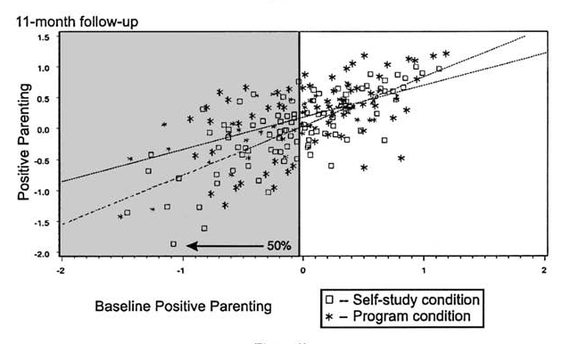

```{r}
#| echo: false

library(knitr)
library(formatR)
library(tidyverse)
library(haven)
library(carData)
library(gridExtra)
opts_chunk$set(out.width = '100%', options(width=60))

opts_knit$set(global.par = TRUE)
opts_chunk$set(echo=FALSE, warning = FALSE, message = FALSE, comment = '', class.output='sh',
               fig.width=8, fig.height=5, fig.align = "center")

my_red <- "#E41A1C"
my_blue <- "#377EB8"
my_green <- "#4DAF4A"
my_purple <- "#984EA3"
my_orange <- "#FF7F00"
my_yellow <- "#FFFF33"
my_red2 <- "#FBB4AE" 
my_blue2 <- "#B3CDE3" 
my_green2 <- "#CCEBC5" 
my_purple2 <- "#DECBE4"
my_orange2 <- "#FED9A6"
my_yellow2 <- "#FFFFCC"
```

```{r}
#| label: helpers
#| echo: false

# ---- Path diagram (replaces the tikz mediation diagrams) --------------------
# Boxes, arrows, and plotmath labels drawn in ggplot. `captions` are plotmath
# strings (use ~ for spaces) placed under the left and right diagrams.
path_diagram <- function(captions = c("Single~Mediator~Model", "Regression~Model"),
                         txt_size = 6.5) {
  boxes <- data.frame(
    xmin = c(2, 0, 4, 6.5, 10), xmax = c(4, 2, 6, 8.5, 12),
    ymin = c(2.5, 1, 1, 1, 1),  ymax = c(3.5, 2, 2, 2, 2),
    label = c("Mediator~italic(m)", "Predictor~italic(x)", "Outcome~italic(y)",
              "Predictor~italic(x)", "Outcome~italic(y)")
  )
  arrows <- data.frame(x = c(1, 4, 2, 8.5), y = c(2, 3, 1.5, 1.5),
                       xend = c(2, 5, 4, 10), yend = c(3, 2, 1.5, 1.5))
  path_labs <- data.frame(x = c(1.2, 4.85, 3, 9.25), y = c(2.75, 2.75, 1.78, 1.78),
                          label = c("hat(a)", "hat(b)", "hat(c)*minute", "hat(c)"))
  caps <- data.frame(x = c(3, 9.25), y = 0.55, label = captions)

  ggplot() +
    geom_rect(data = boxes, aes(xmin = xmin, xmax = xmax, ymin = ymin, ymax = ymax),
              fill = NA, colour = "black", linewidth = 1) +
    geom_text(data = boxes, aes(x = (xmin + xmax) / 2, y = (ymin + ymax) / 2, label = label),
              parse = TRUE, size = txt_size) +
    geom_segment(data = arrows, aes(x = x, y = y, xend = xend, yend = yend),
                 arrow = arrow(length = unit(0.3, "cm"), type = "open"), linewidth = 1) +
    geom_text(data = path_labs, aes(x = x, y = y, label = label),
              parse = TRUE, size = txt_size) +
    geom_text(data = caps, aes(x = x, y = y, label = label),
              parse = TRUE, size = txt_size) +
    coord_fixed(xlim = c(-0.1, 12.1), ylim = c(0.2, 3.7), clip = "off") +
    theme_void()
}

# ---- Regression surfaces for the moderation slide ---------------------------
reg_surface <- function(f, rows) {
  x1 <- seq(0, 1, length = 20)
  x2 <- seq(0, 1, length = 20)
  y <- outer(x1, x2, f)
  pal <- colorRampPalette(c(my_red, my_blue))(20)
  z.facet.center <- (y[-1, -1] + y[-1, -ncol(y)] + y[-nrow(y), -1] + y[-nrow(y), -ncol(y)]) / 4
  z.facet.range <- cut(z.facet.center, 20)
  pmat <- persp(x = x1, y = x2, z = y, theta = -30, box = TRUE, axes = TRUE,
                ticktype = "simple", col = pal[z.facet.range],
                xlab = "x", ylab = "z", zlab = "y", cex.lab = 1.5)
  for (r in rows) {
    lines(trans3d(x = x1, y = rep(x2[r], 20), z = y[, r], pmat = pmat),
          col = my_orange, lwd = 5)
  }
}

# ---- Annotated console output (replaces tikz rectangles drawn over output) ---
# Prints `lines` as a block of text, draws a coloured outline around the
# `highlight` line(s), and puts `label` (HTML) beside the first highlighted line.
html_output <- function(lines, highlight = NULL, label = NULL, color = my_orange, lh = 1.35) {
  esc <- function(s) {
    s <- gsub("&", "&amp;", s, fixed = TRUE)
    s <- gsub("<", "&lt;", s, fixed = TRUE)
    gsub(">", "&gt;", s, fixed = TRUE)
  }
  rows <- vapply(seq_along(lines), function(i) {
    txt <- if (nzchar(lines[i])) esc(lines[i]) else "&nbsp;"
    outline <- if (i %in% highlight) {
      sprintf("outline: 3px solid %s; outline-offset: -1px;", color)
    } else ""
    sprintf("<span style='display:block; white-space:pre; line-height:%sem; %s'>%s</span>",
            lh, outline, txt)
  }, character(1))
  lab <- ""
  if (!is.null(label) && length(highlight) > 0) {
    top <- 0.4 + (highlight[1] - 1) * lh
    lab <- sprintf(paste0("<div style='position:absolute; left:100%%; margin-left:1em; ",
                          "top:%sem; height:%sem; display:flex; align-items:center; ",
                          "white-space:nowrap; color:%s; font-size:0.9em; line-height:1.1;'>%s</div>"),
                   top, lh, color, label)
  }
  html <- paste0("<div style='position:relative; display:inline-block; margin-right:10em;'>",
                 "<pre class='sh' style='margin:0; padding:0.4em 0.6em; font-size:1em; overflow:visible;'>",
                 "<code>", paste(rows, collapse = ""), "</code></pre>", lab, "</div>")
  cat("\n```{=html}\n", html, "\n```\n", sep = "")
}

# ---- Simple slopes (2D companion to reg_surface) ----------------------------
simple_slopes <- function(highlight = 1, rows = c(3, 10), 
                          f = function(x, z) 0 + 2 * x + 1 * z - 3 * x * z) {
  z_vals <- seq(0, 1, length = 20)[rows]
  d <- expand.grid(x = c(0, 1), z = z_vals)
  d$y <- f(d$x, d$z)
  d$active <- d$z == z_vals[highlight]
  d <- d[order(d$active), ]                      # draw highlighted line last (on top)
  ends <- d[d$x == 1, ]
  ends$lab <- sprintf("z == %.2f", ends$z)

  ggplot(d, aes(x, y, group = z)) +
    geom_line(aes(colour = active, linewidth = active)) +
    geom_text(data = ends, aes(label = lab, colour = active), parse = TRUE,
              hjust = -0.15, size = 6) +
    scale_colour_manual(values = c("TRUE" = my_orange, "FALSE" = "grey70"), guide = "none") +
    scale_linewidth_manual(values = c("TRUE" = 2.5, "FALSE" = 1), guide = "none") +
    scale_x_continuous(breaks = c(0, .5, 1)) +
    coord_cartesian(xlim = c(0, 1.3), clip = "off") +
    labs(x = "x", y = "y") +
    theme_minimal(base_size = 18)
}
```

## Types of Third Variables

::: {style="font-size: 0.95em;"}

Types of relationships a third variable ($z$) can have with a DV ($y$) and IV ($x$):

- Confounder

  - $z$ is related to both $x$ and $y$

  - The relationship between $x$ and $y$ changes when accounting for $z$

- Suppressor

  - Like a confounder, but $z$ is unrelated to $y$

- Distorter

  - $z$ changes the sign of the relationship between $x$ and $y$

  - $z$ changes a zero relationship between $x$ and $y$ to a nonzero relationship
  
::: 

## More Third Variables

- **Moderator** (This lecture)

  - The relationship between $x$ and $y$ changes across levels of $z$

- Mediator

  - $x$ causes $y$

  - $z$ is intermediate in the causal process


## Moderation Analysis

::: {style="font-size: 0.8em;"}

Definition:

- The regression of $y$ on one predictor is conditional on (varies depending on) the value of another predictor

Prevalence of moderation effects:

- West, Aiken, Cham, & Liu (2013) conducted a literature review of the Journal of Consulting and Clinical Psychology (2010, Volume 78, Issues 4-6)
- They found 61% (28 of 46) of the articles tested at least one moderation effect in regression models

Moderation and interaction:

- In most situations, **a moderation effect is equivalent to an interaction effect**
- We have learned about interaction effects in factorial ANOVA
- Today, we will learn about interaction effects (moderation) in multiple regression

:::

## Moderation Analysis: Clinical Psychology

One option: explore the moderation between the treatment effect (e.g., treatment group and control group) and the pre-treatment (baseline) individual difference variables on outcome variable

Through investigating the moderation effect, we can infer who will benefit from the treatment program most, and under what circumstances

<br>

::: {style="font-size: 0.7em;"}

Kraemer, H. C., Wilson, G. T., Fairburn, C. G., & Agras, W. S. (2002). Mediators and moderators of treatment effects in randomized clinical trials. *Archives of General Psychiatry*, *59*, 877--883.

:::

## Real Example

{fig-align="center" width="55%"}

::: {style="font-size: 0.8em;"}

::: columns

:::: column

Program leads to higher positive parenting than self-study on the shaded side

::::

:::: column

Self-study leads to higher positive parenting than the program on the unshaded side

::::

:::

:::

::: {style="font-size: 0.5em;"}

Sandler, I. N., Ayers, T. S., Wolchik, S. A., Telin, J. Y., Kwok, O. M., Haine, R. A., ..., & Griffin, W. A. (2003). The family bereavement program: Efficacy evaluation of a theory-based prevention program for parentally bereaved children and adolescents. *Journal of Consulting and Clinical Psychology*, *71*, 587--600.

:::

## Moderation Analysis

Moderation model:

$$\hat{y} = b_0 + b_1x + b_2z + b_3(xz)$$

- $y$: criterion/dependent variable

- $x$: predictor/independent variable

- $z$: moderator

- $xz$: moderation term of $x$ and $z$ (= product of $x$ and $z$)

This is a **linear-by-linear** moderation model

- Regression of $y$ on $x$ is linear at every value of $z$

- Regression of $y$ on $z$ is linear at every value of $x$

## Moderation Analysis

::: columns

:::: {.column width="50%"}

::: {style="text-align: center;"}
Regression surface with no interaction
:::

```{r}
#| fig-width: 7
#| fig-height: 5.5

reg_surface(function(x1, x2) 0 + 2 * x1 + 1 * x2, rows = c(3, 5))
```

Regression lines of $y$ on $x$ are linear and parallel across values of $z$

::::

:::: {.column width="50%"}

::: {style="text-align: center;"}
Regression surface with interaction
:::

```{r}
#| fig-width: 7
#| fig-height: 5.5

reg_surface(function(x1, x2) 0 + 2 * x1 + 1 * x2 - 3 * x1 * x2, rows = c(3, 10))
```

Regression lines of $y$ on $x$ are linear but not parallel across values of $z$

::::

:::

## Simple Slopes

::: columns

:::: {.column width="50%"}

```{r}
#| fig-width: 7
#| fig-height: 5

simple_slopes(highlight = 1)
```

::::

:::: {.column width="50%"}

```{r}
#| fig-width: 7
#| fig-height: 5

simple_slopes(highlight = 2)
```

::::

:::

Regression lines of $y$ on $x$ are linear but not parallel across values of $z$

## Uncentered Moderation

::: {style="font-size: 0.725em;"}


Moderation model:

$$\hat{y} = b_0 + b_1x + b_2z + b_3 (xz)$$

Interpretations when $x$ and $z$ are **uncentered** (no need to center $y$):

- $b_0$: intercept
  - value of $\hat{y}$ when ($x=0$) and ($z=0$)

- $b_1$: linear regression of $y$ on $x$ at $z = 0$
  - when $z = 0$, regression model becomes $\hat{y} = b_0 + b_1x$

- $b_2$: linear regression of $y$ on $z$ at $x = 0$
  - when $x = 0$, regression model becomes $\hat{y} = b_0 + b_2z$

- $b_3$: moderation effect
  - change of linear regression of $y$ on $x$, when $z$ increases one unit
  - change of linear regression of $y$ on $z$, when $x$ increases one unit

:::

## Centered Moderation

::: {style="font-size: 0.7em;"}

Centered Moderation model:

$$\hat{y} = b_0 + b_1(x - \bar{x}) + b_2(z - \bar{z}) + b_3 [(x - \bar{x})(z - \bar{z})]$$

Interpretations when $x$ and $z$ are **centered**:

- $b_0$: intercept
  - value of $\hat{y}$ at ($x = \bar{x}$) and ($z = \bar{z}$)

- $b_1$: linear regression of $y$ on $x - \bar{x}$ at $z = \bar{z}$
  - average of all regressions of $y$ on $x$ at every value of $z$ across range of $z$

- $b_2$: linear regression of $y$ on $z - \bar{z}$ at $x = \bar{x}$
  - average of all regressions of $y$ on $z$ at every value of $x$ across range of $x$

- $b_3$: moderation effect
  - change of linear regression of $y$ on $x$, when $z$ increases one unit
  - change of linear regression of $y$ on $z$, when $x$ increases one unit
  - centering does not change the highest order term
  
:::

## Centering and Interpretation

- Centering the predictors $x$ and $z$ yields meaningful interpretations for the lower-order coefficients $b_0$, $b_1$, $b_2$

- If predictors are [continuous]{style="text-decoration: underline;"}, it recommended to always center the predictors in moderation analysis
  
- If predictors are [categorical]{style="text-decoration: underline;"}, not necessary to center (more on this later)

## Moderation Example

Example: wage data for men in 1988

- `lnhr`: log hours worked annually

- `lnwg`: log hourly wage in U.S. dollars

- `ageh`: age of the man

- `agesq`: squared age of the man

- `disab`: dummy variable for having a disability

```{r}
dat <- read_dta("../../data/hours.dta")
dat <- dat %>% filter(year == 1988) %>% dplyr::select(-year, -id, -kids)
options(width = 90)
```

::: {style="font-size: 0.8em;"}

```{r}
#| echo: true

summary(dat)
```

:::

```{r}
options(width = 60)
```

## Moderation Analysis

::: {style="font-size: 0.75em;"}

First, we will predict wages from annual hours worked, using age as a moderator, centering both predictors:

$$\widehat{\texttt{lnwg}} = b_0 + b_1\texttt{lnhr} + b_2\texttt{ageh} + b_3\texttt{lnhr}\times \texttt{ageh}$$

```{r}
#| echo: true
#| eval: false

dat <- dat %>% 
mutate(lnhrC = lnhr - mean(lnhr), 
       agehC = ageh - mean(ageh))
lm1 <- lm(lnwg ~ lnhrC  * agehC, dat)
summary(lm1)
```

[Note: `*` in the formula means to include both main effects and interactions]{style="color: #377EB8; font-size: 0.8em;"}

```{r}
#| results: asis

options(width = 90)
dat <- dat %>% 
  mutate(lnhrC = lnhr - mean(lnhr), 
         agehC = ageh - mean(ageh))
lm1 <- lm(lnwg ~ lnhrC * agehC, dat)

out <- capture.output(summary(lm1))
i0 <- grep("^Coefficients:", out)
keep <- c(i0:(i0 + 5), 
          grep("^Signif", out), 
          grep("^Residual standard error", out), 
          grep("^Multiple R-squared", out))

# The interaction term is the 4th coefficient row = 6th kept line
html_output(out[keep], highlight = 6, 
            label = "significant<br>moderation<br>effect", color = my_orange)
options(width = 60)
```

:::

## Confidence Intervals

```{r}
#| echo: true
confint(lm1)
```

## Probing the Effect

::: {style="font-size: 0.85em;"}

Moderation model (linear-by-linear moderation, $x$ and $z$ centered):

$$\hat{y} = b_0 + b_1x + b_2z + b_3(xz)$$

How to probe the moderation effect?

- Rearrange the moderation model into the form of a **simple regression model**, which shows the linear regression of $y$ on $x$ at values of $z$:

$$\hat{y} = \underbrace{(b_0 + b_2z)}_{\text{simple intercept}} + \underbrace{(b_1 + b_3z)}_{\text{simple slope}}x$$

$$\widehat{\texttt{lnwg}} = (2.64 + .01\times \texttt{ageC}) + (.18 + .04\times \texttt{ageC}) \times \texttt{lnhrC}$$

We can probe the model by plugging in particular values of $z$ (`ageC`)

:::

## Visualizing Moderation

```{r}
#| fig-width: 11
#| fig-height: 6

d <- data.frame(x = seq(min(dat$lnhrC), max(dat$lnhrC), length = 10))
highz <- sd(dat$agehC)
medz <- 0
lowz <- -sd(dat$agehC)
d$"1SD above median age" <- (2.64 + .01 * highz) + (.18 + .04 * highz) * d$x
d$"median age" <- (2.64 + .01 * medz) + (.18 + .04 * medz) * d$x
d$"1SD below median age" <- (2.64 + .01 * lowz) + (.18 + .04 * lowz) * d$x
d <- d %>% 
  pivot_longer("1SD above median age":"1SD below median age", 
               names_to = "level", values_to = "y") %>%
  mutate(level = fct_relevel(level, "1SD above median age", after = 2))

ggplot(d, aes(x, y, color = level, shape = level)) + 
  geom_line(linewidth = 1) + geom_point(size = 3) + 
  labs(x = "log annual hours worked (centered)", y = "log hourly wage") + 
  theme_minimal(base_size = 18) + 
  theme(legend.position = "bottom", legend.title = element_blank()) + 
  scale_color_manual(values = c(my_blue, my_purple, my_red))
```

## Standardized Coefficients in Moderation Analysis {.scrollable}

To run standardized moderation, feed `lm` standardized variables:

```{r}
options(width = 90)
```

::: {style="font-size: 0.65em;"}

```{r}
#| echo: true

lm_std <- lm(scale(lnwg) ~ scale(lnhr) * scale(ageh), dat)
summary(lm_std)
```

:::

```{r}
options(width = 60)
```

## Categorical Predictors

Suppose our moderator variable $z$ is categorical

Different options for coding the effect:

::: {style="font-size: 0.85em;"}

| | Category 1 | Category 2 | Centered? |
|:---|:---:|:---:|:---|
| Dummy Coding | 0 | 1 | No |
| Unweighted Effects | -1 | 1 | Yes, if groups are same size |
| Weighted Effects | -5 | 1 | Yes, if weights are proportional to group size |

I.e., if there are 5x as many observations in Category 1 as 2, this weighted effects coding will be "centered"

:::

## Categorical Predictors (Dummy Coded)

Moderation model ($x$ is still centered):

$$\hat{y} = b_0 + b_1x + b_2z + b_3(xz)$$

Simple regression model; linear regression of $y$ on $x$ at values of $z$

$$\hat{y} = (b_0 + b_2z) + (b_1 + b_3z)x$$

Put the two values of $z$ into the simple regression model

- $z = 0$: $\hat{y} = b_0 + b_1x$
- $z = 1$: $\hat{y} = (b_0 + b_2) + (b_1 + b_3)x$

## Dummy Coded Interpretations


- $b_0$: value of $\hat{y}$ at $\bar{x}$ and $z = 0$
- $b_1$: linear regression slope of $y$ on $x$ at $z = 0$
- $b_2$: difference in $\hat{y}$ at $\bar{x}$ between the two $z$ groups
- $b_3$: difference of linear regression slope of $y$ on $x$ between the two $z$ groups

## Example in `R`

::: {style="font-size: 0.8em;"}

Suppose we use disability status (0 = no disability, 1 = disability) as a moderator instead of age:

```{r}
#| echo: true
#| eval: false

summary(lm(lnwg ~ lnhrC * disab, dat))
```

```{r}
options(width = 90)
tmp <- capture.output(summary(lm(lnwg ~ lnhrC * disab, dat)))
i0 <- grep("^Coefficients:", tmp)
cat(tmp[i0:(i0 + 5)], sep = "\n")
options(width = 60)
```

For a man without a disability:

$$\widehat{\texttt{lnwg}} = 2.64 + .31\times\texttt{lnhrC}$$

For a man with a disability:

$$\begin{aligned}
\widehat{\texttt{lnwg}} &= (2.64 - .11) + (.31 - .21)\times\texttt{lnhrC} \\
&= 2.52 + .10\,\texttt{lnhrC}
\end{aligned}$$

In this example, the moderation effect is not significant (nor is the main effect of disability)

:::

## Simple Slopes

```{r}
#| fig-width: 11
#| fig-height: 6.5

d <- data.frame(x = seq(min(dat$lnhrC), max(dat$lnhrC), length = 266))
d$"with disability" <- 2.63542 - .11476 + (.30708 - .20641) * d$x
d$"without disability" <- 2.63542 + .30708 * d$x
d <- d %>% 
  pivot_longer(-x, names_to = "grp", values_to = "y")

# Label the raw data with the same group names so lines, points, and the
# on-plot labels all share one color mapping
pts <- dat %>% 
  mutate(grp = ifelse(disab == 1, "with disability", "without disability"))

grp_cols <- c("without disability" = my_blue, "with disability" = my_purple)

ggplot(d, aes(x, y, color = grp)) + 
  geom_line(linewidth = 1.2) + 
  geom_point(data = pts, aes(x = lnhrC, y = lnwg, shape = grp, color = grp), 
             size = 1.5, inherit.aes = FALSE) + 
  # Replaces the tikz text overlay
  annotate("text", x = -1.7, y = 4.15, label = "without disability", 
           hjust = 1, size = 8, col = my_blue) +
  annotate("text", x = -1.7, y = 3.7, label = "with disability", 
           hjust = 1, size = 8, col = my_purple) +
  scale_color_manual(values = grp_cols) + 
  labs(x = "log annual hours worked (centered)", y = "log hourly wage") + 
  theme_minimal(base_size = 18) + 
  guides(shape = "none", col = "none")
```

## "Main" Effects

If there was a meaningful interaction, how would we interpret the main effects?

- Disability: [The difference between no disability and disability when log hours worked = 0 (if uncentered) or at the average of log hours worked (if centered)]{.answer .fragment .content-visible unless-meta="params.v0"}
- Log hours worked: [The slope of log hours worked at disability = 0]{.answer .fragment .content-visible unless-meta="params.v0"}

## Power for Moderation

::: {style="font-size: 0.95em;"}

Because moderation analysis is a special case of multiple linear regression, power can be assessed using method covered in earlier lectures

Moderation effects are harder to estimate than main effects!


- For a given size for the main effect, $4\times N$ is needed to have an equally accurate interaction effect of the same size

- $16\times N$ is needed to have an equally accurate interaction effect of half the size

:::

::: {style="font-size: 0.7em;"}

Gelman, A., Hill, J., & Vehtari, A. (2020). *Regression and other stories*. Cambridge University Press. p. 301

:::

## APA Writeup


::: {style="font-size: 0.85em;"}

Using the continuous moderator (age) as example:

We estimated a multiple linear regression predicting log hourly wage from log annual hours worked, age, and their interaction. Both continuous predictors were mean-centered. The overall model was statistically significant, $R^2 = .09$, adjusted $R^2 = .08$, $F(3, 528) = 16.54$, $p < .001$.

Age significantly moderated the relationship between hours worked and wage, $b = 0.039$, $t(528) = 5.23$, $p < .001$, 95% CI $[0.024, 0.054]$. For each additional year of age, the slope of log wage on log hours increased by 0.039. Plotting simple slopes at one standard deviation above and below the mean age indicated that the relationship between hours worked and wage was positive for older men and negative for younger men.

At the mean age, hours worked was positively related to wage, $b = 0.181$, $t(528) = 2.21$, $p = .027$, 95% CI $[0.020, 0.341]$. At the mean of hours worked, age was positively related to wage, $b = 0.007$, $t(528) = 2.99$, $p = .003$, 95% CI $[0.003, 0.012]$.

:::

