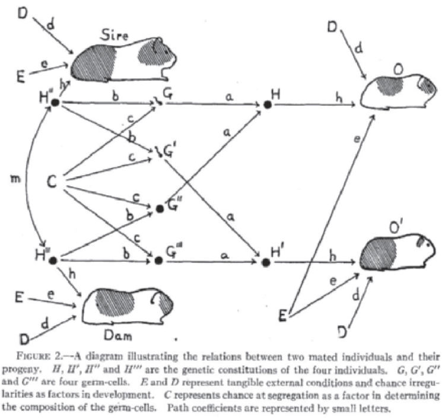

```{r}
#| echo: false

library(knitr)
library(formatR)
library(tidyverse)
library(haven)
library(carData)
library(gridExtra)
opts_chunk$set(out.width = '100%', options(width=60))

opts_knit$set(global.par = TRUE)
opts_chunk$set(echo=FALSE, warning = FALSE, message = FALSE, comment = '', class.output='sh',
               fig.width=8, fig.height=5, fig.align = "center")

my_red <- "#E41A1C"
my_blue <- "#377EB8"
my_green <- "#4DAF4A"
my_purple <- "#984EA3"
my_orange <- "#FF7F00"
my_yellow <- "#FFFF33"
my_red2 <- "#FBB4AE" 
my_blue2 <- "#B3CDE3" 
my_green2 <- "#CCEBC5" 
my_purple2 <- "#DECBE4"
my_orange2 <- "#FED9A6"
my_yellow2 <- "#FFFFCC"
```

```{r}
#| label: helpers
#| echo: false

# ---- Path diagram (replaces the tikz mediation diagrams) --------------------
# Boxes, arrows, and plotmath labels drawn in ggplot. `captions` are plotmath
# strings (use ~ for spaces) placed under the left and right diagrams.
path_diagram <- function(captions = c("Single~Mediator~Model", "Regression~Model"),
                         txt_size = 6.5) {
  boxes <- data.frame(
    xmin = c(2, 0, 4, 6.5, 10), xmax = c(4, 2, 6, 8.5, 12),
    ymin = c(2.5, 1, 1, 1, 1),  ymax = c(3.5, 2, 2, 2, 2),
    label = c("Mediator~italic(m)", "Predictor~italic(x)", "Outcome~italic(y)",
              "Predictor~italic(x)", "Outcome~italic(y)")
  )
  arrows <- data.frame(x = c(1, 4, 2, 8.5), y = c(2, 3, 1.5, 1.5),
                       xend = c(2, 5, 4, 10), yend = c(3, 2, 1.5, 1.5))
  path_labs <- data.frame(x = c(1.2, 4.85, 3, 9.25), y = c(2.75, 2.75, 1.78, 1.78),
                          label = c("hat(a)", "hat(b)", "hat(c)*minute", "hat(c)"))
  caps <- data.frame(x = c(3, 9.25), y = 0.55, label = captions)

  ggplot() +
    geom_rect(data = boxes, aes(xmin = xmin, xmax = xmax, ymin = ymin, ymax = ymax),
              fill = NA, colour = "black", linewidth = 1) +
    geom_text(data = boxes, aes(x = (xmin + xmax) / 2, y = (ymin + ymax) / 2, label = label),
              parse = TRUE, size = txt_size) +
    geom_segment(data = arrows, aes(x = x, y = y, xend = xend, yend = yend),
                 arrow = arrow(length = unit(0.3, "cm"), type = "open"), linewidth = 1) +
    geom_text(data = path_labs, aes(x = x, y = y, label = label),
              parse = TRUE, size = txt_size) +
    geom_text(data = caps, aes(x = x, y = y, label = label),
              parse = TRUE, size = txt_size) +
    coord_fixed(xlim = c(-0.1, 12.1), ylim = c(0.2, 3.7), clip = "off") +
    theme_void()
}

# ---- Regression surfaces for the moderation slide ---------------------------
reg_surface <- function(f, rows) {
  x1 <- seq(0, 1, length = 20)
  x2 <- seq(0, 1, length = 20)
  y <- outer(x1, x2, f)
  pal <- colorRampPalette(c(my_red, my_blue))(20)
  z.facet.center <- (y[-1, -1] + y[-1, -ncol(y)] + y[-nrow(y), -1] + y[-nrow(y), -ncol(y)]) / 4
  z.facet.range <- cut(z.facet.center, 20)
  pmat <- persp(x = x1, y = x2, z = y, theta = -30, box = TRUE, axes = TRUE,
                ticktype = "simple", col = pal[z.facet.range],
                xlab = "x", ylab = "z", zlab = "y", cex.lab = 1.5)
  for (r in rows) {
    lines(trans3d(x = x1, y = rep(x2[r], 20), z = y[, r], pmat = pmat),
          col = my_orange, lwd = 5)
  }
}

# ---- Annotated console output (replaces tikz rectangles drawn over output) ---
# Prints `lines` as a block of text, draws a coloured outline around the
# `highlight` line(s), and puts `label` (HTML) beside the first highlighted line.
html_output <- function(lines, highlight = NULL, label = NULL, color = my_orange, lh = 1.35) {
  esc <- function(s) {
    s <- gsub("&", "&amp;", s, fixed = TRUE)
    s <- gsub("<", "&lt;", s, fixed = TRUE)
    gsub(">", "&gt;", s, fixed = TRUE)
  }
  rows <- vapply(seq_along(lines), function(i) {
    txt <- if (nzchar(lines[i])) esc(lines[i]) else "&nbsp;"
    outline <- if (i %in% highlight) {
      sprintf("outline: 3px solid %s; outline-offset: -1px;", color)
    } else ""
    sprintf("<span style='display:block; white-space:pre; line-height:%sem; %s'>%s</span>",
            lh, outline, txt)
  }, character(1))
  lab <- ""
  if (!is.null(label) && length(highlight) > 0) {
    top <- 0.4 + (highlight[1] - 1) * lh
    lab <- sprintf(paste0("<div style='position:absolute; left:100%%; margin-left:1em; ",
                          "top:%sem; height:%sem; display:flex; align-items:center; ",
                          "white-space:nowrap; color:%s; font-size:0.9em; line-height:1.1;'>%s</div>"),
                   top, lh, color, label)
  }
  html <- paste0("<div style='position:relative; display:inline-block; margin-right:10em;'>",
                 "<pre class='sh' style='margin:0; padding:0.4em 0.6em; font-size:1em; overflow:visible;'>",
                 "<code>", paste(rows, collapse = ""), "</code></pre>", lab, "</div>")
  cat("\n```{=html}\n", html, "\n```\n", sep = "")
}
```

## Concept of Mediation

::: {style="font-size: 0.85em;"}

Definition of a **mediator**:

- A variable that is [intermediate in the causal process]{style="text-decoration: underline;"} relating a predictor to the outcome
- Other names for mediator: intervening variable, process variable
- **Mediation effect** is also known as **indirect effect**

A **statistical mediation model** is a system or set of regression relationships between variables

Three ways to describe a mediation model:

- A variable is intermediate in the causal process relating the predictor to outcome
- A set of regression equations
- Path diagram

Model specification should be based on substantive theories and previous empirical results

:::


## Population $\leftarrow$ Sample

```{r}
#| fig.width: 6
#| fig.height: 2
#| out.width: "100%"

# Zero out standard plot margins
par(mar = c(0, 0, 0, 0))

# Initialize empty canvas
plot(0, 0, col = "white", xlim = c(0, 5), ylim = c(0, 3.5),
     bty = "n", xlab = "", ylab = "", xaxt = "n", yaxt = "n")

# --- Left Box (Population) ---
polygon(x = c(0.2, 1.7, 1.7, 0.2), y = c(2, 2, 3, 3), border = my_blue, lwd = 2)

# --- Right Box (Sample) ---
polygon(x = c(3.3, 4.8, 4.8, 3.3), y = c(.5, .5, 1.5, 1.5), border = my_purple, lwd = 2)

# --- Top Curve (Probability) ---
x_top <- seq(0.95, 4.05, length = 30)
y_top <- -0.478 * x_top^2 + 1.905 * x_top + 1.621
points(x_top, y_top, type = 'l', col = my_blue, lwd = 2)

# Top Arrow (pointing to Sample)
arrows(x0 = x_top[28], x1 = x_top[30], 
       y0 = y_top[28], y1 = y_top[30], 
       col = my_blue, lwd = 2)

# --- Bottom Curve (Statistics) ---
x_bot <- seq(0.95, 4.05, length = 30)
y_bot <- 0.435 * x_bot^2 - 2.656 * x_bot + 4.132
points(x_bot, y_bot, type = 'l', col = my_purple, lwd = 2)

# Bottom Arrow (pointing to Population)
arrows(x0 = x_bot[3], x1 = x_bot[1], 
       y0 = y_bot[3], y1 = y_bot[1], 
       col = my_purple, lwd = 2)

# --- Text Labels ---
text(x = 0.95, y = 2.65, "Population", col = my_blue)
text(x = 0.95, y = 2.35, "(Parameter)", col = my_blue)

text(x = 4.05, y = 1.15, "Sample", col = my_purple)
text(x = 4.05, y = 0.85, "(Data)", col = my_purple)

text(x = 3.1, y = 3.3, "Probability", col = my_blue)
text(x = 1.9, y = 0.3, "Statistics", col = my_purple)
```

- Statistics is about inferring things about a **population** from **data**
- Specifically, how are variables (cor)related?
- **Does not imply anything about causes and effects,** just patterns of covariation

## Statistical vs. Causal

::::: {style="font-size: 0.68em;"}

:::: columns

::: {.column width="50%"}

**Statistical mediation**

- **Goal:** infer the **correlational** relationships among $x$, $m$, and $y$ in a **population**, using a **sample**

- **Inference:** from sample estimates ($\hat{a}$, $\hat{b}$, $\hat{c}^\prime$) to population parameters ($a$, $b$, $c^\prime$)

- **Question:** how do these variables covary in the population?

- **Requires:** a correctly specified model and the usual regression assumptions

- Indirect effect $ab$ summarizes how much of the association between $x$ and $y$ **runs through** $m$

:::

::: {.column width="50%"}

**Causal mediation**

- **Goal:** infer how a population would **change or behave under counterfactual conditions**

- **Inference** about **potential outcomes:** How would $x \rightarrow y$ if some other intermediate variable ($m$) were different than it is?

- **Question:** what would happen to $y$ if we **intervened** on $x$, with or without changing $m$?

- **Requires:** additional assumptions 
    - **Testable:** $x$ preceeds $m$ in tme
    - **Untestable:** no unmeasured confounding of $x \rightarrow m$, $m \rightarrow y$, and $x \rightarrow y$

:::

::::

:::: {style="border-top: 3px solid #888; padding-top: 0.5em; margin-top: 0.5em;"}

- The same estimate of $\hat{a}\hat{b}$ can be reported in both frameworks, but it supports **different claims**
- Statistical mediation needs only the data; causal mediation needs assumptions **beyond** the data (we'll return to this at the end)

::::

:::::


## History of Mediation Analysis

::: columns

:::: {.column width="50%"}

Sewall Wright (1918) developed path analysis to analyze the effects of heredity and environment in determining the spotted pattern of guinea pigs

<br>

Wright used guinea pigs as variables to create the first path diagram

::::

:::: {.column width="50%"}

{width="100%"}

::::

:::

## More History

::: {style="font-size: 0.85em;"}

Path analysis continued to be developed and popularized, notably in three disciplines:

- Econometrics
  - Parallel works notably by Haavelmo (1943), Koopmans (1945), and the Cowles Commission (1952), Trygve Haavelmo won the Nobel Prize in Economics in 1989

- Sociology
  - Rediscovered and popularized notably by Blalock (1961, 1962) and Duncan (1966)

- Psychology
  - Rediscovered and popularized notably by Werts and Linn (1970) and Kenny (1979)
  - Baron and Kenny (1986) is one of the most cited papers about mediation analysis

:::

::: {style="font-size: 0.65em;"}

Baron, R. M., & Kenny, D. A. (1986). The moderator-mediator variable distinction in social psychology research: Conceptual, strategic, and statistical considerations. *Journal of Personality and Social Psychology*, *51*, 1173--1182.

:::

<!-- ## Mediation Analysis: Intervention Research

Mediation analysis is a way to test the effects on an intervention in a theory-based framework

A theory-based approach focuses on the processes underlying interventions, and mediators play a prime role

* **Action theory** focuses on how the intervention program affects mediators

* **Conceptual theory** focuses on how the mediators affect the outcome

Practical implications may include reducing cost and developing more effective interventions once the relevant mediators are identified

## Path Diagram for Intervention Research

Questions that we ask when selecting mediators for an intervention program:

* **Conceptual Theory**
    + Are these the right mediators? Are they causally related to the dependent variable?

* **Action Theory**
    + Can these mediators be changed?

* **Both Action and Conceptual Theory**
    + Will the change in these mediators that arise from our intervention program lead to desired change in the dependent variable?

(The tikz diagram for this slide was commented out in the .Rmd and has not been converted.)
-->

## Examples

- Attitudes $(x)$ $\rightarrow$ intentions $(m)$ $\rightarrow$ behavior $(y)$

- Abuse in Childhood $(x)$ $\rightarrow$ Impaired Threat Appraisal $(m)$ $\rightarrow$ Aggressive Behavior in Adolescence $(y)$

- Grades ($x$) $\rightarrow$ self-esteem ($m$) $\rightarrow$ happiness ($y$)

- Positive Parenting during Childhood ($x$) $\rightarrow$ Self-esteem ($m$) $\rightarrow$ Positive Parenting as an Adult ($y$)

- Assignment to an intervention program (intensive case management, $x$) $\rightarrow$ number of housing contracts ($m$) $\rightarrow$ days of stable housing ($y$)

- Psychotherapy $(x)$ $\rightarrow$ attributional style ($m$) $\rightarrow$ depression ($y$)

## Path Diagram

```{r}
#| fig-width: 12
#| fig-height: 3.6

path_diagram(captions = c("Mediation~Model", "Regression~Model~from~italic(x)~to~italic(y)"))
```

::: {style="font-size: 0.85em;"}

- $a$, $b$, and $c^\prime$ are regression coefficients

- Path diagram visualizes the causal process and forces researchers to consider **assumed** causal relationships between variables

::: columns

:::: column

Set of regression equations:

$$\begin{aligned}
\hat{y} &= \text{intercept} + \hat{b} \times m + \hat{c}^\prime \times x\\
\hat{m} &= \text{intercept} + \hat{a} \times x
\end{aligned}$$

::::

:::: column

If $c^\prime = 0$, $m$ **fully mediates** the relationship between $x$ and $y$

If $c^\prime \neq 0$, $m$ **partially mediates** the relationship between $x$ and $y$

::::

:::

:::

## Quantifying Mediation 


In a single mediator model, the relationship of $x$ to $y$ can be quantified as:

- **direct effect** $= \hat{c}^\prime$

- **mediation effect** $= \hat{a} \times \hat{b}$

- **total effect** = direct effect + mediation effect = $\hat{c}^\prime + \hat{a} \times \hat{b} = \hat{c}$

```{r}
#| fig-width: 12
#| fig-height: 3.6

path_diagram(captions = c("Single~Mediator~Model", "Regression~Model"))
```

## Hypothesis Testing 

::: {style="font-size: 0.8em;"}

Hypotheses:

- $H_0$: $ab = 0$
- $H_1$: $ab \neq 0$ (two-tailed test)
- $ab$ = population mediation effect

**Complication:** sampling distribution of the mediation effect is generally non-normal

<!-- 4 methods for testing of mediation effects (MacKinnon, et al., 2004): -->

There are different ways to test for the mediation effect: 

1. Sobel's Method - not recommended

2. Bootstrapping - recommended, what we'll use in this class

3. Product of Moments - recommended

4. Monte Carlo - recommended

To test, we construct the confidence intervals of the mediation effect

If the confidence interval does **NOT** include zero, we reject the null hypothesis $H_0$

:::

## Example

```{r}
dat <- read_dta("../../data/homework.dta")
```

National Educational Longitudinal Study of 1988 (NELS-88)

We'll look at the following variables:

- `math` ($y$): achievement in mathematics (scaled to have mean 50, sd 10 ($T$-scores))

- `ses` ($x$): student's socioeconomic status (on a standardized metric)

- `homework` ($m$): number of hours spent on homework each week

Socioeconomic status is known to affect many areas of life, including math achievement

Is the effect of SES on math scores mediated (intermediately caused) by the time spent doing homework?

## (1) Sobel's Method

::: {style="font-size: 0.725em;"}

- Developed by Sobel (1982, 1986)

- First method for testing mediation effect

- Assumes that mediation effect is normally distributed [(incorrect)]{style="color: #E41A1C;"}

- Based on this assumption, construct a $(1 - \alpha)\%$ confidence interval for $ab$:

$$\hat{a}\hat{b} \pm z_{\alpha/2} \times (\text{Standard Error of } \hat{a}\hat{b})$$

- Standard error is an asymptotic approximation

- For a single mediator model:

$$\text{Standard Error of } \hat{a}\hat{b} = \sqrt{\hat{a}^2 \times s_{\hat{b}}^2 + \hat{b}^2\times s_{\hat{a}}^2}$$

- $s_{\hat{a}}^2$: standard error of $\hat{a}$
- $s_{\hat{b}}^2$: standard error of $\hat{b}$

:::

## Comments on Sobel


- Simulation studies support that Sobel's method has lower statistical power than other methods for testing the mediation effect (e.g., MacKinnon et al., 2004)
  
- [**Not Recommended**]{style="color: #E41A1C;"}

<!-- ## (1) Sobel's Method in R

```{r echo = TRUE, message = FALSE}
library(multilevel)
sobel_res <- sobel(pred = dat$ses, 
                 med = dat$homework, 
                 out = dat$math)
sobel_res$Indirect.Effect
sobel_res$Indirect.Effect + 
qnorm(c(.025, .975)) * sobel_res$SE
```
-->

## (2) Bootstrapping

::: {style="font-size: 0.8em;"}

Efron and Tibshirani (1986) developed the use of bootstrapping to construct confidence interval for ANY population parameter with unknown sampling distribution (e.g., mediation effect)

Procedures of bootstrapping $(1 - \alpha)$% confidence interval for mediation effect:

1. Calculate the mediation effect in the **original sample**
  
2. Generate multiple bootstrap samples from the original sample data by randomly sampling with replacement many times (e.g., 2000 times)
  
3. Calculate the mediation effect in each bootstrap sample
  
4. The mediation effects from these bootstrap samples form the **empirical sampling distribution of the mediation effect**
  
5. $(\alpha/2)$th and $(1 - \alpha/2)$th percentiles of empirical sampling distribution are the upper and lower limits of the $(1 - \alpha)$% confidence interval of the mediation effect

:::

## Bootstrap Demo

Suppose we observe a small sample of $N = 10$ values:

::: {style="font-size: 0.85em;"}

```{r}
#| echo: true

set.seed(2024)
obs <- sample(1:100, size = 10)

obs
mean(obs)
```

:::

- Bootstrapping treats the sample as a stand-in for the population, and **resamples from it**
- A **bootstrap resample** draws $N = 10$ values from the original sample **with replacement**

## Resampling

```{r}
#| echo: false

# Generate all 500 resamples up front so the means on later slides match these
set.seed(1)
boot_samples <- replicate(500, sample(obs, size = length(obs), replace = TRUE), 
                          simplify = FALSE)
boot_means <- map_dbl(boot_samples, mean)

show_resample <- function(i) {
  cat("Resample ", i, ":  ", paste(sort(boot_samples[[i]]), collapse = "  "), "\n", 
      "Mean = ", format(round(boot_means[i], 1), nsmall = 1), "\n", sep = "")
}
```

:::: {style="font-size: 0.85em;"}

Original sample:

```{r}
cat("Original:    ", paste(sort(obs), collapse = "  "), "\n", 
    "Mean = ", format(round(mean(obs), 1), nsmall = 1), "\n", sep = "")
```

::: {.fragment}

Resample 1 (10 values drawn **with replacement**):

```{r}
show_resample(1)
```

:::

::: {.fragment}

Resample 2:

```{r}
show_resample(2)
```

:::

::: {.fragment}

Resample 3:

```{r}
show_resample(3)
```

:::

::::

::: {style="font-size: 0.6em;"}

(Values are sorted only to make repeated values easy to see)

:::

## Many Resamples

::: columns

:::: {.column width="40%"}

We repeat this many times (here, 500). Each resample gives one **bootstrap mean**:

::: {style="font-size: 0.85em;"}

```{r}
fmt <- function(i) format(round(boot_means[i], 1), nsmall = 1)
boot_tab <- data.frame(
  resample = c("1", "2", "3", "⋮", "500"),
  mean = c(fmt(1), fmt(2), fmt(3), "⋮", fmt(500))
)
print(boot_tab, row.names = FALSE, right = TRUE)
```

:::

::::

:::: {.column width="60%"}

- Resamples 1--3 are the ones from the previous slide
- Resamples 4--499 are not shown
- The 500 bootstrap means form the **empirical sampling distribution** of the mean

::::

:::

## Confidence Interval

::: {style="font-size: 0.85em;"}

::: columns

:::: {.column width="55%"}

```{r}
#| fig-width: 8
#| fig-height: 5.5

ci <- quantile(boot_means, probs = c(.025, .975))
d <- data.frame(m = boot_means, 
                region = ifelse(boot_means < ci[1] | boot_means > ci[2], "tail", "middle"))

ggplot(d, aes(m, fill = region)) + 
  geom_histogram(binwidth = 1.5, colour = "white") + 
  geom_vline(xintercept = ci, linetype = 2, linewidth = 1) + 
  annotate("text", x = ci[1], y = Inf, vjust = 1.5, hjust = 1.1, size = 6,
           label = sprintf("2.5th percentile\n%.1f", ci[1])) + 
  annotate("text", x = ci[2], y = Inf, vjust = 1.5, hjust = -0.1, size = 6,
           label = sprintf("97.5th percentile\n%.1f", ci[2])) + 
  scale_fill_manual(values = c(middle = my_blue, tail = my_red), guide = "none") + 
  scale_x_continuous(expand = expansion(mult = 0.2)) + 
  labs(x = "Bootstrap mean", y = "Count") + 
  theme_minimal(base_size = 18)
```

::::

:::: {.column width="45%"}


1. Sort the 500 bootstrap means
2. Cut off the lowest 2.5% ($500 \times .025 = 12.5$ values) and the highest 2.5%
3. The range of the remaining middle 95% is the **95% confidence interval**

```{r}
#| echo: true

quantile(boot_means, probs = c(.025, .975))
```


::::


:::

- Reject values outside, retain values in side
- Flexible procedure! Doable with almost any statistical analysis!
:::


## Comments on Bootstrapping

::: {style="font-size: 0.85em;"}


- Simulation studies support that bootstrapping method produces correct Type I error rates and high statistical power relative to other methods
  
- Performs similarly to the product of moments method
  
- Although it is tempting to believe that bootstrapping works well for samples, bootstrapping works asymptotically ($N\rightarrow \infty$)
  
- There are some variants of bootstrapping (e.g., bias-corrected, bias-corrected-accelerated) that try to correct for the sampling distribution of the parameters by bootstrap. But recent research has found ordinary bootstrapping works best in various situations (e.g., Falk & Biesanz, 2015)
  
- [**Recommended**]{style="color: #377EB8;"}

::: 

## Bootstrapping in `R` {.scrollable}

::: {style="font-size: 0.75em;"}

```{r}
#| echo: true

library(mediation)
mod_m <- lm(homework ~ ses, dat) # x predicting m
mod_y <- lm(math ~ ses + homework, dat) # x and m predicting y

res <- mediate(model.m = mod_m,
               model.y = mod_y, 
               treat = "ses",
               mediator = "homework",
               sims = 1000, boot = TRUE)
summary(res)
```

:::

## (3) Product of Moments


::: {style="font-size: 0.8em;"}

Aroian (1947) and Aroian, Taneja, and Cornwell (1978) developed the theoretical probability distribution of the product of two normal variables

Based on the central limit theorem, when sample size increases, sampling distribution of a regression coefficient ($\hat{a}$ or $\hat{b}$) is closer to normal distribution

MacKinnon and colleagues (2002) utilized this theory to develop the confidence interval for the mediation effect $\hat{a}\hat{b}$

This method requires these inputs:

1. $\hat{a}$ and $\hat{b}$

2. standard error of $\hat{a}$, standard error of $\hat{b}$

3. correlation between $\hat{a}$ and $\hat{b}$ (for a single mediation model, correlation always = 0)

:::

## Comments on Product of Moments


- Simulation studies support that the product of moments method produces correct Type I error rate and high statistical power relative to other methods

<!-- * `RMediation` (Tofighi & MacKinnon, 2011) is an `R` package that utilizes this method -->

- [**Recommended**]{style="color: #377EB8;"}

## (4) Monte Carlo Sim

::: {style="font-size: 0.8em;"}

Procedures:

1. Based on central limit theorem, when sample size increases, sampling distribution of $\hat{a}$, $\hat{b}$ is closer to normal distribution

2. Randomly generate multivariate normal variables for $\hat{a}$, $\hat{b}$:

    - means of variables = $\hat{a}$ and $\hat{b}$
    - variances of variables = squared standard errors of $\hat{a}$ and $\hat{b}$
    - covariance of variables = covariance between $\hat{a}$ and $\hat{b}$
    - simulated multivariate normal variables represent the sampling distribution of $\hat{a}$ and $\hat{b}$

3. Compute mediation effect $\hat{m} = \hat{a} \times \hat{b}$ using these simulated variables

4. Like in bootstrapping, $(\alpha/2)$th and $(1 - \alpha/2)$th percentile of the mediation effect above = $(1 - \alpha)$% confidence interval for the mediation effect

:::

## Comments on Monte Carlo


- Simulation studies support that Monte Carlo produces correct Type I error rates and high statistical power relative to other methods

- Its performance was similar to product of moments method and bootstrapping

- Can take some time to run

- [**Recommended**]{style="color: #377EB8;"}

## Effect Size Measures

Two types:

- Effect size for individual paths ($\hat{a}$, $\hat{b}$, $\hat{c}^\prime$)

  - Correlations
  
  - Partial correlations
  
  - Standardized regression coefficients

- Effect size for mediation effect ($\hat{a}\hat{b}$)

  - Ratio of mediation effect to the total effect
  
  - Ratio of mediation effect to direct effect
  
  - $R^2$ attributable to the mediation effect
  
  - Standardized mediation effect

## Effect Sizes for Individual Paths

- Correlations between $x$, $m$, and $y$

  - Correlation between $x$ and $m$ (for $\hat{a}$)

  - Partial correlation between $m$ and $y$ (for $\hat{b}$, partialling out $x$)

  - Partial correlation between $x$ and $y$ (for $\hat{c}^\prime$, partialling out $m$)

- Standardized regression coefficients for $\hat{a}$, $\hat{b}$, and $\hat{c}^\prime$

  - Interpretation: change in standard deviations in the dependent variable for a standard deviation change in the independent variable

- Correlations and standardized regression coefficients tend to be useful/accurate with 50+ subjects

## Effect Size for Mediation 

::: {style="font-size: 0.85em;"}

- Ratio of mediation effect to total effect between $x$ and $y$:

$$\frac{\hat{a}\hat{b}}{\hat{a}\hat{b}+\hat{c}^\prime}$$

- This effect size usually requires sample size of 500 to perform well

```{r}
#| echo: true

coef(mod_m)
coef(mod_y)
.512 * 2.258 / (.512 * 2.258 + 4.808)
```

:::

## More Effect Size for Mediation

::: {style="font-size: 0.85em;"}

- Ratio of mediation effect to direct effect between $x$ and $y$:

$$\frac{\hat{a}\hat{b}}{\hat{c}^\prime}$$

- This effect size usually requires sample size of 1000+ to perform well

```{r}
#| echo: true

.512 * 2.258 / 4.808
```

:::

## Effect Size for Mediation Effect

::: {style="font-size: 0.85em;"}

- $R$-square attributable to the mediation effect:

$$r^2_{ym} - (R^2_{y,mx} - r^2_{yx})$$

- This effect size works reasonably well at small sample sizes

- $r^2_{ym}$: squared Pearson correlation between $y$ and $m$

- $R^2_{y,mx}$: $R$-square of the regression $x$ and $m$ predicting $y$

- $r^2_{yx}$: squared Pearson correlation between $y$ and $x$

```{r}
#| echo: true

cor(dat$math, dat$homework)^2 - 
(summary(mod_y)$r.squared - cor(dat$math, dat$ses)^2)
```

:::

## $R^2$ for Mediation Effect

- Mediation effect standardized by $SD$ of $x$ ($s_x$) and $SD$ of $y$ ($s_y$) (Cheung, 2009):

$$\hat{a}\hat{b}\times\frac{s_x}{s_y}$$

- This effect size usually requires sample size of 500 to perform well

```{r}
#| echo: true

.5123839 * 2.25825 * sd(dat$ses) / sd(dat$math)
```

<!-- ## Effect Size for Mediation Effect

* $k^2$ (Preacher & Kelly, 2011):

    + Proportion of the maximum possible indirect effect

    + Divide the mediation effect by the largest possible value of $\hat{a}\hat{b}$ that could be obtained given the data

    + The largest possible mediation effect is a function of the observed variances and covariances among $x$, $m$, and $y$

    + More complicated to calculate (R code not shown here)

* For these effect sizes, there are often no rules of thumb like Cohen's (1988) suggestion about small, medium, and large effects
-->

## Other 'Third' Variables

::: {style="font-size: 0.85em;"}

Suppressor

- A variable that is related to $x$ but not related to $y$
- The relationship between $x$ and $y$ increases when adjusting for the confounder
- Example: Horst (1941) found that the relationship between mechanical ability and pilot performance increases when verbal ability is included in the model

Distorter

- A variable reverses the sign of the relationship between $x$ and $y$
- A variable changes a zero relationship between $x$ and $y$ to a nonzero relationship
- Example: Relationship between state-level average SAT scores and educational expenditures flips when including the proportion of students who take the SAT

When suppressor or distorter is a mediator, it can lead to an **inconsistent mediation model**

:::

## Inconsistent Mediation

Occurs when the relationship of $x$ to $y$ increases in magnitude when the mediator is included in the analysis (MacKinnon, Krull, & Lockwood, 2000)

In other words, $\hat{c}^\prime$ is larger in magnitude than $\hat{c}$

```{r}
#| fig-width: 12
#| fig-height: 3.6

path_diagram(captions = c("Single~Mediator~Model", "Regression~Model"))
```

## Other Issues in Mediation 

::: {style="font-size: 0.85em;"}

- Statistical power analysis for mediation effect:

  - Monte Carlo simulation (Thoemmes, McKinnon, & Reiser, 2010)

- Moderated Mediation (Edwards & Lambert, 2007)---a combination of mediation and moderation models

- Causal inference of mediation effect (Imai, Keele, & Tingley, 2010)

  - $x \rightarrow m$ has no problem if $x$ is successfully randomized

  - $m \rightarrow y$ has problems when $m$ is not randomized
  
    - Means we cannot guarantee no unmeasured confounder!

- Product of regression coefficients is only valid to quantify mediation effects when the mediator and outcome are normal

- How to quantify and test the mediation effects for categorical mediator and outcome in mediation analysis?

::: 


## Causality Revisited

::::: {style="font-size: 0.68em;"}

:::: columns

::: {.column width="50%"}

**Statistical mediation**

- **Goal:** infer the **correlational** relationships among $x$, $m$, and $y$ in a **population**, using a **sample**

- **Inference:** from sample estimates ($\hat{a}$, $\hat{b}$, $\hat{c}^\prime$) to population parameters ($a$, $b$, $c^\prime$)

- **Question:** how do these variables covary in the population?

- **Requires:** a correctly specified model and the usual regression assumptions

- Indirect effect $ab$ summarizes how much of the association between $x$ and $y$ **runs through** $m$

:::

::: {.column width="50%"}

**Causal mediation**

- **Goal:** infer how a population would **change or behave under counterfactual conditions**

- **Inference** about **potential outcomes:** How would $x \rightarrow y$ if some other intermediate variable ($m$) were different than it is?

- **Question:** what would happen to $y$ if we **intervened** on $x$, with or without changing $m$?

- **Requires:** additional assumptions 
    - **Testable:** $x$ preceeds $m$ in tme
    - **Untestable:** no unmeasured confounding of $x \rightarrow m$, $m \rightarrow y$, and $x \rightarrow y$

:::

::::

:::: {style="border-top: 3px solid #888; padding-top: 0.5em; margin-top: 0.5em;"}

- Statistical mediation needs only the data; causal mediation needs assumptions **beyond** the data 
- Causal inference is its own field and is not technically statistics!

::::

:::::

## APA Writeup

::: {style="font-size: 0.85em;"}

We tested whether weekly time spent on homework mediated the relationship between socioeconomic status (SES) and math achievement ($T$-score) using a percentile bootstrap with 1,000 resamples ($N = 519$). SES was positively associated with homework time, $a = 0.51$, and homework time was positively associated with math achievement controlling for SES, $b = 2.26$.

The indirect effect of SES on math achievement through homework time was statistically significant, $ab = 1.16$, 95% bootstrap CI $[0.75, 1.64]$. The direct effect remained significant, $c^\prime = 4.81$, 95% CI $[3.92, 5.69]$, indicating partial mediation. The total effect of SES on math achievement was $c = 5.97$, 95% CI $[5.15, 6.74]$. Approximately 19% of the total effect was mediated by homework time (95% CI $[13\%, 28\%]$).

**Because neither SES nor homework time was experimentally manipulated, these results describe statistical mediation and should not be interpreted as evidence of a causal mediation process.**

:::